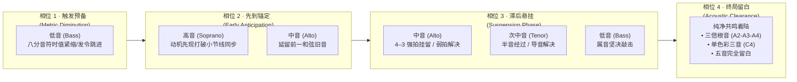

# 众赞歌终止式

<p class="doc-subtitle">巴赫四部众赞歌如何通过声部时钟与相位解耦驱动终止收束？</p>

在传统和声学教学以及基于深度学习的早期自动作曲模型中，终止式（Cadence）往往被理解为一个发生在特定重拍上的**垂直和弦瞬时切片**——例如正格终止的 $V \to I$，或带有四六和弦预备的 $K_{4}^{6} \to V^{7} \to I$。模型倾向于命令所有声部在同一瞬间齐步迈入主和弦强拍，结果往往产生僵硬、机械且缺乏呼吸感的“撞线刹车”。

然而，深入检视约翰·塞巴斯蒂安·巴赫（J. S. Bach）流传至今的 370 首四部众赞歌（Chorales）底层原生乐谱（Humdrum Kern 谱源），我们会发现一个截然相反的工坊事实：**在巴赫的笔触下，一个具有高度歌唱性与说服力的终止式，绝非四个声部的同步着陆，而是一套精密运转的“声部时钟系统（Voice Clock Architecture）”。**

通过在小节线前后引入微观的**时钟相位差（Metric Phase Shift）**，巴赫让不同声部在不同的拍位上相继到达目标：有的声部提前先现以锚定调性，有的声部故意滞后挂留以维系推力，低音通过节奏细分充当发令枪，而落地瞬间的五音甚至被主动留白以换取纯净共鸣。这种声部时钟的微观解耦机制，正是巴赫众赞歌经久不衰的物理奥秘。

---

## 一、 终止声部时钟的四相架构模型

为了将巴赫复杂的对位笔触形式化，笔者根据对 370 首众赞歌原生谱源的实证分析，可以将其归纳描述为四个在时间轴上交错推进的动力相位（即笔者提出的“终止声部时钟四相模型”，The 4-Phase Cadential Clock Model）：



1. **相位 1（低音触发，Metric Diminution）**：低音声部打破原有的四分音符均质步进，在终止前夕突然切入八分音符跳进或折返级进，利用节奏密度的瞬间翻倍发出“即将终止”的听觉警报。
2. **相位 2（旋律先到，Early Anticipation）**：女高音声部（通常为主旋律）利用十六分或八分音符的先现音（Anticipation），在其他三部仍处于属和弦或下属和弦框架时，**提前半拍抢先到达主音**，在听觉心理上建立不可动摇的调性预期。
3. **相位 3（内声部滞后，Suspension Phase）**：中音或次中音声部故意“不配合”旋律的先到，而是将前一和弦的音符延留至强拍，形成尖锐的 $4–3$ 或 $7–6$ 重音挂留，在旋律已经到达终点的背景下，继续压榨出最后的结构推力。
4. **相位 4（终局留白，Acoustic Clearance）**：落地和弦降临（通常伴随延长记号 Fermata）。巴赫极其审慎地处理各声部倾向音的线性归宿，为了规避平行五八度并确保各线条顺畅，常常**彻底省略和弦五音**，呈现“三倍根音 + 单三音”的极简空灵声学。

---

## 二、 原生乐谱实证：四大时钟机制的逐音解构

以下分析完全基于本地解包的 Humdrum Kern 权威机器可读乐谱，落到具体小节、拍位、声部音名与音程。

### 1. 旋律时钟先到：BWV 269《从心底深处》的半拍先现（`chor001.krn`）

在 G 大调圣咏 `chor001.krn`（3/4 拍）第 3–4 小节的半终止（Half Cadence）收束中，巴赫展示了女高音声部如何通过先现音打破小节线的垂直同步：

根据原生 Kern 谱（第 34–42 行）：
- **第 3 小节前两拍（时钟细分与动机爬升）**：
  * 低音在第 1 拍为 $C3$（`4C`），在第 2 拍突然由四分音符均质细分为八分音符级进下行 $B2 \to A2$（`8BBL 8AAJ`）；
  * 次中音第 1 拍由八分音符下行 $C4 \to B3$（`8cL 8BJ`），第 2 拍走至 $C4$（`4c`）；中音由 $E4 \to D4$ 升至 $E4 \to F\sharp 4$（`8eL 8d` 与 `8e 8f#J`）；
  * 女高音在第 1 拍唱出 $G4$ 的附点四分音符（`4.g`），时值跨越至第 2 拍前半拍；紧接着在**第 2 拍后半拍（b2.5）切入八分音符 $A4$（`8a`）**作为向上级进的经过音。
- **第 3 小节第 3 拍的相位展开**：
  * 低音在第 3 拍进入大字组 $G2$（`4GG`），次中音进入 $D4$（`4d`），中音进入 $G4$（`4g`），下方三声部共同搭建起 G 大调纯净协和框架；
  * 此时女高音并未停留在 $A4$，而是**顺势上扬冲向四分音符三音 $B4$（`4b`）**，与低音 $G2$ 形成纯粹的十度（三度）协和共鸣，构成了乐句在小节线前的饱满上行峰值。
- **第 4 小节下拍的半终止着陆**：
  * 进入第 4 小节强拍，低音坚决跃入属音 $D3$（`2D;`），次中音保持 $D4$（`2d;`），中音进入导音升 $F4$（`2f#;`）；
  * 女高音由第 3 小节末的高点 $B4$ 平滑级进下行落入五度音 $A4$（`2a;`，带延长记号）；
  * 整个四部织体在第 3 小节通过内声部与低音的八分音符时钟细分打破均质律动，女高音通过 $G4 \to A4 \to B4$ 的后半拍冲刺赋予终止式以强烈的向心势能，最终在第 4 小节严丝合缝地闭合于 D 大调属三和弦半终止。

```lilypond title="巴赫 众赞歌 BWV 269" location="Choral，mm.3–4" id="bach-bwv269-mm3-4"
\version "2.26.0"
\language "english"

global = {
  \key g \major
  \time 3/4
  \tempo "Choral" 4 = 100
}

soprano = {
  \global
  g'4. a'8 b'4 |
  a'2\fermata b'4 |
}

alto = {
  \global
  e'8 d'8 e'8 fs'8 g'4 |
  fs'2\fermata g'4 |
}

tenor = {
  \global
  c'8 b8 c'4 d'4 |
  d'2\fermata d'4 |
}

bass = {
  \global
  c4 b,8 a,8 g,4 |
  d2\fermata g,4 |
}

\score {
  \new StaffGroup <<
    \new Staff { \set Staff.midiInstrument = "choir aahs" \soprano }
    \new Staff { \set Staff.midiInstrument = "choir aahs" \alto }
    \new Staff { \set Staff.midiInstrument = "choir aahs" \clef "treble_8" \tenor }
    \new Staff { \set Staff.midiInstrument = "choir aahs" \clef bass \bass }
  >>
  \layout { ragged-right = ##f }
  \midi { }
}
```

---

### 2. 内声部时钟滞后：BWV 347《我感谢你，亲爱的主》中的跨小节挂留（`chor002.krn`）

在 A 大调圣咏 `chor002.krn`（4/4 拍，主调为三个升号的 A 大调）第 3–4 小节中，巴赫展示了内声部如何故意滞后整整一拍，以 $4–3$ 挂留对抗旋律的平整进行：

根据原生 Kern 谱（第 37–48 行）：
- **第 3 小节第 3–4 拍的准备**：
  * 女高音在第 3 拍奏出 $A4$（`4a`），随后在第 4 拍以八分音符下行滑落至升 $F4$（`8g#L 8f#J`）；
  * 低音走至升 $C3$；
  * 中音声部在第 3 拍以二分音符切入 $E4$（`[2e`），并以连音线跨越小节线！
- **第 4 小节第 1 拍的内声部滞后**：
  * 该乐句目标为向属功能（E 和弦）推进的半终止（Half Cadence）。第 4 小节第 1 拍低音坚决踏上重属根音 $B2$（`4B`，即 A 大调的二级/重属音）；女高音到达高音升 $G4$（`4g#`）；次中音跳入 $B3$；
  * 此时低音与外声部已切入指向属调 E 的重属和弦（$V/V$）框架；
  * 但中音声部**继续延留前一小节的 $E4$（`4e]`）**！$E4$ 相对低音 $B2$ 构成纯四度重音不协和。当女高音和低音已经就位时，中音声部的时钟在这里被强行“扣留”；
- **第 4 小节第 2 拍的延迟解决与第 3 拍半终止落地**：
  * 直到第 2 拍，中音声部才心不甘情不愿地级进下行半音解决至升 $D4$（`4d#`，即重属和弦 $V/V$ 的导音三音），并与次中音的经过七音 $A3$ 汇合为纯正的重属七和弦（$B^7$）；
  * 低音随后下沉至大字一组八度低音 $B2$（`4BB`），并在第 3 拍全员共同落入带延长记号的 **E 和弦（低音属音为小字组 $E3$ `4E;`，各部为 `4E; 4G#; 4B; 4e;`）**——在全曲 A 大调框架中，这正是严谨确立乐段分界的**属三和弦（$V$，半终止 Half Cadence）**。

这种“外声部先到、内声部后到”的错位设计，避免了终止式在强拍上的平淡无奇，使终止式内部拥有了微观的时序起伏。

```lilypond title="巴赫 众赞歌 BWV 347" location="Choral，mm.3–4" id="bach-bwv347-mm3-4"
\version "2.26.0"
\language "english"

global = {
  \key a \major
  \time 4/4
  \tempo "Choral" 4 = 100
}

soprano = {
  \global
  cs''4 b'4 a'4 gs'8 fs'8 |
  gs'4 fs'4 e'4\fermata \once \omit Rest r4 |
}

alto = {
  \global
  a'4 gs'8 fs'8 e'2~ |
  e'4 ds'4 b4\fermata \once \omit Rest r4 |
}

tenor = {
  \global
  e'4 ds'4 cs'2 |
  b4. a8 gs4\fermata \once \omit Rest r4 |
}

bass = {
  \global
  a4 b4 cs'4 b8 a8 |
  b4 b,4 e4\fermata \once \omit Rest r4 |
}

\score {
  \new StaffGroup <<
    \new Staff { \set Staff.midiInstrument = "choir aahs" \soprano }
    \new Staff { \set Staff.midiInstrument = "choir aahs" \alto }
    \new Staff { \set Staff.midiInstrument = "choir aahs" \clef "treble_8" \tenor }
    \new Staff { \set Staff.midiInstrument = "choir aahs" \clef bass \bass }
  >>
  \layout { ragged-right = ##f }
  \midi { }
}
```

---

### 3. 旋律长音锚定与下方时钟二次转折：BWV 38/6《自深处我向你呼求》（`chor010.krn`）

在古老的弗里吉亚调式圣咏《Aus tiefer Not schrei ich zu dir》（`chor010.krn`）第 12–13 小节末尾，巴赫展现了更加不可思议的声部时钟解耦——旋律声部彻底静止，下方三声部进行跨时钟的连续变轨：

根据原生 Kern 谱（第 87–93 行）：
- **女高音的完全静态锚定（m. 13）**：
  * 在第 13 小节开端，女高音便直接唱出全曲的最终落音：**全音符 $E4$（`1e;`，带延长记号）**！
  * 整个小节长达 4 拍，女高音没有任何节奏抖动，完全静止在终结音 $E$ 上。
- **下方三声部的二次对位时钟（m. 13）**：
  * 旋律虽然先到了，但和声并没有在第 1 拍立刻落地；
  * **第 1 拍**：低音进入升 $G2$（`4GG#`），次中音进入 $B3$（`4B`），中音进入 $D4$（`4d]`，由前小节延留而来）；在女高音 $E4$ 的覆盖下，下方三声部构成了一个极度动荡的导音减三和弦第一转位；
  * **第 2 拍**：低音跳向 $A2$（`4AA`），次中音为 $A3$（`4A`），中音走至 $C4$（`4c`）；下方三声部竟然避开 E，转入了一个**阻碍性质的 a 小调三和弦**！
  * **第 3–4 拍**：低音最终下坠至大字一组 $E2$（`2EE;`），次中音跳入大三度升 $G3$（`2G#X;`），中音落入五音 $B3$（`2B;`）；此时才与静候已久的女高音 $E4$ 汇合，锁定带皮卡迪三度（Picardy Third）的庄严 E 大调终束！

在这里，女高音的时钟与下方三声部的时钟完全脱钩：旋律提前两拍在终点等待，下方三声部如同旋转的机械齿轮，经历了一次“减和弦悬挂 $\to$ 阻碍伪解决 $\to$ 终极真解决”的三级跳，展现了巴赫处理体裁终束时近乎神迹的对位自由度。

```lilypond title="巴赫 众赞歌 BWV 38/6" location="Choral，mm.12–13" id="bach-bwv38no6-mm12-13"
\version "2.26.0"
\language "english"

global = {
  \key a \minor
  \time 4/4
  \tempo "Choral" 4 = 100
}

soprano = {
  \global
  a'4 e'4 g'4 f'4 |
  e'1\fermata |
}

alto = {
  \global
  c'4 c'4 d'2~ |
  d'4 c'4 b2\fermata |
}

tenor = {
  \global
  a4 g4 g4 a4 |
  b4 a4 gs2\fermata |
}

bass = {
  \global
  f4 c4 bf,4 a,4 |
  gs,4 a,4 e,2\fermata |
}

\score {
  \new StaffGroup <<
    \new Staff { \set Staff.midiInstrument = "choir aahs" \soprano }
    \new Staff { \set Staff.midiInstrument = "choir aahs" \alto }
    \new Staff { \set Staff.midiInstrument = "choir aahs" \clef "treble_8" \tenor }
    \new Staff { \set Staff.midiInstrument = "choir aahs" \clef bass \bass }
  >>
  \layout { ragged-right = ##f }
  \midi { }
}
```

---

### 4. 落地瞬间的五音留白：BWV 153/5《我心所愿》中的三倍根音（`chor021.krn`）

在传统四部和声的教科书中，学生常被灌输“和弦四音务必齐全”的刻板观念。然而在巴赫圣咏 `chor021.krn`（a 小调，4/4 拍）第 3–4 小节的完全正格终止中，巴赫展示了为何在终止落地的终点**必须坚决舍弃五音**：

根据原生 Kern 谱（第 39–43 行）：
- **第 3 小节第 4 拍的属功能配置**：
  * 低音为小字组属音 $E3$（`4E`）；
  * 次中音为敏感的导音升 $G3$（`4G#`）；
  * 中音为带有下行倾向的属七音 $D4$（由八分音符 `8eL 8dJ` 降落形成）；
  * 女高音为属和弦五音 $B4$（`4b`）。
- **第 4 小节下拍的对位解决（落地和弦）**：
  * 低音：$E3 \to A2$（`2.AA;`，属音纯五度下跳跃入主音根音）；
  * 次中音：升 $G3 \to A3$（`2.A;`，导音根据严格声部导向，**必须上行解决至主音**）；
  * 女高音：$B4 \to A4$（`2.a;`，第 2 级旋律音根据平滑级进，**必须下行解决至主音**）；
  * 中音：$D4 \to C4$（`2.c;`，七音根据不协和解决律，**必须下行级进解决至主和弦三音**）；
- **声学留白的事实**：
  * 审视最终落地在第 4 小节的 a 小调三和弦：
    $$\text{Bass}=A2, \quad \text{Tenor}=A3, \quad \text{Soprano}=A4, \quad \text{Alto}=C4$$
  * **主音 $A$ 被重复了三次（三倍根音），三音 $C$ 出现一次，而五音 $E$ 踪影全无！**

#### 为什么巴赫宁可三倍根音，也绝不补全五音？
1. **严格声部导向对垂直完整性的绝对压制**：若要强行补全五音 $E$：
   - 次中音不能去 $E$：导音升 $G$ 若下跳至 $E$，属于严重的“导音不解决”，破坏调性闭合感；
   - 中音不能去 $E$：属七音 $D$ 若跳升至 $E$，违反了不协和音必须级进下行的物理铁律；
   - 女高音不能去 $E$：主旋律若从 $B4$ 大跳至 $E4$ 或 $E5$，则丧失了平静收束的线条优美度。
2. **声学物理维度的去浊考量（一种可行的解释）**：
   除严格声部导向的必然性外，从历史声学语境审视，在莱比锡圣托马斯或圣尼古拉大教堂的高混响建筑空间中，三和弦若在强奏或延长记号下强行加入纯五度（$A - E$），极易与刚刚消散的属和弦残留泛音产生浑浊叠加。巴赫通过“纯八度根音矩阵（A2-A3-A4）+ 唯一色彩三音（C4）”的精简配置，为声场留出声学余量，在听觉上形成了一种晶莹剔透、毫无声学冗余的绝对安宁感——这构成了理解终局五音留白的一种极具说服力的声学物理假说。

```lilypond title="巴赫 众赞歌 BWV 153/5" location="Choral，mm.3–4" id="bach-bwv153no5-mm3-4"
\version "2.26.0"
\language "english"

global = {
  \key a \minor
  \time 4/4
  \tempo "Choral" 4 = 100
}

soprano = {
  \global
  c''4 c''4 b'4 b'4 |
  a'2.\fermata \once \omit Rest r4 |
}

alto = {
  \global
  ds'4 e'4 fs'4 e'8 d'8 |
  c'2.\fermata \once \omit Rest r4 |
}

tenor = {
  \global
  a4 a4 a4 gs4 |
  a2.\fermata \once \omit Rest r4 |
}

bass = {
  \global
  fs4 e4 ds4 e4 |
  a,2.\fermata \once \omit Rest r4 |
}

\score {
  \new StaffGroup <<
    \new Staff { \set Staff.midiInstrument = "choir aahs" \soprano }
    \new Staff { \set Staff.midiInstrument = "choir aahs" \alto }
    \new Staff { \set Staff.midiInstrument = "choir aahs" \clef "treble_8" \tenor }
    \new Staff { \set Staff.midiInstrument = "choir aahs" \clef bass \bass }
  >>
  \layout { ragged-right = ##f }
  \midi { }
}
```

---

## 三、 对现代严肃创作与生成式 Agent 的启示

巴赫在众赞歌终止式中展现的声部时钟设计，对当下面向严肃音乐创作的计算模型与 AI Agent（如 OpenViking 符号音乐生成流水线）具有不可估量的指导意义：

1. **废黜“齐步走刹车”，植入多通道相位控制器（Multi-Channel Phase Scheduler）**：
   AI 生成模型在构建乐段终止时，绝不能将和弦代号映射为时间对齐的 MIDI 块。生成器必须将 SATB 四个通道赋予独立的毫秒/拍位偏移：
   - **旋律通道（Soprano）**：赋予负相位偏移（$-\frac{1}{2}$ 拍至 $-\frac{1}{4}$ 拍），允许其以先现音方式提前探路；
   - **中音声部（Alto）**：赋予正相位偏移（$+\frac{1}{2}$ 拍），强制执行跨小节线挂留滞后；
   - **低音通道（Bass）**：在倒数第 1–2 拍注入时值倍增，以八分音符的跳进激发向心重力。
2. **重写和弦完整性惩罚函数（The Cadential Incomplete-Chord Rule）**：
   许多音乐理论校验器（Linter）会把“终止和弦缺少五音”误判为缺陷或扣分项。应当修正规则引擎：在乐句终止式的终结拍位，当导音与七音均实现正确解决时，系统应当**主动鼓励并优先采信“三倍根音 + 单三音”的配置**，将垂直完整性的优先级置于水平声部流畅性之下。
3. **空间混响感知的自适应留白（Acoustic-Aware Voicing）**：
   声部写作应感知目标声场环境。在高混响虚拟声学空间中，声部越接近终止，越应剔除不必要的内声部重叠与五音共鸣，使作品在落地瞬间获得肃穆透明的历史声响。
