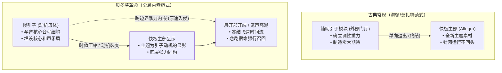

# 从外部门厅到戏剧母体：贝多芬钢琴奏鸣曲中慢引子的结构内嵌与动机渗透

在 18 世纪后半叶维也纳古典乐派的常规实践中，置于奏鸣曲式开端的**慢速引子（Slow Introduction）**大多被赋予一种清晰而克制的修辞职能。根据 Open Music Theory 在奏鸣曲理论导论（见 `SonataTheory-intro.md` 的 Auxiliary modules 章节，该术语更早源自詹姆斯·赫波科斯基与沃伦·达西的曲式学传统）中的界定，慢引子属于置于奏鸣曲本体之外的**“辅助模块（Auxiliary Module）”**：它扮演着如同歌剧序幕或宏伟建筑“外部门厅（Antechamber）”的角色——以庄严厚重的和声确立宏观主调重力，渲染神秘而肃穆的期待感；然而，一旦快板主部（Allegro）的明快节奏爆发，慢引子便单向退出、功成身退，其材料通常不再参与后续呈示部、展开部与再现部的核心运转。

然而，在路德维希·凡·贝多芬（Ludwig van Beethoven）的 32 首钢琴奏鸣曲创作历程中，慢引子经历了一场彻底颠覆古典惯例的结构革命。贝多芬拒绝将慢引子仅仅作为外在的包装纸；相反，他通过**“动机母体化（Motivic Matrix）”**与**“跨区戏剧暴力内嵌（Dramatic Intrusion）”**两大核心技术，将原本属于外部边缘的慢速材料，升华为贯穿全曲的基因源泉与干预结构命运的绝对主宰。

本文以贝多芬早、中、晚期三部具有里程碑意义的钢琴奏鸣曲——《c小调第8“悲怆”》（Op. 13）、《降E大调第26“告别”》（Op. 81a）与《c小调第32》（Op. 111）第一乐章为实证枢纽，系统解构慢引子如何从古典主义的外部装饰，异化为驱动悲剧性交响戏剧的终极引擎。

---

## 1. 结构力学机制：慢引子如何突破“门厅”隔离

在海顿晚期交响曲或莫扎特交响曲的成熟典范中，慢引子与快板主部之间存在着一条心照不宣的美学界线：慢引子负责“制造张力与期待”，快板主部负责“释放动能并建立方整性主题”。这种美学分工虽然保证了古典曲式的纯粹性，却人为割裂了慢速时间流与快速时间流之间的内在连续性。

基于总谱剖析与历史文献的比对，笔者推导指出：贝多芬在钢琴奏鸣曲中打破这种结构隔离，主要依托于以下三重视角递进的力学重构：

### 1.1 动机母体化与时值压缩（Diminution）
慢引子不再由泛化的和声序进充填，而是直接孵化出具有极高性格辨识度的核心微观细胞（2 至 3 个音的音核或特征节奏）。当音乐进入快板时，第一主题绝非凭空出现的崭新乐思，而是将慢引子中的音核以 2 至 4 倍的速率进行**时值压缩（Diminution）**、音程倒影或节拍置换。快板主部的狂暴奔流，本质上是慢引子潜在势能的瞬间动能释放。

正如前篇[《混合乐段与古典主题句法的多维解耦》](../../../techniques/structure/hybrid-themes-and-syntax-decoupling.md)所指出的动机与和声功能解耦，在这里，贝多芬更进一步将**“主题动机材料”与“表层速度/节拍容器”彻底解耦**——同一套音程基因，既能在极慢的速度下表现为沉重的叹息，也能在极快的速度下化作烈火般的突进。

### 1.2 跨越曲式边界的暴力内嵌（Dramatic Intrusion）
在传统奏鸣曲式中，呈示部末尾、展开部起点与再现部收束是结构铰链的最强支撑点。贝多芬最激进的发明，是在这些关键节点上，**断然切断正在狂飙突进的快板物理时间，以原速（Tempo I）强行召回慢引子材料**。

这种“时间断裂”具有摧毁性的心理戏剧效应：它打破了快板所建立的自足假象，向听者无情昭示——飞速奔跑的快板不过是表面挣扎，深沉、阴郁、不可动摇的慢引子才是无法逃遁的宿命本体。

### 1.3 调性与和声的全息统摄
慢引子中所埋设的极端和声事件（如减七和弦的不稳定性、阻碍终止的落空感、下行半音阶声部导向），直接成为统领整部多乐章套曲调性布局的隐秘轴心。慢引子因此获得了全息图（Hologram）般的统摄力：引子的一小节，即映射着整个乐章的宏观命运。

---

## 2. 早期激化：《c小调第8钢琴奏鸣曲“悲怆”》Op. 13

在 1798 年出版的《悲怆》奏鸣曲第一乐章中，年轻的贝多芬首次向世人展示了慢引子对整个奏鸣曲式骨架的惊天突袭。

### 2.1 Grave 的动机孵化与快板的裂变

开端十个小节的 Grave（c 小调，4/4 拍）吸收了法国序曲式的崇高美学：
- m. 1 强奏（$fp$）爆发的 c 小调厚重和弦，紧接着带着重音的双重附点下行动机；
- 随后，右音声部升华为极其痛苦的**上升大六度跳跃伴随下行二度叹息**（$\text{Eb} - \text{C} - \text{B} - \text{C}$，伴随减七和弦 $vii^{\circ 7}/V$ 的张力支撑）；
- 在进入 m. 11 的快板（Allegro di molto e con brio，2/2 拍）时，双手以轻盈却紧绷的八度颤音轰然启动主部第一主题。仔细比对谱面即可发现：快板第一主题火箭般级进攀升的四音列（$\text{C} - \text{D} - \text{Eb} - \text{E} \dots$），在骨架音上恰恰是 Grave 叹息动机的**方向倒影与 4 倍时值压缩**！慢引子的悲剧叹息，在此被压缩为狂暴反抗的飞驰战车。

### 2.2 两次惊心动魄的戏剧内嵌

更为震动古典规范的，是 Grave 在后续结构中的两度暴力反扑：
1. **呈示部收束与展开部交界处（mm. 133–136）**：按照古典惯例，呈示部在经过长达 120 小节的高压冲刺后，应顺畅划入展开部。然而贝多芬在正格终止的落音处骤然休止，在毫无防备的悬崖边缘，**Grave 原速原貌突然降临**！不仅速度骤降为极慢，调性更突兀切入远关系的 g 小调。它以四小节严酷的质问彻底粉碎了呈示部的胜利狂欢，成为整个展开部痛苦拷问的真正序幕；
2. **再现部冲刺向全曲尾声处（mm. 295–298）**：在再现部主部与副部呼啸而过、直奔最后的凯旋时，快板动能再次被猛然切断，Grave 再次以原速凄厉现身于主调 c 小调之上。直到它在高音区留下两记悬空的单音，快板才在最后四小节以绝望的强奏完成最后的致命撞击。

> **【谱例占位 · 待资料助手交付】**
> - **作品**：路德维希·凡·贝多芬《c小调第8钢琴奏鸣曲“悲怆”》Op. 13，第一乐章 Grave - Allegro di molto e con brio
> - **小节范围**：mm. 1–19（开端 Grave 动机向 Allegro 主部第一主题的裂变衔接）
> - **声部编制与 GM 编号**：钢琴双手（GM 0: Acoustic Grand Piano）
> - **调性与拍号**：c 小调，Grave 4/4 拍 $\rightarrow$ Allegro 2/2 拍
> - **结构说明**：mm. 1–10 慢引子（双重附点、减七和弦与六度跳跃叹息动机）；mm. 11–19 快板主部呈示（低音颤音，高音以 4 倍时值压缩倒影引子动机形成飞驰第一主题）

---

## 3. 中期全息交融：《降E大调第26钢琴奏鸣曲“告别”》Op. 81a

如果说《悲怆》展示的是慢引子对快板进程的“外在暴力打断”，那么在 1809 年创作的《告别》（Les Adieux）奏鸣曲中，贝多芬则展示了一种更高维度的技法——**慢引子与快板主部的“分子级全息交融”**。

### 3.1 “告别”音核与阻碍终止的落空感

全曲开端 16 小节的 Adagio（降 E 大调，2/4 拍）不仅是引子，更是整部奏鸣曲的哲学公理：
- 贝多芬在乐谱第 1 小节的三个二分音符上方，亲自手书了德语词**“Le-be-wohl（告别）”**；
- 这一动机由三个下行阶梯音级构成：$\hat{8} - \hat{7} - \hat{6}$（降 E - 降 D - C），在传统加兰特图式中被称为典型的“圆号五度（Horn Call）”音型；
- 然而贝多芬在此施展了一个天才的和声颠覆：在常规的圆号五度解决中，第三个音必须落回主和弦（I: 降 E 大调）；但贝多芬却让低音意外踩在 C 音上，构成一个充满怅惘与不确定性的**阻碍终止（Deceptive Cadence: vi 级 c 小调和弦）**！
- 这一“落空感”瞬间将明朗的贵族狩猎圆号，转变为离别时撕心裂肺的心理阴影。

### 3.2 动机细胞在快板与尾声中的全息泛化

一旦进入 m. 17 的快板（Allegro），慢引子的“告别三音核”瞬间展现出惊人的繁殖力：
1. **主部主题的动力化**：开篇三音级被压缩为短促有力的附点二分音符跳跃，原本哀伤的叹息演化为飞奔追赶的马车步伐；
2. **副部主题的对位潜流**：在属调（降 B 大调）呈示副部时，上方声部唱出抒情旋律，而内声部与低音则以极弱的音量悄然翻转再现“告别”三音级；
3. **庞大尾声的双重圆号重叠**：最震撼的结构呼应出现在本乐章长达 40 小节的超大尾声（Coda，m. 223 起）中——整个尾声完全摒弃了快板的其他材料，整整 40 小节只专注于对“告别”三音级的重读：两组八度声部如同两只远近相隔的邮政圆号，在不同音区以交错的节拍重叠鸣响。慢引子在此不仅没有消失，反而反客为主，将整个快板的终点转化为了慢引子精神的绝对凯旋。

> **【谱例占位 · 待资料助手交付】**
> - **作品**：路德维希·凡·贝多芬《降E大调第26钢琴奏鸣曲“告别”》Op. 81a，第一乐章 Adagio - Allegro
> - **小节范围**：mm. 1–25
> - **声部编制与 GM 编号**：钢琴双手（GM 0: Acoustic Grand Piano）
> - **调性与拍号**：降 E 大调，Adagio 2/4 拍 $\rightarrow$ Allegro 2/2 拍
> - **结构说明**：mm. 1–4 “Le-be-wohl” 下行三音级动机（$\hat{8}-\hat{7}-\hat{6}$）及落入 vi 级阻碍和弦；mm. 17–25 快板启动，告别动机时值压缩为切分跳跃演化为主部第一主题

---

## 4. 晚期终极悲剧熔炉：《c小调第32钢琴奏鸣曲》Op. 111

在贝多芬钢琴奏鸣曲的终极巅峰——1822 年完成的 Op. 111 第一乐章中，慢引子完成了从“交响戏剧”向“形而上超验斗争”的终极飞跃。

### 4.1 Maestoso 的极端力学压榨

开端 16 小节的 Maestoso（c 小调，4/4 拍）将钢琴乐器的物理表现力压榨到了前所未有的极限：
- **双重附点与极端跳跃**：第一小节在双重附点后以 $ff$ 的巨响猛然下坠下行七度，落在一个刺耳的减七和弦（$\text{Eb} - \text{F#} - \text{A} - \text{C}$）上；
- **半音阶地基下陷**：低音声部随后陷入阴森严酷的下行半音阶（Passus duriusculus），仿佛将整个调性引力拉入无底深渊；
- **震音引爆的临界点**：在第 11–15 小节，贝多芬在极低音区写下了持续数小节的震音长音（Pedal Trill），上方声部则如游魂般以极弱（$pp$）微光摸索前行。这不再是传统意义上的“慢板前奏”，而是一座高压积聚的死火山。

### 4.2 赋格化第一主题的破茧而出

当引子在低音震音的蓄能达到绝对饱和时，m. 19 爆发出的 Allegro con brio ed appassionato 第一主题，展现了晚期贝多芬对古典主调曲式与巴赫复调对位的最高综合：
- 第一主题那棱角分明、如同花岗岩雕刻般的乐思（$\text{C} - \text{Eb} - \text{B} - \text{C} - \text{A} - \text{Ab}$），**正是 Maestoso 开端减七和弦大跳的纯对位结晶**；
- 随后，这一主题不再以常规的乐段或乐句展开，而是直接以凶悍无情的**二重赋格（Double Fugue）**展开各声部模仿对决（正如 scholar-b2 在[《对位中的挂留延留力学》](../../../techniques/counterpoint/suspension-mechanics-and-voice-leading.md)中所揭示的声部张力网络）。

在 Op. 111 中，慢引子与快板主部已融为一体，成为了不可分割的“意志搏斗本体”——唯有历经第一乐章慢引子与赋格快板在 c 小调地狱中的惨烈搏杀，第二乐章 Arietta 那神圣超验的 C 大调净土才具有说服全人类的救赎力量。

> **【谱例占位 · 待资料助手交付】**
> - **作品**：路德维希·凡·贝多芬《c小调第32钢琴奏鸣曲》Op. 111，第一乐章 Maestoso - Allegro con brio ed appassionato
> - **小节范围**：mm. 1–25
> - **声部编制与 GM 编号**：钢琴双手（GM 0: Acoustic Grand Piano）
> - **调性与拍号**：c 小调，Maestoso 4/4 拍 $\rightarrow$ Allegro 2/2 拍
> - **结构说明**：mm. 1–5 Maestoso 极端强奏减七和弦大跳与附点下坠；mm. 11–16 低音区持续神秘震音蓄能；mm. 19–25 Allegro 爆发，减七跳跃动机裂变为赋格化主部主题

---

## 5. 创作思维工具箱：慢引子全息内嵌的决策图谱

通过解构贝多芬跨越三十年的慢引子实验，我们可以为现代音乐分析与创作 Agent 提炼出一套跳出“引子即装饰”陈规的进阶决策模型：

| 维度 / 策略 | 早期《悲怆》范式（突入式内嵌） | 中期《告别》范式（全息泛化式） | 晚期 Op. 111 范式（复调母体式） |
| :--- | :--- | :--- | :--- |
| **引子核心基因** | 附点节奏 + 上升六度跳跃伴随下行二度叹息 | 具有特定文学/情感符号的下行三音级（Horn Call） | 宽音程减七跳跃 + 深渊半音阶 + 低音震音 |
| **核心和声矛盾** | $vii^{\circ 7}/V$ 的极端悲剧性张力 | $\hat{8}-\hat{7}-\hat{6}$ 遭遇 vi 级阻碍终止的落空感 | 多重减七和弦连续下行与半音地基沉降 |
| **快板转换机制** | 4 倍时值压缩 + 方向倒影（狂暴级进上升） | 附点切分轻盈化（二分切分跳跃） | 严密二重赋格答题对位（Polyphonic Stretto） |
| **结构内嵌手段** | **暴力打断**：在呈示部关门与尾声处原速降临 | **动机泛化**：快板各主题及 40 小节尾声完全由此构成 | **母体升华**：快板彻底成为引子矛盾的复调厮杀场 |
| **最佳适用情境** | 冲突激烈的戏剧性奏鸣曲式快板 | 叙事性、心理化或哲思漫游型大型乐章 | 具有崇高、悲壮与超验解脱诉求的史诗篇章 |

### 给创作 Agent 的系统设计准则

1. **拒绝“两张皮”的引子创作**：在构思慢引子时，绝不能先写一段动听但孤立的和弦进行，再另起炉灶写快板主题；**引子的前两小节必须包含全曲快板主题的音程骨架原型**；
2. **埋设不对称的和声陷阱**：慢引子之所以引人入胜，在于其制造了未被满足的心理期待。在引子收束前，避免使用平庸的正格终止，而应使用**阻碍终止、半音枢纽（Scharnier）或悬挂减七和弦**，将巨大的和声未决势能直接导入快板的第一拍；
3. **跨区戏剧召回机制**：在长篇奏鸣曲式生成中，当展开部或尾声面临动力衰竭时，最强有力的戏剧手段不是增加新的杂乱乐思，而是**突然冻结当前快板速度，将慢引子的核心动机以原速重新投射**，利用巨大的音响反差唤醒听者的深度心理共鸣。

从外部门厅到戏剧母体，贝多芬对慢引子的重构不仅改写了古典奏鸣曲式的生命周期，更将时间的物理相对性与人类意志的悲剧张力熔铸进了西方音乐史最深刻的丰碑之中。
