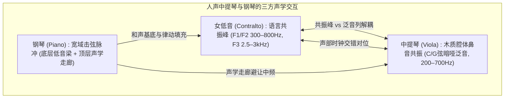

# 人声中提琴与钢琴

女低音、助奏中提琴与钢琴如何在同频区段中化解声学掩蔽并实现三方复调对话？

在西方艺术歌曲与室内乐文献中，以“钢琴伴奏独唱”为主导的二元模式占据着绝对统治地位。然而，约翰内斯·勃拉姆斯（Johannes Brahms）于 1884 年出版的《两首歌曲》（*Zwei Gesänge für eine Altstimme mit Bratsche und Klavier*, Op. 91）却打破了这一常规，确立了由**女低音（Contralto/Mezzo-Soprano）、助奏中提琴（Viola Obbligato）与钢琴（Pianoforte）**组成的非凡三方编制。

这一编制的诞生植根于深刻的私人情感与室内乐合作：作品专门献给杰出的女低音歌唱家阿玛莉·约阿希姆（Amalie Joachim）及其丈夫——传奇小提琴与中提琴大师约瑟夫·约阿希姆（Joseph Joachim）。在传统声乐室内乐中，助奏乐器常被降格为断续的装饰性过门或旋律加倍；而勃拉姆斯却将三件乐器提升至彻底平等的室内乐重奏地位。

然而，从声学物理学角度审视，这一组合蕴含着极高的配器风险：女低音的歌唱音域与[中提琴写作](../techniques/sound/viola-writing-and-orchestral-voicing.md)的常用核心音区在声学频段上几乎**完全重叠**（均在 $c\text{–}f^2$ 的小字组至小字二组低位）。若处理不当，弦乐的摩擦延留极易掩蔽人声咬字，钢琴的打击瞬态亦极易造成中频泥泞。本文结合物理声学与两首作品的机器可读底本，系统剖析勃拉姆斯如何化解同频冲突，构筑三维立体的室内乐声场。

---

## 一、同频竞争与音色解耦：女低音与中提琴的声学物理

不同于[《弦乐四重奏》](string-quartet-acoustic-role-differentiation.md)的均质发音或[《钢琴三重奏》](piano-trio-acoustic-compromise.md)的高低音区分离，“人声—中提琴—钢琴”编制面临着特殊的声学挑战：

### 1. 临界频带内的频率重叠与掩蔽陷阱

根据心理声学临界频带（Critical Bandwidth）理论，当两个具有相似基频与声能的持续声源出现在同一频段内时，听觉系统无法在空间上清晰剥离彼此，从而引发相互掩蔽（Mutual Masking）。

女低音的歌唱核心音域通常位于 $a\text{–}e^2$（220–660 Hz），而中提琴最为丰满温暖的 D 弦与 A 弦中低把位恰好处于完全相同的 196–660 Hz 区间。若二者进行同音加倍或同度平行进行，中提琴的弓弦摩擦声将直接干扰人声的辅音起振，导致歌词清晰度急剧衰减。

### 2. 元音共振峰与木质泛音柱的质感剥离

勃拉姆斯在配器上展现了对乐器声学特质的敏锐洞察。他利用两种发音介质在频谱构造上的天然差异实现**音色解耦（Timbral Decoupling）**：

- **人声共振峰（Formants）**：人类声带振动经过口腔与鼻咽共鸣腔调制，产生集中的第一（$F_1$）、第二（$F_2$）元音共振峰（300–800 Hz），以及赋予歌唱穿透力的“歌手共振峰”（Singer's Formant $F_3$ 约 2.5–3.0 kHz）。人声具备清晰的语言文字轮廓与喉位能量集中点；
- **中提琴的暗哑木质共振**：中提琴的共鸣木箱容积在声学比例上略小于其 C 弦调谐物理需求，因此在中低频段（特别是 C 弦与 G 弦）产生出独特的轻微沙哑感与浓郁的鼻音泛音。

这种“人肉咽喉共鸣”与“木质腔体共振”在质感上的极性反差，使二者即便在同一绝对音高上重合，人耳也能凭借泛音色谱的迥异实现轻松辨识。

### 3. 句法错位与时域呼吸互补

在横向时间轴上，勃拉姆斯严格遵循时域互补策略：
- **呼应式对答（Call-and-Response）**：人声唱出核心长音与乐句时，中提琴转为持续长音或轻柔分解琶音；当人声换气或句末停歇时，中提琴骤然跃出承载动机副旋律；
- **音区瞬时错位**：中提琴频繁潜入小字组低音区（充当次中音低音支撑），或飞升至小字二组高位（$f^2\text{–}a^2$ 形成悬浮天幕），与中音区人声拉开五度至八度以上的空间空隙，彻底释放中频通道。

---

## 二、《渴望的平息》（Op. 91 No. 1）实证：抒情助奏与戏剧裂变

《渴望的平息》（*Gestillte Sehnsucht*，弗里德里希·吕克特词）为 $2/4$ 拍的 Adagio espressivo，D 大调，全曲 98 小节，采用严谨的三部曲式（$A\text{–}B\text{–}A'$）。

### 1. 前奏的中提琴歌唱性主题呈示（mm. 1–13）

在人声进入前，中提琴率先以广阔的独奏线条呈示全曲核心动机：

*谱例：勃拉姆斯《两首歌曲》Op. 91 No. 1，mm. 1–13，前奏中提琴抒情主题呈示与钢琴声学铺垫*

- **中提琴核心主题（mm. 0–5）**：中提琴由小字组 $F\sharp_3\text{–}D_3$ 弱起切入，在第 1 小节滑向低音 $C\sharp_3\text{–}E_3\text{–}G_3$，随后通过大幅度大跳向上攀升至小字二组（m. 5: $A_4\text{–}F\sharp_4\text{–}A_4\text{–}D_4$），以深沉的弧形乐句奠定了平静渴望的意境；
- **钢琴的声学减重**：钢琴右手避免厚重的柱式和弦，代之以轻柔跳跃的十六分音符短分解和弦，左手仅在强拍点缀八度低音，为中提琴留出了毫无阻碍的共鸣环境。

从和声级数与调性布局来看，这 13 个小节展现了高度成熟的古典和声导向：
- mm. 0–4：在 D 大调主和弦上以 $I \rightarrow V_2 \rightarrow I^6 \rightarrow IV \rightarrow V$ 展开，中提琴在两小节内完成了从低音 $C\sharp_3$ 到次高音 $A_4$ 的跨八度扩张；
- mm. 5–8：转向关系小调 B 小调（$vi$）与副属和弦，中提琴在第 7–8 小节攀升至全段最高音 $E_5$，随后以柔和的下行音阶化解张力；
- mm. 9–13：确立属音准备（Dominant Lock），钢琴与中提琴在持续属音 $A$ 上逐渐收束力度，形成完美的声学留白，为女低音在弱拍悄然切入创造了绝佳条件。

### 2. 人声进入后的平行贴合与卡农错位（mm. 14–35）

第 14 小节，女低音以极具感染力的弱奏进入（*In goldnen Abendschein getauchet...*）：

*谱例：勃拉姆斯《两首歌曲》Op. 91 No. 1，mm. 14–25，人声进入与中提琴助奏的音色解耦与错位模仿*

分析此处的复调织体，展现了经典的三方平衡机制：
- **错位模仿与补充**：第 14 小节人声唱出小字一组主旋律（$F\sharp_4\text{–}E_4\text{–}D_4\text{–}F\sharp_4$）时，中提琴在弱拍后以低八度（$F\sharp_3\text{–}D_3$）进行精巧的回声呼应；
- **三六度和声伴唱（mm. 21–25）**：在通向半终止的乐句中，中提琴升入高把位（$C\sharp_5\text{–}E_5\text{–}D_5$），与人声的高音区（$A_4\text{–}F\sharp_4\text{–}A_4$）形成纯净的六度与十度平行伴奏，展现出如二重唱般密不可分的交融度。

### 3. D 小调中段的织体撕裂与双音驱动（mm. 36–66）

在 $B$ 段（*Poco più animato*，第 36 小节起），平静被内心的剧烈不安打破。调性骤变至 D 小调与 F 大调，速度加快：
- 中提琴全面激发张力：使用密集切分音与连续十六分音符音阶冲刺（mm. 42–44: $F\sharp_3\text{–}A_3\text{–}E\flat_4\text{–}D_4$），并结合强烈的双音运弓，在声学上模拟管弦乐中低音弦乐组的澎湃巨浪；
- 人声以高亢的切分音与戏剧性叹息（*Immer reger wird das Sehnen...*）同中提琴对抗，钢琴则以轰鸣的低音八度与跨八度琶音铺垫波涛声场，构筑起全曲的戏剧性顶点。

### 4. 和声归拢与尾声消融（mm. 67–98）

再现部（Tempo I，第 67 小节）以纯粹的 D 大调平静归来。在第 85–98 小节的长尾声中，人声在持续主音长音上缓缓沉寂，中提琴与钢琴重回开篇的柔美回响。中提琴在小字组 $D_3$ 与空弦 $A_3$ 上演奏极弱的泛音与和弦，最终消融于虚空。

---

## 三、《神圣摇篮曲》（Op. 91 No. 2）实证：古圣咏定旋律与双旋律复调

《神圣摇篮曲》（*Geistliches Wiegenlied*，洛佩·德·维加词，盖贝尔译）为 $6/8$ 拍的 Andante con moto，F 大调，全曲 157 小节。该曲体现了勃拉姆斯深厚的历史主义复调技艺。

### 1. 中提琴的圣咏定旋律呈示（mm. 1–10）

作品开篇并未直接进入摇篮曲主旋律，而是由中提琴在无词状态下独奏呈示 14 世纪德国著名的中世纪圣诞颂歌《约瑟，我亲爱的约瑟》（*Joseph, lieber Joseph mein / Resonet in laudibus*）：

*谱例：勃拉姆斯《两首歌曲》Op. 91 No. 2，mm. 1–10，中提琴独奏呈示古圣咏定旋律《约瑟，我亲爱的约瑟》*

- **中提琴作为神圣代言者**：中提琴在柔和的 F 大调中展开纯朴的颂歌旋律（$c^1\text{–}a\text{–}f\text{–}a \mid c^1\text{–}d^1\text{–}c^1 \mid c^1\text{–}a\text{–}f\text{–}a \mid c^1\text{–}d^1\text{–}c^1$），音符完全落在中提琴最具歌唱性的中低音弦上。勃拉姆斯甚至在最初的手稿中直接将颂歌歌词题写在中提琴分谱下方；
- **钢琴的摇篮节律导入**：钢琴在第 3 小节切入 $6/8$ 拍轻柔起伏的八分音符摇摆节奏（Rocking rhythm），左手以温和的大跳（$F_2\text{–}A_2\text{–}C_3$）构筑摇篮的晃动动力学。

勃拉姆斯对这首 14 世纪德国古圣咏的援引具有深厚的情感与学术背景。圣咏完整唱词包含四句对称诗行：
1. 句一（mm. 1–2）：“Joseph, lieber Joseph mein”（约瑟，我亲爱的约瑟）；
2. 句二（mm. 3–4）：“hilf mir wiegen mein Kindelein”（请帮我摇晃我的小孩）；
3. 句三（mm. 5–8）：“Gott der wird dein Lohner sein”（上帝必将报偿你）；
4. 句四（mm. 9–10）：“im Himmelreich der Jungfrau Sohn Maria”（在天国之中童贞玛利亚之子）。

中提琴在不依赖任何文字陈述的情况下，仅凭琴弓在低沉的 C 弦与 G 弦上的深情抚触，便将整首古老颂歌的宗教神圣性与摇篮亲情注入声场。

### 2. 人声摇篮曲切入与中提琴高维悬浮（mm. 13–25）

第 13 小节，女低音唱出圣母玛利亚安抚圣婴的宁静摇篮曲（*Die ihr schwebet um diese Palmen in Nacht und Wind...*）：
- **中提琴升维为长音天幕**：为了给人声的叙事留出清晰的语言空间，中提琴在此处果断放弃低音旋律，骤然飞升至小字二组高位（$f^2$），演奏长达四小节的极弱延音（mm. 13–16）；
- **三层声场架构确立**：形成了顶层中提琴纯净弦乐长音、中景人声母性抚慰吟唱、底层钢琴温润摇篮晃动的立体[音响平面分层](../techniques/sound/planes-of-tone-layering.md)。

### 3. 双旋律复调对位与卡农交织（mm. 26–46）

在 mm. 26–46 中，全曲进入了最具对位功力的复调交响时刻：

*谱例：勃拉姆斯《两首歌曲》Op. 91 No. 2，mm. 26–46，人声摇篮曲与中提琴定旋律的双层复调对话与平行卡农*

- **双旋律复合对位**：人声歌唱与中提琴圣咏形成了平行的二重唱。在 mm. 40–43 中，人声下行歌唱（$c^2\text{–}b^1\text{–}a^1 \mid g^1\text{–}f^1\text{–}f^1\text{–}a^1$），中提琴在其下方三度与六度严密咬合（$e^1\text{–}d^1\text{–}c^1 \mid b\text{–}a$），展现出严谨的[挂留音机制与声部导向](../techniques/counterpoint/suspension-mechanics-and-voice-leading.md)；
- **微观卡农模仿（mm. 44–46）**：中提琴紧随人声的叹息动机（$c^2\text{–}f\sharp^1\text{–}g^1$），以一拍之差展开紧凑的卡农呼应，三方织体呈现出如文艺复兴复调经文歌般的严谨对位。

此处构成了西方音乐史上极具开创性的**双重文本复调隐喻（Dual-text Polyphonic Metaphor）**：
- 人声唱出的是源自西班牙剧作家洛佩·德·维加（由盖贝尔德译）的受难预感诗篇——圣母在黑夜与狂风中向棕榈树祈祷，企盼狂风止息、莫惊醒圣婴；
- 中提琴则在中景无言回响着古德意志的约瑟摇篮颂歌；
- 钢琴则以不变的纯五度与八度摇摆音型充当摇篮底座。两段时空相隔数百年、语言与视角截然不同的文本，在纯器乐与人声的对位中融为一体，赋予作品深不可测的精神深度。

### 4. 钢琴摇篮晃动音型的声学走廊设计（mm. 47–60）

在展开高潮处（mm. 47–60），外在狂风呼啸的歌词意象（*es schlummert mein Kind...*）被钢琴暗涌的低音三连音与半音化离调生动再现。

然而，无论和声张力如何扩张，钢琴右手始终避开中央 C（$c^1$）附近的拥挤音区，将琴键两端的音响拉开达四个八度，为女低音与中提琴的同频深情对话始终保留着一条清晰透彻的“声学走廊”。

---

## 四、室内乐编配启示：异质三重奏的声场构建法则

勃拉姆斯在 Op. 91 中开创的“人声—独奏弦乐—键盘”三方架构，打破了传统艺术歌曲的伴奏藩篱，为现代室内乐与重奏编配提供了可直接迁移的核心法则：

1. **同频异质乐器的频谱解耦策略**：当两件乐器（如人声与提琴、长笛与双簧管）音区完全重合时，不要试图依靠动态强弱强行压制，而应利用发音机制的物理反差（语言共振峰 vs 弓弦泛音列）。通过在起音瞬态（Attack Transient）与横向声部节奏上制造微观时差，让人耳的听觉过滤器自然将两者分层。

2. **助奏声部（Obbligato）的真正平权原则**：室内乐中的额外独奏乐器绝不能仅是装饰性填充。赋予助奏乐器独立的音乐母题（如 Op. 91 No. 2 中的圣咏定旋律）、完整的独奏引子与复调对话职能，才能激发三方编制的内在戏剧张力，体现[乐思与编制媒介的双向选择](bidirectional-selection-of-musical-ideas-and-medium.md)。

3. **键盘织体的声学走廊法则（Acoustic Corridor）**：钢琴在与同频单音线条合作时，应严格限制双手在中频区的堆叠厚度。通过“深沉基频低音＋晶莹高把位点缀”的两极化布局，将中间一至两个八度空间彻底让渡给旋律声部，根绝中频声学泥泞。

4. **语言韵律与运弓呼吸的有机结合**：声乐室内乐必须兼顾歌词重音与器乐弓法。中提琴的长弓连奏能弥补人声换气带来的声能瞬间中断，而人声清晰的辅音爆发又能赋予弦乐线条鲜明的节拍起伏，实现声乐与器乐的互补共生。

5. **双重文本隐喻与室内乐精神升华**：在室内乐声乐作品中，助奏乐器不仅是声学伙伴，更是戏剧叙事的“第二主角”。通过在器乐分谱中注入具有特定历史或宗教寓意的定旋律（Cantus Firmus），能够让人声的诗歌意象与器乐的抽象思辨产生多维交响，实现室内乐体裁的思想升华。
