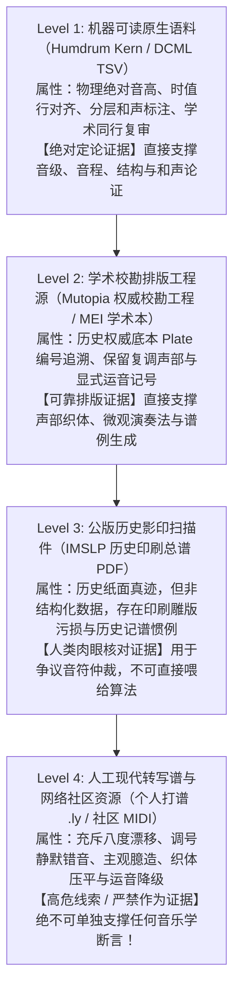

# 谱源可信度阶梯

为什么机器可读原生语料能当证据，而人工转写不能？

在数字音乐学（Digital Musicology）与面向严肃音乐创作的计算 Agent（如 OpenViking 符号音乐引擎）研发中，一切高维的风格分析、对位检验、和声拓扑与乐段生成，都建立在一个最底层的前提之上：**我们所引用的乐谱数据，是否真实反映了作曲家与声学物理的历史事实？**

在本知识库的工程实践中，曾经历过一场极为震撼的“文献学震荡”：当针对早期遗留的 5 份现代人工转写 `.ly` 文件进行独立逐音校勘时（详见文末核验记录说明），发现其**合格率为惊人的 0%**——贝多芬 Op. 135 第 4 乐章大提琴旋律被旧编者凭空臆造、中提琴与大提琴整体高出一个八度、Op. 74 第一乐章大提琴跌入大字二组超低音、舒伯特《魔王》（D. 328）马蹄断奏被篡改为保持音、独唱漏音……
与此形成鲜明对比的是，当分析工作转向 **Humdrum Kern 原生总谱、洛桑联邦理工学院（DCML）和声标注 TSV 以及 Mutopia 权威校勘源码**时，所有音级、小节、声部音程与运音记号均严丝合缝、高度自洽。

这迫使我们必须直面一个深刻的记谱与方法论问题：
**为什么机器可读的原生语料能够作为严肃论证的“铁证”，而看似排版精美的人工转写乐谱却频频沦为“伪证”？什么样的来源可以当证据，什么只能当线索？**

本文立足本轮工程的真实比对样本，解构不同谱源背后的数据哲学差异，并确立面向人与面向 Agent 的**“谱源可信度四级阶梯（Evidence Hierarchy）”**。

---

## 一、 数据哲学的本质对立：机器原生语料 vs 人工转写乐谱

为什么两类乐谱在事实保真度上会出现如此巨大的鸿沟？根本原因在于它们所秉持的**数据哲学与约束机制**完全处于不同维度。

### 1. 机器可读原生语料（Humdrum Kern & DCML）：基于物理事实与分层解耦
- **Kern 的纯物理绝对坐标**：
  在 Humdrum Kern 语法中，数据本质上是一个**时间行严格对齐的音高物理矩阵**。字符大小写与重复次数（`CC`=C2, `C`=C3, `c`=C4, `cc`=C5）代表绝对物理音高。它在底层与排版软件使用的视觉谱号（高音、中音、低音谱号）**彻底解耦**。无论视觉上如何为了人类阅读而变换谱号，数据底层的音区永远不可被视觉错觉篡改；
- **DCML 的多重同行复审与特征分层**：
  DCML 数据集不仅记录综合和弦标记，更将数据严格解耦为 `chord_tones`（和弦音绝对数值集合）、`added_tones`（外音/挂留音/经过音）、`root`（根音）与 `bass_note`（低音）。更为关键的是，其元数据（`metadata.tsv`）显式记录了 `annotators`（第一标注者）与 `reviewers`（独立复审者，如 Markus Neuwirth 标注、JH 独立复审），具备现代学术出版的同行评议基因；
- **原子化的变音记号绑定**：
  在原生数据中，每一个音符的升降号直接作为字符属性内嵌于音符 token（如 `16ee-` 显式自带降号），绝不依赖外部“调号全局变量”的隐式转换。

### 2. 人工现代转写乐谱（未校勘 `.ly` / 社区打谱 / 网络 MIDI）：充斥隐式陷阱与主观污染
相比之下，个人打谱工程或未经校勘的人工转写文件，充斥着人类认知与打谱软件交互时的致命漏洞：
- **人类心智模型的视觉固化**：打谱者长期被高音谱号驯化，在抄录中音谱号（中提琴）或低音谱号（大提琴）的线间音符时，大脑极易发生音区误判，随手打出的音符导致整乐章“系统性高/低整八度”（如 Op. 135 m. 13）；
- **编译器的隐式行为依赖**：编者误以为在文件开头写了 `\key ef \major` 调号，后续音符就会自动降噪，殊不知打谱编译器仅将其作为视觉打印指令，未显式写降号的音符被静默编译为还原音（如 Op. 74 m. 9）；
- **主观臆造与随意性篡改**：当打谱者面对复杂的复调交错、跨声部休止或难以理解的声部空白时，往往出于“填补空缺”的业余心理，凭空捏造声部旋律（如 Op. 135 m. 4 大提琴被塞入虚构的降 D-C 旋律）；
- **演奏法认知降级与织体压平**：因快捷键混淆将极其严酷的短跳音（staccatissimo）随手打成保持音（tenuto，如 D. 328 m. 2）；为排版省事，擅自截短左手时值、删除独唱弱起音、压平跨谱表复调。

---

## 二、 谱源可信度四级阶梯（The Four-Tier Evidence Hierarchy）

基于上述事实机理，我们为知识库构建与生成式 Agent 确立以下四个不可僭越的可信度层级：

### 1. 为什么 Level 1 是“绝对定论证据”？
在分析贝多芬《Op. 132》第一乐章开篇由大提琴、第二小提琴、中提琴与第一小提琴构成的四音半音卡农细胞时：
- Kern 原生谱（`quartet15-1.krn`）以逐小节对齐的方式，给出了大提琴 `2GG/ 2AA/`（$G\sharp 2 - A2$）与第一小提琴 `2d#/ 2e/`（$D\sharp 4 - E4$）的绝对物理音名；
- DCML TSV 标注（`n15op132_01.harmonies.tsv`）不仅给出了 `#viio`、`viio43/V` 与 `Ger43` 的级数，还列出了每一拍垂直切片中各声部的音级数值。
这种语料**经得起计算程序的逐音哈希校验**，无论由谁来运行分析脚本，得出的音程与和声结论都是唯一且可复现的。

### 2. 为什么 Level 4 只能当线索、绝不能当证据？
如果一个研究学者或 AI Agent 采信了未经校勘的 Level 4 文件：
- 读到旧谱代码 `beethoven-op135-mvt4-mm12-16-allegro.ly`，就会得出“贝多芬在 Op. 135 快板呈示部把大提琴写在中音区、放弃了低音八度”的荒唐结论；
- 读到旧谱代码 `schubert-d328-mm1-5-prelude.ly`，就会得出“舒伯特要求钢琴用保持音（Tenuto）演奏马蹄飞奔”的彻底误判。
**在严肃学术语境下，错误的论据比缺乏论据更具毁灭性。** 凡未经 Level 1 或 Level 2 独立核验的 Level 4 资产，在知识库中必须一律视作“未经验证的待定草稿”。

---

## 三、 面向严肃知识库与创作 Agent 的证据采信准则

为了防止知识库在后续演进中被劣质符号语料污染，同时指导创作 Agent（OpenViking）在网络环境下的信息检索与生成，制定以下三条硬性采信铁律：

### 1. 终结“见谱即信”：强制建立源头溯源链（Provenance Chain）
- 知识库中凡引用具体小节、音级进行与和声代号的句子，必须在研究笔记与归档中指明所依托的 Level 1 谱源文件名与具体小节定位（如 `quartet16-4.krn` mm. 12–16）；
- 谱例生成若依赖 LilyPond 源码，源码必须显式注明其参考的 Level 2 历史底本（如 C.F. Peters Band I，Plate 编号）或由 Level 1 经受控流水线无损转译而来。

### 2. 现代打谱资产的“有罪推定”与核验准则（Zero-Trust for Transcriptions）
- 任何外来的人工打谱 `.ly`、MusicXML 或 MIDI 文件，在进入知识库核心目录前，必须通过**独立核验流程的三重硬性审计**：
  1. **八度与音域检查**：核验各声部是否超出乐器物理空弦与极端音域（如大提琴不得低于 $C2$，中提琴不得低于 $C3$）；
  2. **调号与变音一致性检查**：核验所有变音记号是否显式声明，杜绝英语/荷兰语音名模式导致的静默还原；
  3. **复调与运音法完整性检查**：抽查原谱休止符、弱起人声音符与微观跳音记号，杜绝声部压平与符号降级。

### 3. Agent 符号生成的防御性过滤（The OpenViking Evidence Filter）
当生成式 Agent 接收到人类用户的创作或分析指令时：
- 必须优先从本地或权威知识库检索 Level 1/Level 2 结构化数据作为 Prompt 事实输入；
- 若必须参考来自互联网的 Level 4 社区谱源，Agent 内部的规则校验器必须将置信度降至最低，并主动在输出中声明：“该片段源自未校勘的社区转写，已启动物理音域与声部导向防御审计”。

---

> **证据链对齐示例（谱例见同库）**
>
> Op. 135 第四乐章 mm. 12–16 的四声部谱例收录在[《核心细胞的倒影变形与和声再语境化》](../techniques/material/motivic-inversion-and-harmonic-recontextualization.md)。同一片段在人工转写工程里曾被整体抬高一个八度（中提琴记成小字一组、大提琴记成大字组），与原生编码给出的中提琴 C3、大提琴 C2 相差整整八度——这正是本节所说"同一条旋律、两种可信度"的最直接例子。逐音核对过程与旧件对照记录保存在研究区（详见本库 local 核验记录与下属 provenance 记录），不列入正文分析叙述。
