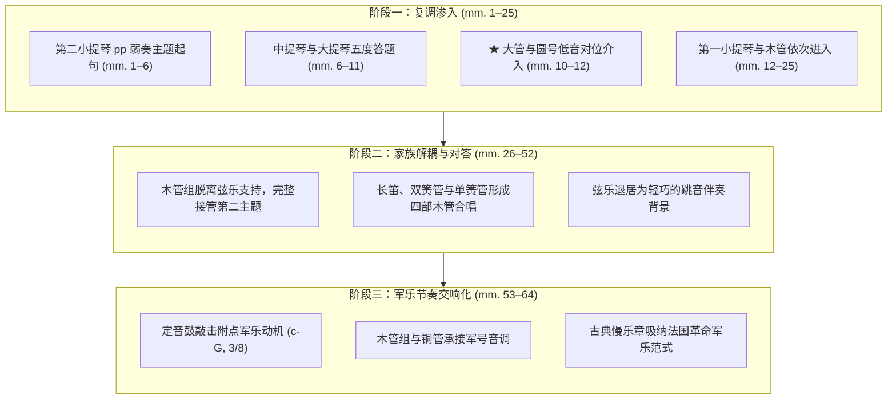

# 管乐交响化

木管组如何从 18 世纪宫廷吹奏乐的伴宴与翻倍外壳中蜕变，成为管弦乐中功能对等的独立声部？

在 18 世纪古典前期的管弦乐组织范式中，交响乐队本质上是一支以弦乐四部为绝对核心的膨胀声场。正如理论家舒尔茨（J. A. P. Schulz）在 1774 年苏尔策《美术通论》的“交响曲”（*Symphonie*）词条中所定义：“属于交响乐的乐器是小提琴、中提琴与低音乐器，每个声部均经过强力倍置；圆号、双簧管与长笛可作为补充或加强之用。”在这一传统下，管乐器长期被束缚于两种功能之中：或在强奏全奏（Tutti）中机械加倍弦乐外声部以提升音响体量，或在弱奏中以长音和弦填充和声背景。

然而，1800 年 4 月 2 日，贝多芬《C 大调第一交响曲》Op. 21 在维也纳宫廷剧院首演后，《音乐广讯报》（*Allgemeine Musikalische Zeitung*, AMZ）的特约评论员在盛赞其新颖与独创性之余，留下一句著名的微词：
> “唯一的美中不足是吹奏乐（*Harmonie*）被使用得太多了，以至于听起来更像是一部吹奏乐（*Harmoniemusik*），而非整全的管弦乐。”

这句当世听众的苛评，恰恰捕捉到了管弦乐配器史上一次决定性的范式跃迁：木管家族彻底摆脱了贵族伴宴吹奏乐（*Harmoniemusik*）的孤立外壳与交响弦乐附属加倍的角色，蜕变为在交响戏剧中与弦乐对等对话、独立承载核心动机与复调展开的有机生命体。

---

## 1. 历史原型的二元分裂：弦乐交响乐与宫廷 Harmoniemusik

要理解 1800 年听众对“管乐过多”的敏感反应，必须首先审视 18 世纪下半叶管乐在西方音乐生态中所处的二元分裂状态。

### 1.1 伴宴与户外的 Harmoniemusik 八重奏
在 18 世纪 70 年代至 80 年代（特别是 1782 年神圣罗马帝国皇帝约瑟夫二世在维也纳建立皇家吹奏乐团后），中欧与德奥贵族宫廷广泛流行一种由 8 件管乐器组成的室内乐编制——**Harmoniemusik（吹奏乐八重奏）**：
- **编制规范**：2 支双簧管、2 支单簧管、2 支圆号、2 支大管（低音部偶加一把低音提琴或大蛇簧管），形成声学自足的双管四重声部；
- **功能属性**：专用于宫廷室外聚会、贵族晚宴伴膳（Tafelmusik）、舞会、狩猎队列与军乐检阅；莫扎特（如《C 小调小夜曲》K. 388、《降 E 大调小夜曲》K. 375、《大组曲》K. 361）、罗塞蒂（Francesco Antonio Rosetti 在瓦勒斯坦宫廷的吹奏乐帕蒂塔）以及青年贝多芬（在波恩时期创作的降 E 大调管乐八重奏 Op. 103 与六重奏 Op. 71）均留有大量成熟范作；
- **声学特征**：由于全系管乐，它天然具备极高的室外声压穿透力与浓郁的吹奏乐色彩。然而在当时的审美层级中，吹奏乐被严格划归为偏向娱乐性、社交伴宴与功能应用的“轻体裁”（Gebrauchsmusik），与承载崇高思想的交响曲相去甚远。

### 1.2 早期交响乐队中的管乐从属范式
与独立的 Harmoniemusik 相对，古典前期的交响乐（如早期海顿与莫扎特交响曲）虽然逐步吸收了双簧管、圆号甚至大管，但其配器语法深受[管弦乐音色转型](orchestral-timbre-aesthetic-shift.md)前期的通奏低音惯性支配：
- 舒尔茨（J. A. P. Schulz）所描述的 18 世纪“八人管弦乐”（Orchestra of 8：四部弦乐加一对双簧管与一对圆号）以及偶加小号与定音鼓的“十一人管弦乐”（Orchestra of 11），在人数上存在绝对不平等：弦乐每部均由多名乐手强力倍置（如 8+8+4+4+5），而管乐各声部严格单人吹奏。这一物理差异直接导致了三种传统管乐配器惯例：
1. **外声部八度加倍（Octave Doubling）**：双簧管或长笛在 Forte 时与第一小提琴同音加倍或高八度加倍，大管则埋没于大提琴与低音提琴的低音线条中；
2. **和声垫料（Harmonie-Füllung）**：圆号与双簧管以二全音符、全音符长音吹奏和弦长音（Pad），仅充当维持和声共鸣的静态“胶水”；
3. **偶发田园色彩（Pastoral Topic）**：仅在单乐章局部（如小步舞曲的三声中部 Trio，或副部主题呈示）获得片刻的双簧管或长笛独奏，用以指涉民俗或田园情调。例如海顿《第 104 伦敦交响曲》第三乐章 Trio（mm. 53–70），双簧管与大管以八度加倍弦乐主旋律，为庄严的宫廷舞曲增添一抹质朴的连德勒（Ländler）风味。

在这一历史预期下，交响乐的严肃性（Gravitas）与结构推进完全系于弦乐四部的精细对位；管乐一旦越过“加倍与填充”的边界自立门户，就会被保守听众视为破坏了交响乐的崇高品格。

### 1.3 乐器制造机理对配器思维的历史制约
古典前期管乐地位的边缘化，除了社会功能分工外，更有其深刻的**物理与乐器制造史根源**：
- **指法分叉与音准缺陷**：18 世纪末的木管乐器尚未经历 19 世纪波姆体系（Boehm System）与复杂联动键杆的工业革命。当时的单簧管通常仅有 5 个金属按键，双簧管为 2–4 键，长笛多为单键或 4 键黄杨木开孔长笛。跨越半音阶时必须依赖交叉指法（Cross-fingering）或分叉指法，极易引发音色突变与音准漂移；
- **音区动态分裂**：长笛低音区声压微弱、中高音区明亮；古典双簧管低音区难以做到微弱触发（Pianissimo）；单簧管夏卢摩音区（Chalumeau）深沉多泛音，而喉音区（Throat Tones）则薄弱干瘪。
早期交响乐作曲家为了规避这些物理缺陷，往往采取“安全防御性配器”——将木管限制在全音阶主要骨干音的长音支撑与齐奏加倍上。而波恩宫廷乐团本身拥有高水准的管乐演奏传统（安东·雷哈青年时期亦在此任长笛手，日后更以管乐五重奏名垂青史）；在这一演奏传统的滋养下，贝多芬打破陈规，将精细的复调对位与动机承载赋予管乐家族。

---

## 2. 贝多芬第一交响曲第二乐章中的功能突围

作于 1799–1800 年的贝多芬《第一交响曲》Op. 21，编制完整采用了海顿在“伦敦交响曲”晚期定型的全套双管配置：2 长笛、2 双簧管、2 单簧管、2 大管、2 圆号、2 小号、定音鼓与五部弦乐。而体现木管组功能革命的代表性乐段，正是第二乐章（*Andante cantabile con moto*，F 大调，3/8 拍）。

### 2.1 赋格模仿中管乐的层级渗入（mm. 1–25）
该乐章采用奏鸣曲式，主部主题以严格的赋格段（Fugato）展开：
- **主题呈示（mm. 1–6）**：第二小提琴以极轻的弱奏（$pp$）唱出歌唱性的 3/8 拍附点主题原型（F 大调主和弦分解起句至 $b\flat^1$）；
- **对位答题与管乐进入（mm. 6–12）**：在第 6 小节第三拍，中提琴与大提琴在属方向（C 大调）唱出答题；在第 10 小节第三拍，大管双声部（`zu 2`）以 $pp$ 与低音提琴同步切入低音（$G_2\to C_3$），随后在 mm. 11–12 持续敲击八分音符低音脉动（$C_3\text{–}E_3\text{–}G_3$）；圆号在第 11 小节以长音 $G$ 渗入；而在第 12 小节第三拍，长笛与双簧管以高音 $c^2$ 与第一小提琴同步加入，管乐家族在赋格呈示阶段即逐层渗入弦乐对位机体。
- **全家族铺展与管弦混合（mm. 13–25）**：第 13 小节第一小提琴完整接管主题旋律，木管与弦乐各声部层层叠加，自发完成了从弦乐室内乐向完整双管管弦交响织体的平滑过渡。

谱例待补：贝多芬第一交响曲 Op. 21 第二乐章，mm. 1–16（弦乐与大管参与的赋格模仿呈示）

### 2.2 木管组脱离弦乐的完整家族接力（mm. 26–52）
在从主部通往属调（C 大调）副部的过渡与展开段落（mm. 26–52）中，贝多芬迈出了更为激进的一步：
- 传统的配器习惯是在副部让弦乐奏出主题、管乐在强拍给出和弦点缀；
- 贝多芬在此反其道而行之：在第 26–34 小节弦乐完成过渡后，于第 34–42 小节，**弦乐退居为细碎流动的十六分音符织体；长笛、双簧管、单簧管与大管组合构成纯粹的四声部木管组**，独立完整地唱出连贯悠扬的抒情旋律与对答。
- 木管各乐器之间并非单向发音，而是通过长笛与双簧管的八度交错、单簧管与大管的中低音支撑，构建起声学自足的“乐队中的乐队”（Orchestra within the orchestra）。

谱例待补：贝多芬第一交响曲 Op. 21 第二乐章，mm. 26–52（木管组脱离弦乐的独立旋律与和声接力，重点 mm. 34–42）

### 2.3 军乐附点动机与定音鼓交响整合（mm. 53–64）
在副部结束句（Closing Theme，m. 53 起），音乐展现了鲜明的法国大革命仪式军乐色彩：
- 定音鼓在古典交响慢乐章中罕见地被赋予独立节奏声部地位，反复敲击附点节奏型（$c\text{–}G$）；
- 与定音鼓形成直接交响对话的，正是以圆号和木管为主的吹奏乐核心（Harmonie）。双簧管与大管以断奏音符切分介入，赋予原本安详的行板以军乐仪仗般的戏剧动量。
- 这一用法表明，贝多芬将曾经游离于正式交响乐之外的民间/军乐 Harmoniemusik 语汇，内化为驱动交响曲式行进的核心戏剧动机。

谱例待补：贝多芬第一交响曲 Op. 21 第二乐章，mm. 53–64（木管与定音鼓附点军乐节奏的交响对答）

### 2.4 外围乐章的呼应：首乐章起句与终曲风暴
第二乐章对木管组的解放并非孤立现象，而是贯穿整部《第一交响曲》的整体配器战略：
- **第一乐章开篇的管乐宣言（m. 1）**：全曲开篇第 1 小节赫然由双簧管、单簧管、大管与圆号以弱奏合奏击出下属方向的属七和弦（$\text{C}\text{–E}\text{–G}\text{–B}\flat$），弦乐仅仅在强拍提供干脆的拨弦（Pizzicato）支撑。让管乐独立领奏交响曲的开门和弦，在 1800 年的维也纳堪称石破天惊；而在随后的第一乐章副部（m. 53，G 大调），双簧管与长笛成为旋律对话的核心主角，第一小提琴退居为流动副旋律。
- **终乐章展开部的木管音阶狂飙**：在第四乐章（Allegro molto e vivace）展开部中，木管组不再只是全奏时的音量放大器，而是以十六分音符急速音阶贯穿全场，与弦乐展开针锋相对的动机拼杀。四部管弦乐整体呈现出木管、铜管与弦乐高度均势的三足鼎立格局。

---

## 3. 管乐交响化的配器力学机理

贝多芬之所以能将 Harmoniemusik 成功熔铸进交响机体，依赖于四套严密的配器声学与织体组织技术：

### 3.1 从“机械倍置”到“家族声学自足”
在古典前期，管乐之所以难以独立，是因为木管乐器的发音机械极不均质（如开孔长笛低音发虚、双簧管低音干瘪、古典单簧管音区色彩分裂）。早期作曲家不得不依赖弦乐作为全频段的声学包络。
贝多芬的突破在于：**将双管木管组（2 Fl, 2 Ob, 2 Cl, 2 Bsn）作为跨越四个八度的闭合共鸣腔体**。正如在[管乐五重奏](../ensembles/wind-quintet-acoustic-balance.md)中所揭示的异质平衡原理，八件木管组合并非孤立单音乐器，而是一整套自洽的声能矩阵：
- 高音区：长笛的高八度穿透力弥补双簧管高音区的干硬；
- 中音区：单簧管充沛的泛音列（夏卢摩音区丰富的泛音）与双簧管中音形成极佳的共振填充；
- 低音区：大管提供柔韧且轮廓清晰的走句低音。
四组乐器在和弦排列上不再盲目顺排，而是大量采用交错排布（Interlocking）与包围排布（Enclosure），使八件木管组合成一个足以与数十人弦乐队分庭抗礼的均质发音体。海顿在 1790 年代后期的“伦敦交响曲”（如第 103、104 首）中固然已常态化配置单簧管并扩大管乐比重，但其木管写作总体上仍偏向于为主干全奏增添色彩或以局部重奏作调味；而贝多芬在 Op. 21 中则彻底确立了木管家族的自主闭环，使其在音区跨度、泛音共振与复调独立性上具备了离开弦乐依然能独立运转的交响能量。

### 3.2 织体分群与分层声部对话
在贝多芬成熟期的交响曲中，管乐组不再是弦乐的影子，而是形成了明确的**家族对答语法（Antiphonal Syntax）**与[音色对比阶梯](../techniques/sound/timbral-contrast-and-formal-articulation.md)：
1. **动机切分接力**：弦乐陈述两小节动机前半段，木管合唱立刻以完全相同或对比性的音色接出后两小节；
2. **前景与背景翻转**：某一乐段中弦乐主奏、木管静态长音和声填充；下一乐句瞬间翻转为木管四部主奏对位、弦乐以轻巧拨弦或跳音沦为伴奏；
3. **多层音响平面的声学解耦**：在[音响平面](../techniques/sound/planes-of-tone-layering.md)的理论视域下，早古典总谱往往将管乐与弦乐捆绑在单一的前景或背景平面上。贝多芬的革新在于赋予木管独立的音响平面身份——当木管四部占据前景旋律平面时，弦乐退居为提供节奏动量的中景运动平面或轻盈拨弦的背景平面。这种声学解耦使管弦乐织体第一次获得了纵深分明的三维景深，打破了弦乐独大带来的单调音色场。

### 3.3 室内乐精神向交响乐队的横向移植
如果说海顿将弦乐四重奏的机智对位注入了交响弦乐，贝多芬则是将 **Harmoniemusik 八重奏的室内乐合奏智慧**全面注入了交响管乐。管乐手不再只是等待 Tutti 强奏信号的敲钟人，而被赋予了室内乐独奏家的呼吸感、声部倾听与微观力度平衡要求。这直接促动了 19 世纪交响乐演奏水准与管乐发音制造技术的全方位工业革命。

### 3.4 动态非对称性与微观力度配平
由于单簧管、双簧管与长笛在物理发音上属于单件独奏乐器，面对 30 人以上的弦乐群，声学掩蔽（Acoustic Masking）极易发生。贝多芬在配器谱面上开始采用**非对称力度标记（Differentiated Dynamics）**：当弦乐标记为 $pp$ 时，木管常标记为 $p$ 或突出主奏声部；而在强奏 Tutti 中，木管通常被推向其最具金属穿透力的中高音区，从而在物理声学层面保障了木管线条不被弦乐厚重的齐奏所吞噬。

---

## 4. 对现代配器写作的实践启示

解构贝多芬管乐交响化的历史跨越，为现代配器写作提供了关键的技术准则：

1. **破除“弦乐先行、管乐填空”的思维定势**：
   在总谱构思初期，避免先写完完整的弦乐五部再把木管塞进空余拍位。应当将木管组视为一支随时可以接管主干陈述的第二管弦乐队，有意识地为其设计专属的四声部复调织体。

2. **利用家族异质性制造曲式标点**：
   当音乐需要完成主题过渡、调性转换或段落收束时，调动木管全家族与弦乐全家族进行音色板块对撞（Block Contrast），远比在单一家族内部做力度增减更能清晰标定曲式结构。

3. **以室内乐复调思维盘活长音和声**：
   在需要管乐维持背景和声时，不要让八件乐器机械地吹奏全音符柱状和弦。应当借鉴赋格与经文歌笔法，让内声部（如单簧管或大管）带出微弱的八分音符反向级进或声部交错，使静态和声获得内部呼吸。

4. **声区共鸣补偿与乐器个性化释放**：
   在管弦乐编配实践中，必须精细校准各木管乐器的物理发音特性，避免陷入等音量错觉：
   - 长笛在主奏时应尽量置于 $g^2$ 以上的高共鸣区，以穿透弦乐中景；
   - 单簧管应充分利用其夏卢摩低音区（$E\text{–}g$）深沉丰满的偶次泛音，为木管组构筑温暖的内声部衬垫；
   - 双簧管在中音区（$a^1\text{–}c^3$）具有天然的鼻音穿透力，最适于承载带附点与装饰音的敏锐动机；
   - 大管则应在次中音区（$c\text{–}c^1$）发挥其干脆、富有弹性的断奏特性，为整个管弦乐队提供灵动的节奏发动机。

5. **警惕“伪交响化”的音响浑浊**：
   1800 年 AMZ 批评家对“过多吹奏乐”的担忧在今天依然具有警示意义：若让木管持续不断地与弦乐重叠齐奏，只会破坏弦乐的弦动质感，使总谱听觉变得呆滞笨重。管乐的崇高力量在于其**进入的稀缺性、陈述的自足性以及与弦乐对位时形成的清晰声学层级**。通过将木管从机械翻倍的奴仆升格为对等对话的哲人，贝多芬为 19 世纪交响乐开辟了一条全新的音响康庄大道。
