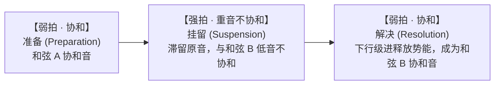
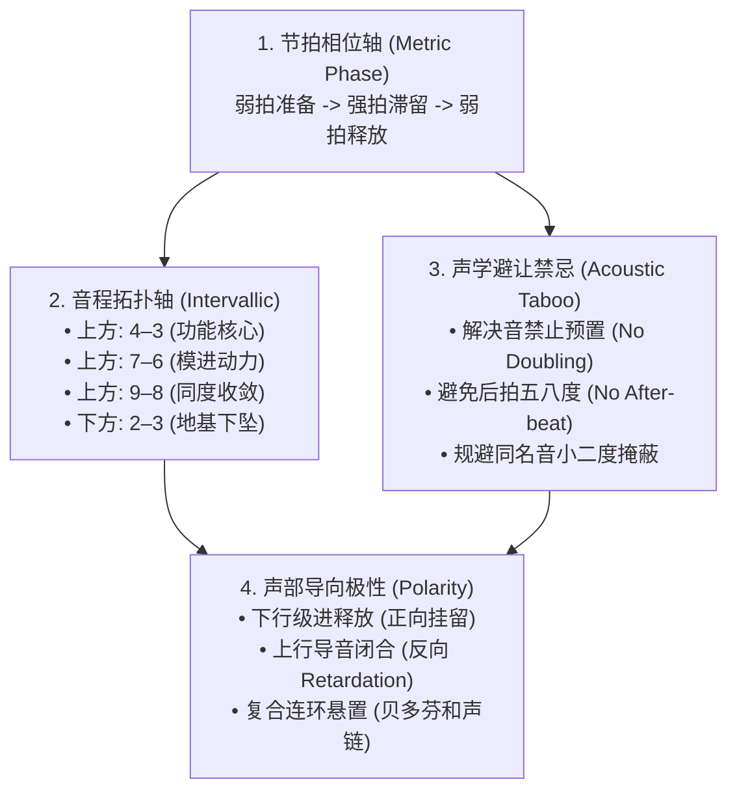

# 挂留音

<p class="doc-subtitle">挂留音如何打破块状和弦并通过相位差驱动声部导向？</p>

在初级和声分析中，音乐常被简化为一系列垂直排列的“和弦切片”（如 $I \to IV \to V \to I$）。然而，对于严肃作曲家以及基于认知图谱构建的音乐生成 Agent 而言，这种静态视角掩盖了音乐时间流动中最关键的生命体征：**旋律线条的横向独立性与微观时间差**。若所有声部在同一时钟强弱拍上机械同步切分，音乐织体便会迅速退化为死板的“块状和弦”（Block Chords）。

打破这种均质性、赋予多声部织体以持久前行动能的核心对位技术，正是**挂留音（Suspension）**。它绝非仅仅是装饰性的非和弦音，而是基于声部时钟相位差（Metric Phase Shift）构建的张力发生器。通过将上一个和弦的某个协和音符故意“滞留”至下一和弦的强拍，挂留音制造了尖锐的重音不协和与重力下坠感，迫使音乐在随后的弱拍级进解决中释放势能。

本文以 Open Music Theory（OMT）第四类对位法规范为理论坐标，结合底层机器可读原生谱源（Humdrum Kern：J. S. 巴赫合唱曲 `chor096.krn`、`chor001.krn`、`chor216.krn`）与贝多芬《Op. 74 竖琴四重奏》慢引子的实证解构，系统剖析挂留音的力学拓扑、声部导向法则、解决音重叠禁忌以及从巴洛克四部合唱向晚期古典半音化和声链的演进逻辑。

---

## 一、 挂留音的严格对位规约与拓扑类型学

依据古典严格对位法（Strict Species Counterpoint）的体系，挂留音的完整形态在第四类对位（Fourth Species，切分对位）中被形式化确立。

### 1. 动量闭环三阶段（The Three-Phase Cycle）

根据 OMT 教材《Composing a Fourth-Species Counterpoint》与《Embellishing Tones》，一个具有合法力学效应的挂留音必须由三个严格的时序阶段构成：

1. **准备阶段（Preparation）**：发生在弱拍（或弱拍位）的协和音。该声部必须在和声发生转变前预先发声，并与低音声部（或定旋律 Cantus Firmus）构成完全或不完全协和音程（如纯五度、三度、六度或同音八度）。
2. **挂留阶段（Suspension）**：强拍（或强拍位）的重音不协和。当下方和声或低音发生改变时，该声部**原音保持（Tied Over）**，拒绝同步转换，从而在强拍与新的低音或和声框架碰撞出尖锐的重音不协和。
3. **解决阶段（Resolution）**：发生在紧随其后的弱拍（或弱拍位）。挂留声部在低音保持不变的前提下，**单向级进下行（Stepwise Downward）**至一个协和音。



### 2. 音程类型学与力学阶梯（Intervallic Typology）

依据挂留音及解决音相对低音声部（Bass）的音程距离，严格对位法将挂留音划分为两大空间拓扑阵营：

#### A. 上方声部挂留（Suspensions Above the Bass）
- **$4–3$ 挂留**：**功能性统治者**。挂留音在强拍对低音构成纯四度（在低音上方为纯四度不协和），弱拍下行级进解决至大三度或小三度。这一进行直接确立了和弦的色彩属性（大小调主三和弦或属三和弦），是古典终束式（Cadential Formulas）中最具决定性的力学杠杆。
- **$7–6$ 挂留**：**线性流动引擎**。强拍构成小七度或大七度，弱拍下行解决至六度。由于 $7 \to 6$ 始终保持在不协和向不完全协和的平滑转化中，极易串联为连续的下行模进链（Suspension Chains），构成巴洛克阿勒曼德舞曲与利切卡尔的核心织体。
- **$9–8$ 挂留**：**同度共鸣收缩**。强拍构成九度（二度的复音程），弱拍收缩解决至根音同度八度。它赋予听觉由外向内收敛的神圣感与安定感。

#### B. 低音声部挂留（Bass Suspensions / Suspensions Below）
- **$2–3$ 挂留**：**重力颠覆者**。与上方声部挂留不同，此处处于挂留滞留状态的**正是低音自身**。当上方声部进入新和弦音时，低音滞留在原位，与上方声部形成二度（或七度/九度）不协和；在弱拍，低音主动**下行级进下坠**，与上方声部形成三度协和。低音挂留打破了“低音作为静止支柱”的古典常态，使地基自身成为张力的释放源。

### 3. 解决音重叠禁忌（The Resolution Doubling Taboo）

在四部和声与复调对位中，存在一条极为严苛的声学与感知禁忌：**除 $9–8$ 挂留外，挂留音的“目标解决音”，绝不可在挂留音发声的同时出现在其他任何上方声部中。**

这一禁忌在音乐力学与心理声学上具有双重必然性：
- **声学掩蔽与粗糙摩擦**：若第一小提琴正在承受 $4–3$ 挂留（例如滞留 $C5$，准备下行解决至 $B4$），而中提琴在强拍同时奏出 $B3$ 或 $B4$，此时 $C$ 与 $B$ 之间未经缓冲的小二度或大七度尖锐摩擦将被直接暴露，破坏了挂留音本应具有的“延留迟到”美感；
- **心理声学预期剥夺**：挂留音之所以引人入胜，在于听觉对“尚未出现的解决音”产生强烈的期盼。若该音早已被其他声部提前占领，挂留音的下行解决便沦为无意义的音符冗余，彻底丧失了复调对位的行进意义。

### 4. 反向延留音（Retardation）

与严格挂留音必定向下级进解决相对，若延留音在弱拍**向上级进解决**，则被称为反向延留音（Retardation）。在巴洛克与古典终束中，反向延留音几乎专用于末尾终止式——最典型的是导音（第 7 级）在主和弦强拍被延留，随后向上级进解决至主音（第 1 级），构成著名的 $7–8$ 终结延留。

---

## 二、 巴赫 370 首四部合唱中的实证透视（Humdrum Kern 证据）

在 J. S. 巴赫的四部和声圣咏（Chorales）中，严格对位的第四类抽象规则被赋予了无与伦比的血肉与戏剧张力。通过检视底层机器可读 Kern 原生乐谱，我们可以精确追踪声部线条的每一个音符。

### 1. 典范 $4–3$ 挂留与半终止推进：BWV 87/7《Jesu, meine Freude》（`chor096.krn`）

在圣咏 `chor096.krn`（d 小调，4/4 拍）的前两小节中，巴赫展示了如何利用女低音声部（Alto）的 $4–3$ 挂留精准构建半终止（Half Cadence）：

根据 Humdrum Kern 谱源（BWV 87/7，本工作树无副本）：
- **第 1 小节第 4 拍（准备阶段）**：
  * 低音为 $A3$（`8AL`）与经过音 $G3$（`8GJ`）；
  * 女高音（Soprano）为 $F4$（`4f`），次中音（Tenor）为 $D4$（`4d`）；
  * 女低音明确奏出 $D4$（`4d`），此时 $D4$ 作为 d 小调主三和弦的根音，处于完全稳定的协和状态。
- **第 2 小节第 1 拍（挂留阶段）**：
  * 和声向属功能转换：低音保持在小字组 $A3$（`4A`），次中音跳进至 $A3$（`8AL`），女高音进至 $E4$（`2e`）；
  * 唯独女低音**原音不动地延留 $D4$（`4d`）**！
  * 在这一下拍上，$D4$ 相对低音 $A3$ 形成了绝对的**纯四度不协和**（对下方属音而言是挂留四度），与上方女高音的 $E4$ 形成大二度挤压。
- **第 2 小节第 2 拍（解决阶段）**：
  * 女低音由 $D4$ 平滑级进下行半音至升 $C4$（`4c#`，导音）；
  * 低音下沉至大字组 $A2$（`4AA`），次中音经过至 $G3$；
  * $D4 \to C\sharp 4$ 的解决瞬间确立了 A 大调属三和弦的纯正结构（$A - C\sharp - E$），随后在第 3 拍毫无阻碍地收束于主音和弦 $D$。

```lilypond title="巴赫 众赞歌 BWV 87/7" location="Choral，mm.1–3" id="bach-bwv87-mm1-3"
\version "2.26.0"
\language "english"

global = {
  \key d \minor
  \time 4/4
  \tempo "Choral" 4 = 100
}

soprano = {
  \global
  a'4 a'4 g'4 f'4 |
  e'2 d'2\fermata |
  a'4 a'4 b'4 cs''4 |
}

alto = {
  \global
  f'4 f'4 e'4 d'4 |
  d'4 cs'4 a2\fermata |
  f'4 f'4 f'8 d'8 g'4 |
}

tenor = {
  \global
  d'4 d'4 d'8 cs'8 d'4 |
  a8 bf8 a8 g8 f2\fermata |
  d'4 d'4 d'8 b8 e'4 |
}

bass = {
  \global
  d8 e8 f8 d8 bf4 a8 g8 |
  a4 a,4 d2\fermata |
  d8 e8 f8 d8 g4 f8 e8 |
}

\score {
  \new StaffGroup <<
    \new Staff { \set Staff.midiInstrument = "choir aahs" \soprano }
    \new Staff { \set Staff.midiInstrument = "choir aahs" \alto }
    \new Staff { \set Staff.midiInstrument = "choir aahs" \clef "treble_8" \tenor }
    \new Staff { \set Staff.midiInstrument = "choir aahs" \clef bass \bass }
  >>
  \layout { ragged-right = ##f }
  \midi { }
}
```

---

### 2. 终止式闭合力学：BWV 269《Aus meines Herzens Grunde》（`chor001.krn`）

在 G 大调圣咏 `chor001.krn`（3/4 拍）第 5–7 小节中，巴赫演示了 $4–3$ 挂留如何充当完全正格终止（PAC）的物理锁扣：

根据 Humdrum Kern 谱源（BWV 269，本工作树无副本）：
- **第 5 小节末至第 6 小节前半（准备与持续）**：
  * 女低音声部在第 5 小节末为导音升 $F4$（`4f#`），随后在第 6 小节第 1–2 拍以二分音符向上级进并保持主音 $G4$（`2g`）；
  * 低音声部在此期间由大字组 $B2$（`4BB`）经级进走至小字组 $C3$（`4C`）。
- **第 6 小节第 3 拍（属功能收紧与导向解决）**：
  * 低音声部切入主调属音 $D3$（`4D`）；
  * 次中音出现八分音符下行级进 $D4 \to C4$（`8dL 8cJ`，第七音下行）；
  * 女高音从第 2 拍进入的 $A4$（`2a`）持续延留至第 3 拍作为属五度音；
  * 女低音由前两拍保持的四度音 $G4$ 顺势下行半音解决至导音升 $F4$（`4f#`，三度音）；
- **第 7 小节（终局落地）**：
  * 四个声部同时释放至 G 大调纯净主和弦（低音扎根于大字组 $G2$，各声部为 `2GG; 2B; 2d; 2g;`，带延长记号）。
  * 这里的声部线条顺畅消除了终止前和声的空洞感，赋予了完全正格终止强大的向心凝聚力。

```lilypond title="巴赫 众赞歌 BWV 269" location="Choral，mm.5–7" id="bach-bwv269-mm5-7"
\version "2.26.0"
\language "english"

global = {
  \key g \major
  \time 3/4
  \tempo "Choral" 4 = 100
}

soprano = {
  \global
  d''2 c''4 |
  b'4 a'2 |
  g'2\fermata \once \omit Rest r4 |
}

alto = {
  \global
  d'4 e'4 fs'4 |
  g'2 fs'4 |
  d'2\fermata \once \omit Rest r4 |
}

tenor = {
  \global
  a4 b4 c'4 |
  d'4 e'4 d'8 c'8 |
  b2\fermata \once \omit Rest r4 |
}

bass = {
  \global
  fs,4 g,4 a,4 |
  b,4 c4 d4 |
  g,2\fermata \once \omit Rest r4 |
}

\score {
  \new StaffGroup <<
    \new Staff { \set Staff.midiInstrument = "choir aahs" \soprano }
    \new Staff { \set Staff.midiInstrument = "choir aahs" \alto }
    \new Staff { \set Staff.midiInstrument = "choir aahs" \clef "treble_8" \tenor }
    \new Staff { \set Staff.midiInstrument = "choir aahs" \clef bass \bass }
  >>
  \layout { ragged-right = ##f }
  \midi { }
}
```

---

### 3. 半音阶下行低音与极端多重挂留：BWV 60/5《Es ist genug!》（`chor216.krn`）

若前两例展示的是挂留音在规约框架内的秩序美，BWV 60/5 则展现了巴赫如何将挂留音推向令人震颤的现代性边缘：

根据 Humdrum Kern 谱源（BWV 60/5，本工作树无副本）：
- **全音—三全音的横向刺穿（mm. 1–2）**：
  * 女高音开篇动机并非级进，而是连续四个全音大二度跳进：$A4 \to B4 \to C\sharp 5 \to D\sharp 5$；
  * 在第 2 小节，最高音 $D\sharp 5$ 与低音 $B\sharp 3$（`2B#;`）、次中音 $F\sharp 4$（`2f#;`）、女低音 $G\sharp 4$（`2g#;`）剧烈对撞，构成极度异化的减三和弦带增四度音响。
- **八度半音下行（Passus Duriusculus）上的连续挂留网（m. 3）**：
  * 低音声部在第 3 小节爆发出一组长达 9 个音符的连续下行：$C\sharp 4 \to B3 \to A3 \to G\sharp 3 \to F\sharp 3 \to E3 \to D3 \to C\sharp 3 \to B2$（最终在第 4 小节落地于大字组主音 $A2$）；
  * 女低音声部在第 1 拍以附点四分音符挂留 $G\sharp 4$（`4.g#`），随后在弱拍下行级进至 $A4$；紧接着在第 3–4 拍以八分音符形成 $G\sharp 4 \to F\sharp 4 \to G\sharp 4 \to E4$ 的交织；
  * 第 4 拍女高音更是突发还原 $D5$（`4ddnX`），与低音的 $C\sharp 3 / B2$ 构成刺耳的复二度/七度碰撞，整座四部架构宛如一座由错位齿轮相互咬合的张力风暴，最终在第 4 小节释放至 A 大调纯粹和弦。

```lilypond title="巴赫 众赞歌 BWV 60/5" location="Choral，mm.1–4" id="bach-bwv60-mm1-4"
\version "2.26.0"
\language "english"

global = {
  \key a \major
  \time 4/4
  \tempo "Choral" 4 = 100
}

soprano = {
  \global
  a'2 b'4 cs''4 |
  ds''2\fermata r4 ds''4 |
  e''4 b'4 b'4 d''4 |
  cs''2.\fermata b'4 |
}

alto = {
  \global
  e'2 e'4 d'8 cs'8 |
  gs'2\fermata r4 gs'4 |
  gs'4. a'8 gs'8 fs'8 gs'8 e'8 |
  a'2.\fermata gs'4 |
}

tenor = {
  \global
  cs'2 b4 fs'4 |
  fs'2\fermata r4 bs4 |
  cs'8 ds'8 e'4 e'4 e'4 |
  e'2.\fermata e'4 |
}

bass = {
  \global
  a2 gs4 as4 |
  bs2\fermata r4 gs4 |
  cs'8 b16 a16 gs8 fs8 e8 d8 cs8 b,8 |
  a,2.\fermata e4 |
}

\score {
  \new StaffGroup <<
    \new Staff { \set Staff.midiInstrument = "choir aahs" \soprano }
    \new Staff { \set Staff.midiInstrument = "choir aahs" \alto }
    \new Staff { \set Staff.midiInstrument = "choir aahs" \clef "treble_8" \tenor }
    \new Staff { \set Staff.midiInstrument = "choir aahs" \clef bass \bass }
  >>
  \layout { ragged-right = ##f }
  \midi { }
}
```

---

## 三、 古典晚期的结构异化：贝多芬 Op. 74 慢引子中的半音挂留和声链

从巴洛克进入古典晚期，贝多芬在《降E大调第10弦乐四重奏“竖琴”》Op. 74 第一乐章慢引子（Poco Adagio，2/2 拍，mm. 1–24）中，对传统挂留音机制实施了深远的结构重组。

值得注意的是，该乐章整体形式架构呈现严格的阶段分工：慢引子全长为 **mm. 1–24**（Poco Adagio，2/2 拍），主部快板（Allegro，4/4 拍）自 **m. 25** 正式爆发。在引子开端（mm. 1–9），贝多芬采用了加兰特图式的去程式化重构（关于前 9 小节中 Meyer 图式与 Fonte 模进的结构功能变形，参见 [加兰特图式与形式功能](../../techniques/structure/galant-schemata-and-formal-functions.md)；其中 m. 9 第一小提琴花彩首音在 Kern 中记为 E♭5、DCML 记为 E♮5，和声逻辑支持降号）；而进入慢引子尾声（**mm. 18–24**），古典图式彻底溶解，半音挂留和声链成为将能量推向快板主部（m. 25）的核心动力引擎（关于该处减七和弦滑移与调性拓扑的系统推导，参见 [结构功能化的半音挂留](../../composers/beethoven/quartets/chromatic-suspension-and-structural-topology.md)）。

根据 Johannes Raiser（2018）在 ZGMTH 发表的实证文献以及 Emanuel Aloys Förster 的历史通奏低音理论，DCML TSV 标注（`n10op74_01.harmonies.tsv`，timesig 列显式记录为 2/2 拍）清晰证实了该段落的力学异化：
1. **单音挂留扩展为多重半音挂留（Mehrfache Vorhaltsbildungen）**：
   贝多芬彻底剥离了挂留音在自然音体系下的温和色彩。自第 18 小节起，引子核心头动机在 as 小调中变形为长达一个多八度的半音攀升线。各声部充满长度达附点四分音符的长时值变音延留，形成了多个声部同时处于未解决状态的“复合挂留”（Compound Suspensions）。
2. **解决和弦的连环悬置（Suspended Resolution Chains）**：
   在严格古典对位中，解决音必定落在稳定的协和音上；而在 Op. 74 mm. 21–23 中，挂留音的解决音本身**立刻转变为下一个减七和弦或属七和弦的挂留准备**！例如第 21 小节突发的减七和弦，随后在第 22 小节直接悬置为下一属和弦的先现音。和声链被永久性地“悬挂”在半空中，调性中心被无限期推迟。
3. **声部功能逆转：低音（大提琴）成为挂留主角（Vorhaltsstimme）**：
   在慢引子即将步入 Allegro 快板主部（m. 25）的最后两小节（mm. 23–24），大提琴抓取了开篇的引子问句动机。然而大提琴在此处不再是坚实的低音支柱，它所奏出的音符充当了整部四重奏最核心的**长挂留声部**，与上方小提琴提前进入的先现音发生剧烈位移，最终才汇流至降 E 大调的属功能大门。

> **乐谱例证 4：见同库另一篇的同一段谱例**
>
> 本段 Op. 74 第一乐章 mm. 18–24 的谱例已嵌入[《结构功能化的半音挂留》](../../composers/beethoven/quartets/chromatic-suspension-and-structural-topology.md)（该篇从和声链与调性拓扑角度分析同一片段）。全库同一段谱例只保留一份，此处不重复收录，读者可在该篇查看完整四声部乐谱。

---

## 四、 挂留音的四维力学拓扑矩阵

综合 OMT 严格对位规约、巴赫合唱曲实践与贝多芬晚期拓展，可以确立一套关于挂留音力学的**四维拓扑矩阵**（The 4D Suspension Matrix）：



1. **节拍相位轴**：挂留音的生命源于“时间错位”。它通过在强拍保留旧信息，打破均质时钟律动，制造必须被解决的物理势能。
2. **音程拓扑轴**：
   - $4–3$ 挂留掌控三和弦中音的诞生，是调性功能确立的终极标点；
   - $7–6$ 挂留提供连续下行的对位滑梯，主导线性的长程转移；
   - $2–3$ 低音挂留使底层地基参与复调歌唱，颠覆常规低音跳进的刻板印象。
3. **声学避让禁忌**：对位严格禁止解决音提前在其他声部出现，确保了张力释放瞬间的心理声学惊喜与音响通透度。
4. **声部导向极性**：从经典的单音下行释放，到终束导音的反向延留（Retardation），再到晚期古典多声部同时挂留、甚至解决到另一个不协和和弦的无限悬挂，展现了对位技术从宗教敬虔向浪漫戏剧的进化轨迹。

---

## 五、 对现代音乐创作与生成式 Agent 的启示

对于当代作曲实践与面向严肃音乐生成的 AI Agent（如基于 OpenViking 知识图谱驱动的对位生成引擎），挂留延留力学提供了极具工程操作价值的指导准则：

1. **根除“块状和弦（Block Chords）”的死穴**：
   在自动化四部和声或室内乐生成流水线中，严禁让所有声部的音符同时起振与切分。生成算法应引入一个独立的**相位偏移控制器（Phase Shift Controller）**：随机或按规则挑选一个次要声部（如中音或次中音声部），使其发声点滞后半拍或一拍，强制执行“弱拍准备 $\to$ 强拍挂留 $\to$ 弱拍解决”，织体将瞬间获得媲美巴赫的复调呼吸感。
2. **终止式强化物理开关（Cadential Suspension Rule）**：
   在任何重要乐段的终止式（PAC / HC）前夕，Agent 应当将属和弦配置为 $V^{4-3}$ 挂留结构：强制将主调主音固定在属和弦强拍，并在弱拍下行级进解决至导音。这一动作具有不可替代的古典句法标点功能。
3. **硬性约束：解决音冲突检测（Resolution Conflict Checker）**：
   在规则校验引擎（Linter）中植入检测逻辑：当声部 A 存在 $4–3$ 或 $7–6$ 挂留时，若在强拍时间窗口内检测到声部 B 或 C 包含了该挂留的音高解决类别（Pitch Class），立即判定为声学掩蔽违规，自动触发声部避让移调。
4. **低音声部的复调化（Liberating the Bass Line）**：
   低音不应仅仅是根音生成器。适度在过渡段运用 $2–3$ 挂留，使低音自身承受挂留并向下级进，能够产生极具深度与歌唱性的复调地基，摆脱低音线条机械单调的痼疾。
