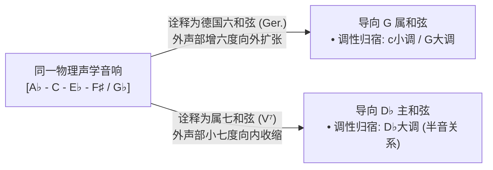

# 增六和弦的力学本质与语法漂移：从古典半音下属加压到浪漫等音枢纽

在西方调性功能和声的发展谱系中，**增六和弦（Augmented-Sixth Chords）**历来占据着极为独特而崇高的地位。然而在传统基础和声教学中，这一家族往往被机械地打上地理标签——“意大利六和弦”、“法国六和弦”、“德国六和弦”与“瑞士六和弦”，并被作为互不相干的静态和弦配方孤立讲授。这种将和弦实体化、标签化的教学惯性，严重掩盖了增六和弦内在的**声学物理驱动机制**，更切断了其从古典主义“局部前属加压”演进至浪漫主义“全局等音转调枢纽”的历史脉络。

本文依据 Open Music Theory (OMT) 中关于变音下属和弦（`alteredSubdominants.md`）与和声功能（`harmonicFunctions.md`）的分析框架，直面和声的对位本质与声学张力，系统解构增六和弦作为外声部“反向半音向心钳夹”的力学根源，阐明四大形态由内声部填充所决定的色彩分化，并追踪其在莫扎特、贝多芬与舒伯特创作中的语法演变。

---

## 1. 对位物理本质：反向半音向心钳夹

传统理论常将增六和弦解释为“重属和弦（$V/V$）的变音衍生体”，然而从调性声部导向的历史生成来看，它本质上是一个自下而上发展起来的**线性对位扩张结构**。

### 1.1 增六度音程的对称性向心运动

增六和弦的核心基因，深植于文艺复兴与巴洛克时期的弗里吉亚进行（Phrygian Cadence）之中。在小调语境下，低音声部自降六级音（$\flat\hat{6}$，solfège 音节记为 *le*）向属音（$\hat{5}$，*sol*）做半音下行；为了强化这种向属音靠拢的向心力，上方声部将原本下行的四级音（$\hat{4}$，*fa*）升半音化为升四级（$\sharp\hat{4}$，*fi*），使其充当属音的临时向上导音：

```
上音声部:  ♯4 (fi)  ------->  5 (sol)   [半音向上解决]
                ↖            ↗
                 增六度 (10半音)
                ↙            ↘
下音声部:  ♭6 (le)  ------->  5 (sol)   [半音向下解决]
```

在外声部之间，$\flat\hat{6}$ 与 $\sharp\hat{4}$ 构成了一个包含 10 个半音的**增六度（Augmented Sixth）**——在声学上，它正是极度尖锐的减三度音程经过八度转位后的产物。这一音程具有极其强烈的物理张力：两个极端声部在相反的方向上同时以半音级进向内夹紧，目标完全一致地聚焦在属音的同度或八度之上。这种高度对称的“反向半音钳夹”，为音乐注入了任何自然音阶和弦都无法比拟的声学聚焦力。

### 1.2 下属功能属性与功能低音定位

无论增六和弦的内声部如何增减，其在古典功能和声中始终表达明确的**下属/前属功能（Subdominant / Predominant, 缩记为 S）**。

在依据 OMT 的功能低音（Functional Bass）分析体系中，增六和弦在低音出现 $\flat\hat{6}$ 时被统一赋予 **`[S6]`** 的结构标记。它不是一个独立的调性中心，而是作为通向属和弦（Dominant, **`[D5]`**）前夕最具侵略性的加压跳板。

---

## 2. 四大变体的声学色彩微积分

依据 OMT `alteredSubdominants.md` 的阐述，所谓的意大利、法国、德国与瑞士六和弦，绝非四种截然不同的和弦体系，而是**在恒定不变的外声部增六度骨架（$\flat\hat{6} - \sharp\hat{4}$）之内，填充不同内声部音级所产生的声学密度与物理色彩差异**。

```
+---------------+------------------------+------------------------------------+--------------------------+
| 变体名称       | 构成音级 (C小调/大调示例) | 内声部特征                         | 声学色彩与对位特性       |
+---------------+------------------------+------------------------------------+--------------------------+
| 意大利六和弦   | A♭ - C - F♯            | 仅 3 个音级，严格四部中双写主音 (C) | 最纯粹轻盈，通透的对位骨架 |
| (Italian 6th) | (le - do - fi)         |                                    |                          |
+---------------+------------------------+------------------------------------+--------------------------+
| 法国六和弦     | A♭ - C - D - F♯        | 引入超主音 re (D)，形成对称双三全音 | 具有全音阶冷峻金属质感   |
| (French 6th)  | (le - do - re - fi)    | (A♭-D 与 C-F♯)                     |                          |
+---------------+------------------------+------------------------------------+--------------------------+
| 德国六和弦     | A♭ - C - E♭ - F♯       | 引入降中音 me (E♭)，垂直与属七等音  | 饱满丰厚，存在莫扎特五度 |
| (German 6th)  | (le - do - me - fi)    |                                    | 依赖终止四六和弦缓冲     |
+---------------+------------------------+------------------------------------+--------------------------+
| 瑞士六和弦     | A♭ - C - D♯ - F♯       | 大调中将 me 记为 ri (D♯)，解决向 mi | 德六的大调升号对位改写   |
| (Swiss 6th)   | (le - do - ri - fi)    |                                    |                          |
+---------------+------------------------+------------------------------------+--------------------------+
```

### 2.1 意大利六和弦：绝对纯粹的对位骨架
意大利六和弦（**It.**）是整个家族的纯粹原型。由于它仅包含三个音级（$\flat\hat{6} - \hat{1} - \sharp\hat{4}$），在严格四部和声中必须重复一个音。根据严格对位规约：具有强烈半音倾向的低音 $\flat\hat{6}$ 与变音 $\sharp\hat{4}$ 严禁重复，因此**主音（$\hat{1}$，*do*）成为唯一合法的双写对象**。这使得意大利六和弦具有极其通透、毫无赘肉的声学织体。

### 2.2 法国六和弦：全音阶内核与双三全音对称
法国六和弦（**Fr.**）在主音之上叠置了超主音（$\hat{2}$，*re*）。这一音级的加入带来了独特的声学奇迹：在 $\text{A}\flat - \text{C} - \text{D} - \text{F}\sharp$ 中，同时交织着两组完全对称的三全音（$\text{A}\flat - \text{D}$ 与 $\text{C} - \text{F}\sharp$）。更重要的是，这四个音全部属于同一个**全音音阶集合（Whole-Tone Collection）**。法国六和弦因此散发出一种现代、清冽、冷峻的金属摩擦质感，成为古典作曲家表现戏剧惊悚或高度理智对抗时的首选。

### 2.3 德国六和弦与“莫扎特五度”危机
德国六和弦（**Ger.**）引入了调式降中音（$\flat\hat{3}$，*me*）。在声学垂直层面上，$\text{A}\flat - \text{C} - \text{E}\flat - \text{F}\sharp$ 展现出极其丰满浑厚的协和感，因为它的物理结构完全等同于一个大三小七和弦（大小七和弦外壳）。

然而，这一饱满外壳在古典严格对位中却引发了严峻的声部连接危机：当低音 $\flat\hat{6}$（*le*，$\text{A}\flat$）下行半音至 $\hat{5}$（*sol*，$\text{G}$）时，内声部的 $\flat\hat{3}$（*me*，$\text{E}\flat$）必须同时下行至 $\hat{2}$（*re*，$\text{D}$）——**两者之间不可避免地产生了一对平行的纯五度（$\text{A}\flat/\text{E}\flat \rightarrow \text{G}/\text{D}$）**，在音乐史上常被称为“莫扎特五度（Mozart's Fifths）”。

为了规避这种粗糙的声学碰撞，古典规范发展出严格的语法防火墙：**德国六和弦通常不能直接跳入原位属和弦，而是必须首先进入“终止四六和弦（$Cad^6_4$）”**。在 $Cad^6_4$ 中，*do*（$\text{C}$）与 *me*（$\text{E}\flat$）被顺理成章地保持为持续音，五度平行的声部危机被巧妙化解，随后再平滑消解至原位属和弦。

### 2.4 瑞士六和弦：大调调性中的记谱自洽
瑞士六和弦（**Sw.**）并非声学上的新发明，而是德国六和弦在大调体系中的记谱纠偏。在自然大调中，若直接使用 *me*（$\text{E}\flat$），其随后进入终止四六和弦中的大三音（*mi*，$\text{E}\natural$）会导致同一个声部出现异名同音的不协调记谱。因此，理论家将其记为升二音（*ri*，$\text{D}\sharp$），使其在视觉与逻辑上均表现为端正的半音上行导向（$\text{D}\sharp \rightarrow \text{E}\natural$）。

---

## 3. 古典句法实践：前属加压与戏剧聚焦

在维也纳古典乐派的乐句构架中，增六和弦绝非孤立展示色彩的盆景，而是被严格安置在乐段后半程，充当**推向终止式前夕的终极前属制动器**。

### 3.1 莫扎特《C大调弦乐四重奏“不协和”》K. 465 第四乐章（mm. 10–16）

在第四乐章充满活力的主部推进中，莫扎特展现了极其精密的**前属级阶梯式加压技术**：

1. **温和前属（m. 13）**：在飞速奔流的乐思中，莫扎特首先在 m. 13 采用了一个温和、典雅的第一转位自然下属和弦（$IV^6$），确立基本的离心下属动力；
2. **极压突变（m. 14 第 2 拍）**：紧接着在 m. 14 的第 2 拍，织体突然收拢，莫扎特悍然切入**法国六和弦（Fr.）**；
3. **声学爆发**：超主音与升四级音构成的双重三全音骤然撕裂了明亮的 C 大调纯净空间，将乐句的张力瞬间推至最高负荷；
4. **终止顺导（mm. 15–16）**：法国六和弦顺势卸力于终止四六和弦（$Cad^6_4$），最终在原位属和弦的驱动下，于 m. 16 毫无悬念地达成雷霆般的完全正格终止（PAC）。

```lilypond title="莫扎特 K.465 第四乐章" location="Allegro，mm.10–16"
\version "2.26.0"
\language "english"

global = {
  \key c \major
  \time 2/4
  \tempo "Allegro" 4 = 144
}

violinoI = {
  \global
  \clef treble
  \set Staff.midiInstrument = "violin"
  b''4. f''8 |
  e''8 c''8 a'8 d''8 |
  c''8 b'8 c''8 c''8 |
  d''8 d''8 e''8 e''8 |
  f''8 f''8 fs''8 f''8 |
  g''8 e''8 \grace { g''16 } f''8 e''16 d''16 |
  c''8 r8 c'8 c'8 |
}

violinoII = {
  \global
  \clef treble
  \set Staff.midiInstrument = "violin"
  f'16 d'16 f'16 d'16 f'8 r8 |
  r8 g'8 c'8 a'8 |
  e'8 d'8 c'8 c'8 |
  c'8 c'8 c'8 c'8 |
  c''8 c''8 c''8 c''8 |
  c''4 \grace { e''16 } d''8 c''16 b'16 |
  c''8 r8 c'8 c'8 |
}

viola = {
  \global
  \clef alto
  \set Staff.midiInstrument = "viola"
  d'16 b16 d'16 b16 d'8 r8 |
  R2 |
  r4 g8 g8 |
  a8 a8 bf8 bf8 |
  c'8 c'8 d'8 d'8 |
  e'8 c'8 g'8 g'8 |
  e'8 r8 c'8 c'8 |
}

violoncello = {
  \global
  \clef bass
  \set Staff.midiInstrument = "cello"
  g8 g8 g8 r8 |
  c'8 e8 f8 fs8 |
  g8 f8 e8 e8 |
  f8 f8 g8 g8 |
  a8 a8 af8 af8 |
  g8 g8 g8 g8 |
  c8 r8 c8 c8 |
}

\score {
  <<
    \new Staff  \violinoI
    \new Staff  \violinoII
    \new Staff  \viola
    \new Staff  \violoncello
  >>
  \layout { ragged-right = ##f }
  \midi { }
}
```

### 3.2 贝多芬《E大调第30钢琴奏鸣曲》Op. 109 第三乐章（mm. 1–8）

在贝多芬晚期这部宛若天籁的沉思变奏曲主题中，德六和弦被赋予了深沉的崇高感：

- **主题陈述（mm. 1–6）**：前 6 小节展现出极为宽广安详的萨拉班德舞曲风格，两小节的乐句平缓呼吸，调性始终静止在清澈的 E 大调主和弦引力中；
- **德六介入（m. 7 拍尾跨至 m. 8）**：在走向全段半终止（HC）的关键隘口，贝多芬在 m. 7 的弱拍毫无征兆地引入**德国六和弦（Ger.）**，低音降六音（$\text{C}\natural$）与高音升四级（$\text{A}\sharp$）瞬间形成刺目的增六度外声部张力；
- **张力跨越**：这一德六和弦并非一闪而过，而是被延留跨越小节线，强力压迫至 m. 8 拍头，随后经过精妙的声部导向，平稳释放在宽广深远的 B 大调半终止长音之中；
- 贝多芬在此雄辩地证明：增六和弦不仅是戏剧性快板乐章中的爆破装置，更能在极静谧的慢板中凝聚起崇高的哲学张力。

```lilypond title="贝多芬 Op.109 第三乐章" location="Andante molto cantabile ed espressivo，mm.1–8"
\version "2.26.0"
\language "english"

global = {
  \key e \major
  \time 3/4
  \tempo "Andante molto cantabile ed espressivo" 4 = 84
}

upper = {
  \clef treble
  <<
    \new Voice = "rh1" {
      \voiceOne
      gs'4( e'4. fs'8) | % 1
      \oneVoice <fs ds'>4 <fs a b>2 | % 2
      \voiceOne
      <gs b gs'>4( e'4. fs'8) | % 3
      \oneVoice <ds' fs'>4( <cs' e' as'>4 <ds' fs' b'>4) | % 4
      \voiceOne \grace { b32[( e'32 gs'32]) } b'4( e'4. gs'16 fs'16) | % 5
      \oneVoice ds'4( b4 \grace { a32[ b32 a32 gs32] } a4) | % 6
      \voiceOne gs4 e'4.->( as8) | % 7
      \oneVoice \clef bass as2\p( b4) | % 8
    }
    \new Voice = "rh2" {
      \voiceTwo
      b4 b4 cs'4 | % 1
      s2. | % 2
      r4 b4 cs'4 | % 3
      s2. | % 4
      r4 b4 cs'4 | % 5
      s2. | % 6
      s2. | % 7
      g4( e4 ds4) | % 8
    }
  >>
}

lower = {
  \clef bass
  <<
    \new Voice = "lh1" {
      \voiceOne
      e,4( gs,4 a,4 | % 1
      b,4 cs4 ds4) | % 2
      e4( gs4 as4 | % 3
      b4 fs4 b,8 a,8) | % 4
      gs,4 gs4 a,4 | % 5
      <b, fs>4 <cs e>4 <ds fs>4 | % 6
      s4 e2 | % 7
      e,4( g,4 b,4) | % 8
    }
    \new Voice = "lh2" {
      \voiceTwo
      s2. | % 1
      s2. | % 2
      s2. | % 3
      s2. | % 4
      gs,2 s4 | % 5
      s2. | % 6
      e4( <cs, cs>4 <c, c>4) | % 7
      c,2 b,,4 | % 8
    }
  >>
}

\score {
  \new PianoStaff <<
    \new Staff = "RH" \with { midiInstrument = "acoustic grand" } {
      \global
      \upper
    }
    \new Staff = "LH" \with { midiInstrument = "acoustic grand" } {
      \global
      \clef bass
      \lower
    }
  >>
  \layout {
    \context {
      \Score
      \override SpacingSpanner.common-shortest-duration =
        #(ly:make-moment 1/16)
    }
  }
  \midi {
    \context {
      \Score
      midiMergeUnisons = ##f
    }
  }
}
```

---

## 4. 浪漫主义的语法漂移：等音枢纽与调性虫洞

如果说在古典主义时期，增六和弦严格服从于“下属功能—属功能”的向心秩序；那么进入 19 世纪（特别是舒伯特、肖邦与李斯特的创作）后，增六和弦发生了一场深刻的**语法异化——由“局部前属加压跳板”蜕变为跨越远关系调性领域的“等音转调枢纽（Enharmonic Pivot）”**。

### 4.1 德六和弦与属七和弦的等音两面性

这一语法异化的物理基石，正是前述德国六和弦在十二平均律中的**绝对声学等同性（Acoustic Equivalence）**：

$$\text{German 6th}\quad [\text{A}\flat - \text{C} - \text{E}\flat - \text{F}\sharp] \quad \Longleftrightarrow \quad \text{Dominant 7th}\quad [\text{A}\flat - \text{C} - \text{E}\flat - \text{G}\flat]$$

在听觉感知中，这两个和弦具有完全相同的垂直泛音组合与音响外壳。然而，其水平对位解决却指向两个截然不同的引力世界：

1. **作为德国六和弦解决**：
   - 最外层增六度（$\text{A}\flat \leftrightarrow \text{F}\sharp$）向外反向扩张；
   - 解决目标为 **G 的八度**（作为 c 小调或 G 大调的属和弦）。
2. **作为大小七和弦（属七）解决**：
   - 最外层小七度（$\text{A}\flat \leftrightarrow \text{G}\flat$）遵循常规声部导向向内反向收缩（$\text{A}\flat$ 下行跳向 $\text{D}\flat$，$\text{G}\flat$ 下行级进至 $\text{F}$）；
   - 解决目标为 **$\text{D}\flat$ 大调的主和弦**！



### 4.2 舒伯特式调性瞬移：半音关系的无痕跃迁

通过操控这枚“等音双面间谍”，浪漫主义作曲家获得了如同宇宙虫洞般的调性穿梭能力。在古典传统中，从 c 小调移动到其半音上方远关系的 降D 大调（调号相差整整 4 个降号），需要经过漫长、繁复的五度链中介和弦过渡；

而在舒伯特的晚期杰作（如**《降B大调钢琴奏鸣曲》D. 960 第一乐章**）中，作曲家仅需引入一枚德六和弦，在听者完全沉浸在下属前属加压的古典预期中时，突然将其改拼为属七和弦并直接落地于半音远关系主和弦。这种瞬间的语法漂移，打破了古典调性空间的连续度规，营造出浪漫主义所独有的梦幻迷离感与幽暗超验境界。

> **【谱例占位 · 待资料助手交付】**
> - **作品**：弗朗茨·舒伯特《降B大调第21钢琴奏鸣曲》D. 960，第一乐章 Molto moderato
> - **小节范围**：mm. 18–48
> - **声部编制与 GM 编号**：钢琴双手（GM 0: Acoustic Grand Piano）
> - **调性与拍号**：降 B 大调，4/4 拍
> - **结构说明**：呈示部主部主题推进，神秘低音升 F 震音引入；利用德六和弦与属七和弦等音重释机制，实现从主调向远关系半音/大三度调区（升 f 小调 / 降 G 大调）的等音转调飞跃
> - **状态**：待制作真实 LilyPond 围栏与独立核验

---

## 5. 跨篇技法脉络的学术呼应

增六和弦的力学解构与语法演进，与本知识库已成稿的学术专题构成了深层的网络交织：

1. **与和声体系专题的深度互补**：
   - 在 scholar-b2 的[《从局部下属到结构对抗：那不勒斯和弦（bII）的调性异化机制》](neapolitan-chord-structural-mutation.md)中，那不勒斯和弦展现了降二级主和弦在小调中的平行调性板块平移；
   - 本篇则从对位极性的另一端（$\flat\hat{6}$ 与 $\sharp\hat{4}$ 的双向钳夹），揭示了前属变和弦如何通过增六度反向扩张达成对属功能的极压，并最终通过等音重拼走向调性空间的大裂变，两者共同奠定了本库在变音下属和弦领域的完整理论大厦。
2. **与曲式结构轴的动力对接**：
   - 在[《终止式延后与时间扩张：古典句法中的规避机制与“再来一次”技术》](../structure/cadential-evasion-and-temporal-expansion.md)中，我们阐述了前属功能的能量蓄积如何决定后续终止式的弹性延后；增六和弦正是古典作曲家在前属阶段注入最大向心势能的最烈性催化剂。
3. **与对位力学专题的严格同构**：
   - 增六和弦在严格对位中面对的“莫扎特五度”危机与终止四六和弦的缓冲规约，深刻印证了 scholar-b2 在[《对位中的挂留延留力学与声部张力网络》](../counterpoint/suspension-mechanics-and-voice-leading.md)中所确立的声部导向优先原则——垂直和弦的饱满度在古典乐派中必须无条件让位于水平线条的纯洁性。
