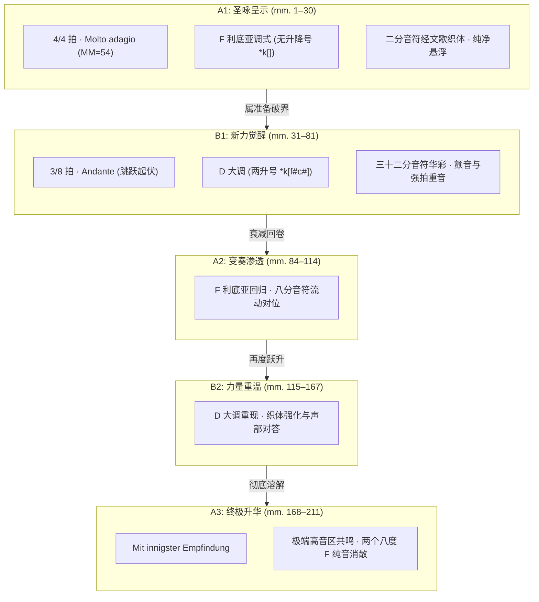

# 利底亚调式
<p class="doc-subtitle">贝多芬 Op. 132 第三乐章《感恩赞》如何以无调号 F 利底亚调式剥离功能和声的向心重力并构建悬浮对位？</p>

在西方大小调功能和声体系中，音乐行进的根本动力来自向心重力：以主和弦（I）为核心引力场，属七和弦（$V^7$）内部导音 $\hat{7}$ 与下属音 $\hat{4}$ 构成的三全音倾向性解决，是驱动句子推进、确立调性边界的动力机制。然而在晚期弦乐四重奏中，贝多芬打破了这种建立在张力—解决二元对立上的动力学范式。

作于 1825 年的《a 小调第 15 弦乐四重奏》Op. 132 第三乐章，标题题作“病愈者献给神圣之主的感恩赞，在利底亚调式上”（*Heiliger Dankgesang eines Genesenen an die Gottheit, in der lydischen Tonart*）。总谱上标注调号为没有任何升降号的自然白键体系（`*k[]`）。在整个慢板乐段中，贝多芬坚决驱逐一切降 B 记谱，自始至终坚守纯自然音还原 B（$B\natural$）。这一古老教会调式的激进复活，不仅从声学与和声语法上彻底拆解了古典功能向心力，更创造出一种超脱世俗张力、静止自足的悬浮对位织体。

---

## 1. 增四度特性音对功能语法的双重瓦解

F 利底亚调式（F Lydian）的自然音列为：$F\text{–}G\text{–}A\text{–}B\natural\text{–}C\text{–}D\text{–}E$。它与常规 F 自然大调的区别，集中在第四级音：由原本的下属半音降 B 变为自然音还原 B（$B\natural$）。这一看似微小的音级置换，在和声动力学层面上产生了根本性的颠覆效应。

### 1.1 下属支撑架构的消解
在自然大调中，建立在第四级上的下属三和弦（IV，$\text{B}\flat\text{–D–F}$）承担着明确的“前属功能”（Pre-dominant），与主和弦、属和弦共同构成古典调性稳定的三角支架。而在 F 利底亚调式中，由于缺乏降 B，第四级上方构成的三和弦演变为减三和弦（$\text{B}\natural\text{–D–F}$，即 vii$^\circ$/V）。

减三和弦本身极度不稳定，无法充当稳固的和声支点；若将第二级作为替代低音，则构成含有还原 B 的大三和弦（II，$\text{G}\text{–B}\natural\text{–D}$）。这一音级配置切断了常规大调中“从主和弦走向下属和弦再走向属和弦”的标准语法链条，使低音失去了古典功能层级所赋予的导向性。

### 1.2 属七向心引力的彻底熄灭
更为决定性的断裂发生在属和弦维度。古典调性引力最强烈的发动引擎是属七和弦：在 F 大调中，属七和弦为 $\text{C}\text{–E}\text{–G}\text{–B}\flat$，其中导音 $E$ 与下属音 $B\flat$ 形成不协和的减五度（三全音）。在解决时，$E$ 向上级进解决至主音 $F$，$B\flat$ 向下级进解决至三音 $A$。这种向心对向运动，构成了古典终止式的物理向心重力。

然而在纯自然音 F 利底亚调式中，在主音五级（C）之上叠置调式自然七音，得到的只能是还原 B：
$$C^{\text{maj}7} = \text{C} - \text{E} - \text{G} - B\natural$$
大七和弦内部不再包含减五度或增四度的倾向性三全音动力，而是由大三度、纯五度与大七度叠合而成。它不具备任何急迫收缩至 $F\text{–}A$ 的动量需求；相反，大七度音 $B\natural$ 与根音 $C$ 形成开阔清冷的协和悬浮感。没有了向心三全音，古典体系中强行将音乐拽向主和弦的重力势能被从语法根源上完全熄灭。

### 1.3 调性重心的悬浮状态
在 F 利底亚调式中，主音 $F$ 与第四级 $B\natural$ 本身构成了全音阶内唯一的增四度三全音（Tritone）。在文艺复兴时期的教会复调中，该音程被称为“音乐之魔”（*diabolus in musica*），作曲家通常借助隐调式虚音规则（*musica ficta*）强制将 $B\natural$ 降为 $B\flat$，使利底亚调式退化为现代 F 大调的原型。不同于古典晚期通过[增六和弦](augmented-sixth-mechanics-and-syntactic-drift.md)或[半音挂留](../../composers/beethoven/quartets/chromatic-suspension-and-structural-topology.md)制造剧烈的半音扭矩与声部阻尼，利底亚调式追求的是全音阶自然音内部的纯净度。

贝多芬在此坚决拒绝了任何虚音妥协。当 $B\natural$ 出现时，它既不是通往 C 的副导音，也不是 G 大调的三音，而是纯粹的第四级特性音。和弦不再遵循紧张与释放的因果链，而是在 F、C、G、Dm、Am 等自然和弦板块之间平移与漫射。虽然主音低音 $F$ 反复出现并作为句末锚点，但它不再具备功能大调那种不容置疑的终极统治力，整座和声建筑呈现出轻盈、无重力的悬浮态。

---

## 2. 圣咏定旋律与四部卡农交织（mm. 1–30）

在 Op. 132 第三乐章的前 30 小节（Molto adagio，4/4 拍），贝多芬展示了如何用极简的古风织体将利底亚调式的和声悬浮感转化为实际乐谱形态。该段落由五个二分音符为主的四小节圣咏乐句（verse 复述句）组成，每句圣咏之间均插入两小节四声部卡农模仿前奏与间奏。

### 2.1 模仿前奏的声部进入机制（mm. 0–2）
在乐章开端，音乐并非以四部齐奏切入，而是由单一声部在弱起小节展开严格的四度与八度对位模仿：

1. **第一小提琴起句（m. 0 弱起第 3 拍）**：
   第一小提琴在弱起单声部弱奏中起句，自小字一组 $c^1$ 展开纯朴的五音骨架（$c^1\text{–}g^1\text{–}c^2\text{–}c^2\text{–}f^1$），确立自然音的肃穆基调。
2. **第二小提琴六度跃进动机进入（m. 1 第 1 拍）**：
   第二小提琴随即奏出由中音区 $c^1$ 向上跃进六度至 $a^1$、随后二度下行至 $G$ 并回升至 $e^1$ 的核心动机线条（$(c^1\text{–}a^1\text{–}G)\text{–}e^1$）。
3. **中提琴低八度进入（m. 1 第 3 拍）**：
   中提琴以小字组低八度形态进入（$C\text{–}A\text{–}G$），进一步拓宽声部纵向跨度。
4. **大提琴底层进入（m. 2 第 1 拍）**：
   以大字组低音进入（C2–A2），并在第 2 小节第 3 拍稳稳落在大字组二分音符 $FF$ 上。

四件乐器在两小节内完成自上而下的空间下潜，展现了[弦乐四重奏](../../ensembles/string-quartet-acoustic-role-differentiation.md)在声部均质性中的层次分工。于第 2 小节第 3 拍，四声部垂直汇聚成纯正的 F 大三和弦（$FF\text{–}C\text{–}A\text{–}f$），由此托出第一句圣咏定旋律。

```lilypond title="贝多芬 第15弦乐四重奏 Op.132 第三乐章" location="Molto adagio，mm.1–6" id="beethoven-op132-iii-mm1-6"
\version "2.26.0"
\language "english"

% 据 CCARH MuseData 转写，学术用途。
% 刊本印刷小节号；本乐章 Molto adagio 由弱起小节引出（不计入 mm.1 起的编号）。

global = {
  \key c \major
  \time 4/4
}

violinI = {
  \clef "treble"
  \tempo "Molto adagio" 4 = 54
  g' 4 c'' 4 ~ c'' 4 f' 4 | % m.1
  g' 4 ) f' 4 <f' a'> 2 | % m.2
  f' 2 e' 2 | % m.3
  d' 2 e' 2 | % m.4
  f' 2 g' 2 | % m.5
  f' 2 ( a'' 4 d'' 4 | % m.6
}

violinII = {
  \clef "treble"
  ( c' 4 a' 4 <g e'> 4 ) ( c' 4 | % m.1
  e' 4 f' 4 ) a 2 | % m.2
  c' 2 c' 2 | % m.3
  a 2 c' 2 | % m.4
  ( c' 2 b 4 e' 4 ) | % m.5
  a 2 r 2 | % m.6
}

viola = {
  \clef "alto"
  r 2 ( c 4 a 4 | % m.1
  g 4 <c c'> 4 ) <c c'> 2 | % m.2
  c 2 g 2 | % m.3
  f 2 g 2 | % m.4
  ( c 2 d 4 e 4 ) | % m.5
  f 2 r 2 | % m.6
}

cello = {
  \clef "bass"
  r 1 | % m.1
  ( c, 4 a, 4 ) f, 2 | % m.2
  a, 2 c 2 | % m.3
  d 2 c 2 | % m.4
  ( a, 2 g, 4 c 4 ) | % m.5
  d 2 r 2 | % m.6
}

\score {
  <<
    \new Staff = "VlnI" {
      \set Staff.midiInstrument = "violin"
      \global
      \violinI
    }
    \new Staff = "VlnII" {
      \set Staff.midiInstrument = "violin"
      \global
      \violinII
    }
    \new Staff = "Vla" {
      \set Staff.midiInstrument = "viola"
      \global
      \viola
    }
    \new Staff = "Vc" {
      \set Staff.midiInstrument = "cello"
      \global
      \cello
    }
  >>
  \layout { ragged-right = ##f }
  \midi { }
}
```

### 2.2 五句圣咏的和声轨迹与还原 B 的标点分布
五句圣咏在结构上呈现为清晰的对称拱形，特性音 $B\natural$ 在各句中的出现位置经过了严密的声部组织：

- **第一句（mm. 2–6）：主调奠基与副属色彩**：
  高音声部圣咏旋律为二分音符平稳进行：$F\text{–}F\text{–}E\mid D\text{–}E\mid F\text{–}G\mid F$。在第 3 小节，低音自 $AA$ 走向 $C$，和声由 F/A 滑入 C 大三和弦；第 4 小节在 Dm 与 C 之间摇摆；第 5 小节第 3 拍，第二小提琴奏出小字组 $B\natural$，与大提琴 $GG$、中提琴 $D$、第一小提琴 $G$ 构成包含增四度特性音的 G 大和弦，随后在第 6 小节顺畅滑向 D 小调与 F 和弦收束。
- **第二句（mm. 8–12）：向五度上方的游移**：
  圣咏旋律起于高点 $G$，转而在五度上方的 C 音建立临时中心。旋律线呈现为 $G\mid A\text{–}C\mid A\text{–}G\mid F\text{–}D\mid E$。在第 11 小节，第二小提琴与大提琴再次带出 $B\natural$（构成第一转位 $\text{G/B}$），乐句于第 12 小节以全自然音的 C 大调三和弦完成停顿。整个行进虽有向属方向靠拢的趋势，但因缺乏降 B，未能形成任何真实的转调属准备。
- **第三句（mm. 14–18）：拱顶与极端音区**：
  全段的高潮转折点。高音声部旋律跨入高音区（$e^1\text{–}c^2\text{–}b^1\text{–}c^2\text{–}a^1\text{–}b^1\text{–}c^2\text{–}d^2$）。在第 15 小节与第 17 小节，第一小提琴两次唱出长达二分音符的小字二组 $b^1$（还原 B）。此处 $b^1$ 与中提琴、大提琴形成减三和弦第一转位（$\text{B}^\circ/\text{D}$）与 E 小调三和弦，刺破了原本柔和的协和音响，带来深沉古朴的哀祷色彩，最终稳定降落在第 18 小节的 G 大调上。

```lilypond title="贝多芬 第15弦乐四重奏 Op.132 第三乐章" location="Molto adagio，mm.14–18" id="beethoven-op132-iii-mm14-18"
\version "2.26.0"
\language "english"

% 据 CCARH MuseData 转写，学术用途。
% 第三句圣咏；第一小提琴 m.17–m.18 的高音区 b''→c''' 为 B 还原音。

global = {
  \key c \major
  \time 4/4
}

violinI = {
  \clef "treble"
  \tempo "Molto adagio" 4 = 54
  d' 4 e' 4 ) e' 2 | % m.14
  c'' 2 b' 2 | % m.15
  c'' 2 a' 2 | % m.16
  b' 2 c'' 2 | % m.17
  <d' d''> 2 ( g'' 4 c'' 4 | % m.18
}

violinII = {
  \clef "treble"
  b 4 c' 4 ) c' 2 | % m.14
  e' 2 e' 2 | % m.15
  <g e'> 2 c' 2 | % m.16
  f' 2 <c' e'> 2 | % m.17
  <b d'> 2 r 2 | % m.18
}

viola = {
  \clef "alto"
  f 4 e 4 ) e 2 | % m.14
  c 2 g 2 | % m.15
  <e g> 2 a 2 | % m.16
  f 2 <g g'> 2 | % m.17
  <g g'> 2 r 2 | % m.18
}

cello = {
  \clef "bass"
  d 4 ) c 4 a, 2 | % m.14
  a, 2 e 2 | % m.15
  c 2 f 2 | % m.16
  d 2 c 2 | % m.17
  g, 2 r 2 | % m.18
}

\score {
  <<
    \new Staff = "VlnI" {
      \set Staff.midiInstrument = "violin"
      \global
      \violinI
    }
    \new Staff = "VlnII" {
      \set Staff.midiInstrument = "violin"
      \global
      \violinII
    }
    \new Staff = "Vla" {
      \set Staff.midiInstrument = "viola"
      \global
      \viola
    }
    \new Staff = "Vc" {
      \set Staff.midiInstrument = "cello"
      \global
      \cello
    }
  >>
  \layout { ragged-right = ##f }
  \midi { }
}
```

- **第四句（mm. 20–24）：向主音的回溯**：
  旋律自高音区回落，形态为 $C\mid C\text{–}D\mid G\text{–}A\mid D\text{–}E\mid F$。第 21 小节第三拍，大提琴打下持续低音 $GG$，中提琴奏出 $F$，第二小提琴击出 $B\natural$，第一小提琴高唱 $d^2$。这一纯自然音属七和弦形态并未向 C 大调解决，而是在第 22–24 小节顺流而下，通过 $C\text{–}F\text{–}G\text{–}F$ 的平缓变动，平稳落回 F 大三和弦（m. 24）。
- **第五句（mm. 26–30）：未竟的开放性准备**：
  作为圣咏呈示的总结段落，高音声部重复第四句前部的骨架。音乐在第 29 小节再次呈现包含 $B\natural$ 的 G 大和弦。然而在第 30 小节，贝多芬并未给出完满终止，而是让大提琴与中提琴以弱奏反复击出八分音符顿音 $AA$ 与 $A$，第二小提琴加入高音 $c\sharp^1$。这一突如其来的 A 大调属准备和弦打破了纯白键世界，直接为后接的新段落撕开了通道。

---

## 3. 宏观建筑：“无重力圣咏”与“新力觉醒”的二元对峙

Op. 132 第三乐章在宏观结构上并非单一调式的孤立陈述，而是建立在两组截然对立的审美世界之间的交替循环之上：五部变奏回旋结构（A1–B1–A2–B2–A3）。



### 3.1 D 大调“新力觉醒”的音响反差
在第 31 小节，音乐突然爆发性切入标注为“新力觉醒”（*Neue Kraft fühlend*）的 Andante 乐段：
- **节拍与速度**：从静止均质的 4/4 拍（$MM=54$）骤变为轻快起伏的 3/8 拍；
- **调性引力场**：从没有任何升降号的白键利底亚调式，跳入带有两个升号（$F\sharp, C\sharp$）的明亮 D 大调；
- **发音物理与动量**：圣咏中的长时值连奏完全被富有弹性的跳音、颤音（Trill）以及奔流不息的三十二分音符琶音所取代。第 31 小节大提琴打下强劲的重音低音 $DD$，第二小提琴与中提琴铺垫跳音和弦；第 32 小节第一小提琴保持高音区强奏长音 $a^2$（A5），第二小提琴则倾泻出如泉涌般的三十二分音符旋律：
  $$a^1 - d^2 - c\sharp^2 - b^1 - a^1 - b^1 - c\sharp^2$$

这一段落生动再现了病愈后肉体感官机能的复苏。与 A 段非世俗的宗教冥想相比，B 段充满了尘世生命的脉搏与肌肉力量。调性上，D 大调具有无可置疑的主—属功能极性，每一次三十二分音符的冲刺都指向确凿的强拍正格终止。

```lilypond title="贝多芬 第15弦乐四重奏 Op.132 第三乐章" location="Andante（D 大调），mm.31–36" id="beethoven-op132-iii-mm31-36"
\version "2.26.0"
\language "english"

% 据 CCARH MuseData 转写，学术用途。
% m.31 起转为 3/8、D 大调（两升）的 Andante；播放速度 8. = 60 为本库试听值（底本未标该段 MM）。

global = {
  \key d \major
  \time 3/8
}

violinI = {
  \clef "treble"
  \tempo "Andante" 8. = 60
  a'' 4. | % m.31
  a'' 4. ~ | % m.32
  a'' 4. ~ | % m.33
  a'' 4. | % m.34
  b'' 8 -. g 8 -. b'' 8 | % m.35
  r 16 a'' 16 r 32 a'' 32 -. b'' 32 -. cs''' 32 -. d''' 32 -. e''' 32 -. fs''' 32 -. g''' 32 -. | % m.36
}

violinII = {
  \clef "treble"
  d'' 8 -. d' 8 -. fs'' 8 | % m.31
  r 16 e'' 16 r 32 ( a' 32 d'' 32 cs'' 32 b' 32 a' 32 b' 32 cs'' 32 ) | % m.32
  d'' 8 -. d' 8 -. d'' 8 | % m.33
  r 16 cs'' 16 r 32 ( fs' 32 b' 32 a' 32 g' 32 fs' 32 g' 32 a' 32 ) | % m.34
  d' 8 -. d'' 8 -. r 8 | % m.35
  a' 8 -. a'' 8 -. r 8 | % m.36
}

viola = {
  \clef "alto"
  <fs a> 8 -. fs' 8 -. r 8 | % m.31
  a 8 -. <e' a'> 8 -. r 8 | % m.32
  fs 8 -. <d' fs'> 8 -. r 8 | % m.33
  fs 8 -. <fs' cs''> 8 -. r 8 | % m.34
  b 8 -. <d' b'> 8 -. r 8 | % m.35
  d' 8 -. d'' 8 -. d 8 | % m.36
}

cello = {
  \clef "bass"
  d, 8 -. d 8 -. r 8 | % m.31
  cs 8 cs' 8 -. r 8 | % m.32
  b, 8 -. b 8 -. r 8 | % m.33
  a, 8 -. a 8 -. r 8 | % m.34
  g, 8 -. g 8 -. r 8 | % m.35
  fs 8 -. fs' 8 -. b, 8 | % m.36
}

\score {
  <<
    \new Staff = "VlnI" {
      \set Staff.midiInstrument = "violin"
      \global
      \violinI
    }
    \new Staff = "VlnII" {
      \set Staff.midiInstrument = "violin"
      \global
      \violinII
    }
    \new Staff = "Vla" {
      \set Staff.midiInstrument = "viola"
      \global
      \viola
    }
    \new Staff = "Vc" {
      \set Staff.midiInstrument = "cello"
      \global
      \cello
    }
  >>
  \layout { ragged-right = ##f }
  \midi { }
}
```

### 3.2 变奏渗透：A2 段的八分音符对位织体（mm. 84–114）
当 F 利底亚圣咏在第 84 小节第二次出现时，贝多芬并未进行简单的动力学重复，而是对其织体进行了深度的对位重构：
- **主导旋律的声部置换**：圣咏定旋律被完整托付给第一小提琴（mm. 86–88，唱出 f3–e3 ｜ d3–e3）；
- **对位伴奏的八分音符活化**：第二小提琴、中提琴与大提琴不再采用均质的二分音符柱状和弦，而是交替织入连绵不绝的八分音符对位副旋律与[挂留音](../../techniques/counterpoint/suspension-mechanics-and-voice-leading.md)。四条声部在利底亚自然音阶内展开细密缠绕，将原本静止的经文歌形态转化为具有流动感的巴洛克圣咏前奏曲（Chorale Prelude）织体。

### 3.3 终极变奏与高八度音响消解（mm. 168–211）
当 F 利底亚圣咏在第 168 小节最后一次回归时，贝多芬题写了著名的德语表情标记：“以最由衷的情感”（*Mit innigster Empfindung*）。此时，圣咏与前奏卡农的边界被彻底打破：
1. **声部密度的极致化**：开篇六度跃进动机被压缩至密接和应（Stretto）状态，四件乐器以极其紧密的时差相互咬合，几乎每一个半小节都发生声部交错；
2. **音区的升华与解体**：在乐章尾声（mm. 209–211），大提琴切换为中音谱号，离开低音声部攀升至小字一组 $f$（F4）；中提琴奏出 $a$ 与 $c^1$；第二小提琴在 $c^2$ 与 $a^2$ 处加倍；第一小提琴则升至高音区 $a^3$ 与 $f^3$（小字三组）。
3. **静止终止**：在第 211 小节，四件乐器在极弱（$pp$）与延长记号下，凝固在一个跨越两个八度（$F_4\text{–}F_6$）的纯 F 大三和弦上。这里没有任何古典终止式的属和弦过渡，音乐在完全释放了功能重力后，平静地融化在纯净的声学空间中。

---

## 4. 对现代调式创作的技法启示

贝多芬在 Op. 132 中对 F 利底亚调式的运用，绝非浪漫主义复古风潮中简单的风格模仿，而是对调式力学深度开掘后作出的结构性抉择：

首先，**阻断主属三全音，是获得调式纯净色彩的前提**。在传统大小调中，音乐的推进完全依赖于不协和音程向协和音程的向心解决。如果创作者试图营造超脱、冥想或空灵的氛围，最彻底的技术手段就是通过音级调式置换（如利用利底亚调式的 $\sharp\hat{4}$ 代替 $\natural\hat{4}$），消解属七和弦中的向心三全音，使和弦从功能齿轮还原为纯粹的声学色彩。

其次，**以长时值定旋律（Cantus Firmus）作为失去功能重力后的结构定盘星**。当和声丧失了主属向心拉力，织体极易陷入散漫无序的危险。贝多芬的应对策略是借鉴古老经文歌手法，以缓慢、整齐的二分音符圣咏作为承重墙，给无重力的调式音响提供清晰的句法轮廓。

第三，**以横向对位模仿的微观相位差代偿纵向功能推力**。在没有属七引力驱动的情况下，音乐的生命力完全来自于复调声部之间的微观时间差。通过两拍一处的严格模仿与长短音符的交错，四条独立歌唱的旋律线条在时间轴上自发维持着行进动量，从而在零重力状态下依然保持着崇高的建筑感。

最后，**将静态调式与动态功能调性进行大板块二元并置，构建音响层面的戏剧对抗**。大型慢乐章无需拘泥于单一的奏鸣展开或机械变奏。通过将彻底剥离了重力的 F 利底亚调式（4/4 拍、二分音符、静止冥想）与功能驱动极强、充满世俗生命脉搏的 D 大调（3/8 拍、三十二分音符华彩与跳音）进行剧烈交替，作品获得了极为深刻的戏剧张力。这种在调性力学机制层面上的大尺度空间并置，为现代器乐写作在宏观结构中平衡动态与静态提供了成熟的范本。
