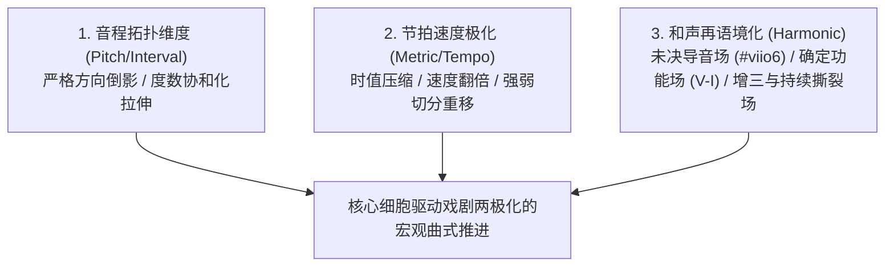

# 动机倒影

<p class="doc-subtitle">核心动机细胞如何通过倒影变形与和声再语境化驱动曲式推进？</p>

在传统音乐分析中，主题通常被假定为一个具有完整句法形态的乐句结构（如四小节的方整句或八小节的平行乐段）。然而，在维也纳古典乐派晚期至早期浪漫主义的创作实践中，最具戏剧张力的音乐篇章往往并非建立在冗长的旋律展示之上，而是由极度精炼的三到四个音构成的微观“核心细胞”（Germinal Cell）驱动。

作曲家通过对核心细胞施加**音程几何变换**（特别是严格方向倒影与度数协和化拉伸）、**节拍与速度极化**（时值压缩与速度翻倍），以及**和声再语境化**（从不稳定导音和弦到确定性功能主属，再到危机爆发的增三和弦与持续音摩擦），使同一个微观动机细胞在不同曲式位置迸发出截然相反的戏剧性格，从而主导宏观奏鸣结构的推进。

本文以贝多芬《F大调第16弦乐四重奏》Op. 135 第四乐章（“艰难的抉择”）的核心问答动机为实证轴心，严格结合原生乐谱源（Kern）与标准化和声标注（DCML），并引入舒伯特艺术歌曲《魔王》D. 328 中的持续音不协和摩擦进行互文对比，系统阐明核心细胞的衍生机制与变奏逻辑。

---

## 一、 贝多芬 Op. 135 第四乐章核心细胞的解构

贝多芬在 Op. 135 第四乐章总谱题头写下了著名的动机哲学问答：“Muss es sein?”（必须如此吗？）与“Es muss sein!”（必须如此！）。这两句对白在音乐学上绝非外在的文学修辞，而是高度纯粹的微观动机对位构成。

### 1. 原型疑问句：减四度内缩与导音和弦未决（mm. 1–4）

乐章在 3/2 拍的沉重步伐中展开（Grave ma non troppo tratto，二分音符 = 40）。

根据原生乐谱 `quartet16-4.krn`（mm. 1–4 Grave）的声部记录，问句动机首先由中提琴与大提琴在低音区齐奏呈示：

- **音级轨迹**：$G \to E \to A\flat$（在 f 小调中为第 2 级 $\to$ 升第 7 级导音 $\to$ 降第 6 级）。
- **音程矢量**：从 $G$ 下行小三度（-3 半音）至 $E$，再向上跳进减四度/增二度（+4 半音）至 $A\flat$。
- **声部与织体反应**：在这三个沉重音符奏毕后，第一小提琴在第 3 拍以 $fp$ 切入高音 $c''$，并在紧随其后的第 2 小节展开一条由平滑级进构成的叹息下行线（$c''-b\flat'-a\flat'-g'-f'$），形成低音痉挛与高音呻吟的对位呼应。

从和声角度审视，根据 DCML 和声标注表 `n16op135_04.harmonies.tsv`（m. 1）：
- 开篇第 1 小节的和弦被明确标注为 `#viio6` $\to$ `i6`。
- 这一标注揭示了关键的音乐实质：贝多芬完全打破了古典奏鸣乐章以主和弦奠定调性基础的惯例，直接以悬浮、紧张的**导音减和弦第一转位**切入。细胞内部的 $E$ 与 $A\flat$ 构成了减七和弦骨架，使整个疑问动机悬停在半空调性场中，赋予听觉强烈的动荡感与解决渴望。

```lilypond title="贝多芬 Op.135 第四乐章" location="Grave ma non troppo tratto，mm.1–4" id="beethoven-op135-iv-mm1-4"
\version "2.26.0"
\language "english"

global = {
  \key f \minor
  \time 3/2
  \tempo "Grave ma non troppo tratto" 2 = 40
  \set Score.currentBarNumber = #1
}

violinOne = {
  \global
  \clef treble
  r2 r2 c''2^\fp~ |                            % m.1
  c''8( bf'8 af'8 g'8 f'8 af'8 c''8 e''8 f''4) r4 |  % m.2
  r2 r2 f''2~ |                              % m.3
  f''8( ef''8 df''8 c''8 bf'8 df''8 f''8 a''8 bf''4) r4 |  % m.4
  \bar "|."
}

violinTwo = {
  \global
  \clef treble
  r1. |                                     % m.1
  r2 c''2~ c''8( bf'8 af'8 g'8) |            % m.2
  f'4 r4 r2 r2 |                            % m.3
  f'2~ f'8( ef'8 df'8 c'8 bf8 d'8 f'8 bf'8) |   % m.4
  \bar "|."
}

viola = {
  \global
  \clef alto
  g4. e8 af2 r2 |                           % m.1
  c'2~ c'8( bf8 af8 g8 f8 af8 c'8 f'8) |    % m.2
  c'4. a8 df'2 r2 |                         % m.3
  r2 f'2~ f'8 f'8( d'8 bf8) |               % m.4
  \bar "|."
}

cello = {
  \global
  \clef bass
  g,4. e,8 af,2 r2 |                        % m.1
  r1. |                                     % m.2
  c4. a,8 df2 r2 |                          % m.3
  r2 r2 af2 |                               % m.4
  \bar "|."
}

\score {
  \new StaffGroup <<
    \new Staff { \set Staff.midiInstrument = "violin" \violinOne }

    \new Staff { \set Staff.midiInstrument = "violin" \violinTwo }

    \new Staff { \set Staff.midiInstrument = "viola" \viola }

    \new Staff { \set Staff.midiInstrument = "cello" \cello }
  >>
  \layout { ragged-right = ##f }
  \midi { }
}
```

---

### 2. 倒影确证句：方向倒影、度数协和化与主属确证（mm. 12–16）

在引子末尾的弱音停顿后，音乐在第 12 小节末尾突然爆发出斩钉截铁的答句动机“Es muss sein!”，曲式直接跨入奏鸣主部（Allegro，二分音符 = 80，4/4 拍）。

根据原生乐谱 `quartet16-4.krn`（mm. 12–16 Allegro），这一解答动机由第一小提琴与第二小提琴以八度同音在弱起拍（第 4 拍）坚决奏出：

- **第一组动机（mm. 12–13）**：弱起 $A$ 向上跳进小三度至 $C$，再向下跳进纯四度回落至 $G$（$A \to C \to G$）。
- **第二组模进（mm. 14–15）**：弱起 $G$ 向上跳进小三度至 $B\flat$，再向下跳进纯四度回落至主音 $F$（$G \to B\flat \to F$）。
- **伴奏声部**：下方大提琴与中提琴完全摒弃了 Grave 的叹息织体，代之以充满机械冲击力的断音四分音符级进上行爬升（$C-E-G$ / $C-D-E\flat-E-F$）。（关于此处中提琴与大提琴在机器转写中常见的谱号耦合失真与八度漂移，详见[《八度歧义与演奏法》](../../notation/clef-octave-ambiguity-and-encoding-loss.md)）。

#### 音程几何与动力学的质变
将问句“Muss es sein?”与答句“Es muss sein!”进行微观音程比对，可以清晰还原贝多芬的变奏拓扑逻辑：
1. **严格的方向倒影（Directional Inversion）**：问句的音程方向是“先下后上”（下行小三度，上行减四度）；答句则完全颠倒为“先上后下”（上行小三度，下行纯四度）。
2. **度数协和化拉伸（Interval Expansion）**：问句后半段的 $+4$ 半音是极度不安、向内收缩的减四度；答句后半段的 $-5$ 半音则将其拉伸为开阔坚实、具有稳定调性谐振的**纯四度**，第二组模进更顺理成章地将落音锁定在主调主音 $F$ 上。
3. **节拍与速度极化（Metric Compression & Tempo Doubling）**：拍号从宽广滞涩的 3/2 拍（二分音符 = 40）压缩为 4/4 拍（二分音符 = 80），速度整整翻了一倍，动机时值由长音拖曳变为弱起短音冲刺，完成了从“绝望沉思”向“果敢决断”的性格跃迁。

#### 和声确证
在 DCML 和声标注表 `n16op135_04.harmonies.tsv`（mm. 13–16）中：
- mm. 13–14 标注为持续的属功能 `V` $\to$ `V6`；
- mm. 15–16 在大提琴冲向主音时被标注为明确的 `I`。
- 这一和声进程表明，答句动机的音程反转与属到主（$V \to I$）的强功能解决形成了完全共振。和声不再是开篇的悬浮导音，而是提供了无懈可击的功能支撑。

```lilypond title="贝多芬 Op.135 第四乐章" location="Allegro，mm.12–16" id="beethoven-op135-iv-mm12-16"
\version "2.26.0"
\language "english"

global = {
  \key f \minor
  \time 3/2
  \set Score.currentBarNumber = #12
}

violinOne = {
  \global
  \clef treble
  \tempo "Grave ma non troppo tratto" 2 = 40
  r2 c''8 c''8 c''4~ c''4 \tempo "Allegro" 2 = 80 a''4 |   % m.12 (3/2); a''4 = Allegro anacrusis
  \time 4/4 \key f \major
  c'''2 g''2 |                               % m.13 (A -> C -> G)
  r2 r4 g''4 |                               % m.14 (anacrusis G; 3 beats rest)
  bf''2 f''2 |                               % m.15 (G -> Bb -> F)
  r1 |                                       % m.16
  \bar "|."
}

violinTwo = {
  \global
  \clef treble
  r2 c'8 c'8 c'4~ c'4 a'4 |                  % m.12
  \time 4/4 \key f \major
  c''2 g'2 |                                 % m.13
  r2 r4 g'4 |                                % m.14 (3 beats rest)
  bf'2 f'2 |                                 % m.15
  r1 |                                       % m.16
  \bar "|."
}

viola = {
  \global
  \clef alto
  c8 c8 c4 r2 r4 r4 |                        % m.12
  \time 4/4 \key f \major
  r4 c4 e4 g4 |                              % m.13 (C–E–G)
  c'4 d'4 ef'4 e'4 |                         % m.14 (C–D–Eb–E)
  f'4 a'4 c''4 f'4 |                         % m.15 (F–A–C)
  f'4 f'4 f'4 a'4 |                          % m.16
  \bar "|."
}

cello = {
  \global
  \clef bass
  c,8 c,8 c,4 r2 r4 r4 |                     % m.12
  \time 4/4 \key f \major
  r4 c,4 e,4 g,4 |                           % m.13
  c4 d4 ef4 e4 |                             % m.14
  f4 a4 c'4 d'4 |                            % m.15
  ef'4 e'4 f'4 f'4 |                         % m.16
  \bar "|."
}

\score {
  \new StaffGroup <<
    \new Staff { \set Staff.midiInstrument = "violin" \violinOne }

    \new Staff { \set Staff.midiInstrument = "violin" \violinTwo }

    \new Staff { \set Staff.midiInstrument = "viola" \viola }

    \new Staff { \set Staff.midiInstrument = "cello" \cello }
  >>
  \layout { ragged-right = ##f }
  \midi { }
}
```

---

### 3. 极限语境化蜕变：十六分音符震音与增三和弦虚无（mm. 165–172）

在奏鸣曲式的展开部末尾、再现部爆发前夕，贝多芬做出了晚期风格中最具震撼力的语境重构。

根据原生乐谱 `quartet16-4.krn`（mm. 165–172），全曲在第 165 小节毫无防备地骤然刹车，拍号与速度再次变回 3/2 拍的 Grave ma non troppo tratto（二分音符 = 80）：

- **动机再现**：中提琴与大提琴再次齐奏出开篇的问句核心细胞 $G \to E \to A\flat$。
- **声学背景突变**：在开篇呈示部中，问句发生在空旷、静默的对位织体中；而在此处，上方第一小提琴与第二小提琴在极高音区以强奏（$f$）爆发出**连续不断的十六分音符震音（Tremolo）**，近乎疯狂地反复敲击 $c'''$ 与 $e''$。

#### 和声异化：从减七到增三
在 DCML 标注表 `n16op135_04.harmonies.tsv`（mm. 165–168）中，记录了一个极其罕见的和声突变：
- m. 165 标注为 `V64` $\to$ `V6` $\to$ `III+` $\to$ `III+6`，紧随其后为 `VI+7`。
- 此处的 `III+` 正是由低音问句落音 $A\flat$ 与高音震音中的持续音 $C$、$E$ 所共同构成的**增三和弦**（$A\flat - C - E$）。
- 在传统功能和声中，增三和弦由于其对称性与模糊性，具有极强的不稳定性。贝多芬在此处通过高音尖锐震音与增三和弦的碰撞，彻底剥夺了问句动机在呈示部的哲学哀伤，将其异化为面对命运崩溃时的惊悚与绝望。同一动机细胞在此完成了从“古典式疑问”向“浪漫式惊惧”的极限和声再语境化。

```lilypond title="贝多芬 Op.135 第四乐章" location="Grave ma non troppo tratto，mm.165–172" id="beethoven-op135-iv-mm165-172"
\version "2.26.0"
\language "english"

global = {
  \key f \minor
  \time 3/2
  \tempo "Grave ma non troppo tratto" 2 = 40
  \set Score.currentBarNumber = #165
}

violinOne = {
  \global
  \clef treble
  c'''2:16\ff c'''2:16 c'''2:16 |
  c'''2:16\> c'''2:16 c'''2:16 |
  c'''2:16\ff c'''2:16 c'''4..:16\! r16 |
  c'''2:16\> c'''2:16 bf''2:16 |
  bf''2:16\f bf''2:16 bf''2:16\> |
  <df'' bf''>2:16\f <df'' bf''>2:16 <df'' bf''>4 r4 |
  r2 <df'' bf''>2:16\f <df'' bf''>4 r4 |
  r2 <df'' bf''>2:16\f\> <df'' bf''>4\dim r4\! |
  \bar "||"
}

violinTwo = {
  \global
  \clef treble
  <c'' e''>2:16\ff <c'' e''>2:16 <c'' e''>2:16 |
  <c'' e''>2:16\> <c'' e''>2:16 <c'' f''>2:16 |
  <a' f''>2:16\ff <a' f''>2:16 <a' f''>2:16\! |
  <a' f''>2:16\> <a' f''>2:16 <bf' f''>2:16 |
  <df'' f''>2:16\f <df'' g''>2:16 <df'' g''>2:16\> |
  <e'' g''>2:16\f <e'' g''>2:16 <e'' g''>4 r4 |
  r2 <e'' g''>2:16\f <e'' g''>4 r4 |
  r2 <e'' g''>2:16\f\> <e'' g''>4\dim r4\! |
  \bar "||"
}

viola = {
  \global
  \clef alto
  g4.\ff e8-. af2~ <af c'>2 |
  <af c'>8( bf af g af c' f' g' af' f' c' af) |
  c'4.\ff a8-. df'2 r2 |
  r2 r2 ( df'8 f' bf' df'' ) |
  df'4.\f bf8-. e'2 r2 |
  df2:16\f df4 r4 r2 |
  df2:16\f c4 r4 r2 |
  c2:16\f\> c4\dim r4 r2\! |
  \bar "||"
}

cello = {
  \global
  \clef bass
  g,4.\ff e,8-. af,2 r2 |
  R1. |
  c4.\ff a,8-. df2 f2~\sf |
  f8( ef df c df f bf c' df'4) r4 |
  df4.\f bf,8-. e2 r2 |
  df,2:16\f df,4 r4 r2 |
  df,2:16\f c,4 r4 r2 |
  c,2:16\f\> c,4\dim r4 r2\! |
  \bar "||"
}

\score {
  \new StaffGroup <<
    \new Staff \with {
      midiInstrument = "violin"
      midiMinimumVolume = #0.2
      midiMaximumVolume = #0.9
    } { \violinOne }

    \new Staff \with {
      midiInstrument = "violin"
      midiMinimumVolume = #0.2
      midiMaximumVolume = #0.9
    } { \violinTwo }

    \new Staff \with {
      midiInstrument = "viola"
      midiMinimumVolume = #0.2
      midiMaximumVolume = #0.9
    } { \viola }

    \new Staff \with {
      midiInstrument = "cello"
      midiMinimumVolume = #0.2
      midiMaximumVolume = #0.9
    } { \cello }
  >>
  \layout { ragged-right = ##f }
  \midi { }
}
```

---

## 二、 互文透视：舒伯特《魔王》D. 328 中的持续音摩擦与细胞攀升

为了证明核心细胞再语境化不仅是器乐奏鸣曲的专属技巧，更在浪漫主义声乐戏剧中构成核心张力源，我们可以透视舒伯特 1815 年创作的艺术歌曲《魔王》D. 328。

### 1. 伴奏前奏的潜伏细胞（mm. 1–5）
在全曲开篇的快速三连音马蹄律动之下（4/4 拍，Schnell，四分音符 = 152），钢琴左手低音在第 2 小节与第 4 小节爆发出一组级进爬升与回落：
$$G \to A \to B\flat \to C \to D \to E\flat \to D$$
其顶点与回落的核心半音音程正是 $D \to E\flat \to D$（5 级 $\to$ 降 6 级 $\to$ 5 级）。这个包含小二度摩擦的半音细胞，构成了全曲悲剧力量的潜伏母题。

### 2. 持续音上的声部对撞（mm. 72–76）
在儿子第一次惊恐呼喊“Mein Vater, mein Vater, und hörest du nicht!”（mm. 72–76）时，舒伯特实施了极具现代性的声部对撞：
- **声乐旋律**：儿子惊恐的声音被固定在高音区降六级音 $E\flat 5$（ef''）；
- **钢琴伴奏右手**：八度三连音毫不留情地持续敲击主调属音 $D4/D5$（$<d' d''>$8）；
- **声学效果**：$E\flat$ 与 $D$ 形成了持续、无任何缓冲的**小二度/小九度尖锐碰撞**。
- **低音对位推进**：伴奏左手在低音声部以八度半音导向步进推进（$B\flat \to B \to C \to A \to F\sharp$），强行切入重属导七和弦（$\sharp iv^{\circ 7}$ / $vii^{\circ 7}/V$），但高音的 $E\flat$ 拒绝向下解决至属音 $D$，造成了无法调和的声部对峙（此类通过半音摩擦与声部导向撕裂和声的对位机制，亦深度贯穿于贝多芬晚期弦乐四重奏中，参见[《半音挂留》](../../composers/beethoven/quartets/chromatic-suspension-and-structural-topology.md)）。

更为精妙的是，在后续的情节发展中，舒伯特将这个包含持续音小二度摩擦的惊呼细胞，依次在 g 小调（$E\flat-D$）、a 小调（$F-E$）与 c 小调（$A\flat-G$）中**连续抬升调性台阶**。动机细胞的核心音程没有改变，但每一次和声重设与音高攀升，都将戏剧冲突推向更高维度的窒息感。

```lilypond title="舒伯特 D.328《魔王》钢琴前奏" location="Schnell，mm.1–5" id="schubert-d328-mm1-5"
\version "2.26.0"
\language "english"

global = {
  \key g \minor
  \time 4/4
  \tempo "Schnell" 4 = 152
}

pianoUpper = {
  \global
  \clef treble
  \tuplet 3/2 { <g g'>8[ <g g'> <g g'>] } \tuplet 3/2 { <g g'>8[ <g g'> <g g'>] }
  \tuplet 3/2 { <g g'>8[ <g g'> <g g'>] } \tuplet 3/2 { <g g'>8[ <g g'> <g g'>] } |   % m.1
  \tuplet 3/2 { <g g'>8[ <g g'> <g g'>] } \tuplet 3/2 { <g g'>8[ <g g'> <g g'>] }
  \tuplet 3/2 { <g g'>8[ <g g'> <g g'>] } \tuplet 3/2 { <g g'>8[ <g g'> <g g'>] } |   % m.2
  \tuplet 3/2 { <g g'>8[ <g g'> <g g'>] } \tuplet 3/2 { <g g'>8[ <g g'> <g g'>] }
  \tuplet 3/2 { <g g'>8[ <g g'> <g g'>] } \tuplet 3/2 { <g g'>8[ <g g'> <g g'>] } |   % m.3
  \tuplet 3/2 { <g g'>8[ <g g'> <g g'>] } \tuplet 3/2 { <g g'>8[ <g g'> <g g'>] }
  \tuplet 3/2 { <g g'>8[ <g g'> <g g'>] } \tuplet 3/2 { <g g'>8[ <g g'> <g g'>] } |   % m.4
  \tuplet 3/2 { <g g'>8[ <g g'> <g g'>] } \tuplet 3/2 { <g g'>8[ <g g'> <g g'>] }
  \tuplet 3/2 { <g g'>8[ <g g'> <g g'>] } \tuplet 3/2 { <g g'>8[ <g g'> <g g'>] } |   % m.5
  \bar "|."
}

pianoLower = {
  \global
  \clef bass
  R1 |                                                                  % m.1 (rest)
  \tuplet 3/2 { g,8( a,8 bf,8 } \tuplet 3/2 { c8 d8 ef8) } d4-. bf,4-. |  % m.2
  g,4-. r4 r2 |                                                        % m.3
  \tuplet 3/2 { g,8( a,8 bf,8 } \tuplet 3/2 { c8 d8 ef8) } d4-. bf,4-. |  % m.4
  g,4-. r4 r2 |                                                        % m.5
  \bar "|."
}

\score {
  \new PianoStaff <<
    \new Staff { \set Staff.midiInstrument = "acoustic grand" \pianoUpper }
    \new Staff { \set Staff.midiInstrument = "acoustic grand" \pianoLower }
  >>
  \layout { ragged-right = ##f }
  \midi { }
}
```

```lilypond title="舒伯特 D.328《魔王》" location="Schnell，mm.72–76" id="schubert-d328-mm72-76"
\version "2.26.0"
\language "english"

global = {
  \key g \minor
  \time 4/4
  \tempo "Schnell" 4 = 152
  \set Score.currentBarNumber = #72
}

voice = {
  \global
  \clef treble
  bf'2 r4^\f d''4 |                     % m.72 (f from 3rd beat per Mutopia dynamics layer)
  ef''2 ef''4. ef''8 |                  % m.73
  ef''8( d''8) d''4 r4 d''4 |           % m.74
  ef''2 ef''4. ef''8 |                  % m.75
  d''2 r4 a'4 |                         % m.76
  \bar "|."
}

pianoUpper = {
  \global
  \clef treble
  \tuplet 3/2 { <d f bf>8[ <d' d''> <d' d''>] } \tuplet 3/2 { <d' d''>8[ <d' d''> <d' d''>] }
  \f \tuplet 3/2 { <d' d''>8[ <d' d''> <d' d''>] } \tuplet 3/2 { <d' d''>8[ <d' d''> <d' d''>] } |   % m.72
  \tuplet 3/2 { <d' d''>8[ <d' d''> <d' d''>] } \tuplet 3/2 { <d' d''>8[ <d' d''> <d' d''>] }
  \tuplet 3/2 { <d' d''>8[ <d' d''> <d' d''>] } \tuplet 3/2 { <d' d''>8[ <d' d''> <d' d''>] } |   % m.73
  \tuplet 3/2 { <d' d''>8[ <d' d''> <d' d''>] } \tuplet 3/2 { <d' d''>8[ <d' d''> <d' d''>] }
  \tuplet 3/2 { <d' d''>8[ <d' d''> <d' d''>] } \tuplet 3/2 { <d' d''>8[ <d' d''> <d' d''>] } |   % m.74
  \tuplet 3/2 { <d' d''>8[ <d' d''> <d' d''>] } \tuplet 3/2 { <d' d''>8[ <d' d''> <d' d''>] }
  \tuplet 3/2 { <d' d''>8[ <d' d''> <d' d''>] } \tuplet 3/2 { <d' d''>8[ <d' d''> <d' d''>] } |   % m.75
  \tuplet 3/2 { <d' d''>8[ <d' d''> <d' d''>] } \tuplet 3/2 { <d' d''>8[ <d' d''> <d' d''>] }
  \p \tuplet 3/2 { <d' d''>8[ <d' d''> <d' d''>] } \tuplet 3/2 { <d' d''>8[ <d' d''> <d' d''>] } |   % m.76
  \bar "|."
}

pianoLower = {
  \global
  \clef bass
  <bf,, bf,>4 r2 <b, b>4 |             % m.72
  <c c'>2 <a, a>2 |                    % m.73
  <fs, fs>2 r4 <b, b>4 |               % m.74
  <c c'>2 <a, a>2 |                    % m.75
  <fs, fs>2 r4 fs4 |                  % m.76
  \bar "|."
}

\score {
  \new StaffGroup <<
    \new Staff { \set Staff.midiInstrument = "voice oohs" \voice }

    \new PianoStaff <<
      \new Staff { \set Staff.midiInstrument = "acoustic grand" \pianoUpper }
      \new Staff { \set Staff.midiInstrument = "acoustic grand" \pianoLower }
    >>
  >>
  \layout { ragged-right = ##f }
  \midi { }
}
```

---

## 三、 核心细胞变奏的三维拓扑矩阵

综合贝多芬 Op. 135 与舒伯特 D. 328 的实证分析，可以提炼出一套关于微观动机变奏与展开的**三维拓扑矩阵**（The 3D Variation Matrix）：



1. **音程拓扑维度**：
   - 方向倒影打破原动机的情感动量（如“下沉叹息”反转为“攀登呼告”）；
   - 音程拉伸将紧张的不协和音程（减四度、减七度）释放为开阔的纯音程（纯四度、纯五度），或反向将纯协和音程压缩为紧张的半音摩擦。
2. **节拍与速度维度**：
   - 节拍重音移位破坏原有的方整性，弱起冲刺赋予细胞前进驱动力；
   - 速度与时值的极化对比（如 3/2 Grave 到 4/4 Allegro）直接改变音符在时间轴上的信息密度。
3. **和声再语境化维度**：
   - 同一细胞依次历经**未决态**（导音减和弦）、**确证态**（主属正规进行）与**撕裂态**（增三和弦与持续音不协和摩擦），实现单薄线条所无法承载的结构深度。

---

## 四、 对现代音乐创作与生成式 Agent 的启示

对于当代严肃音乐创作以及面向音乐生成的 AI Agent（如基于 OpenViking 知识图谱驱动的作曲系统），核心细胞的变奏机制提供了极具操作价值的技术启示：

1. **规避“伪主题冗余”，恪守动机经济性（Motivic Economy）**：
   在构思大型管弦乐或室内乐作品时，切忌在开篇抛出大量无法互相派生的冗余旋律线条。一个仅包含两到三个音程关系的微观“细胞”，足以通过倒影与调式光影衍生出整部作品的全部素材。
2. **多维解耦与状态机控制（Decoupled Variation Pipeline）**：
   在自动化音乐生成架构中，不应将动机变奏视作单一的“音符扰动”，而应将其解耦为三个独立的控制参数管道：
   - 管道 A（音程拓扑转换）：执行逆行、倒影、模进与音程缩放；
   - 管道 B（节拍重采样）：调整细分律动（三连音 vs 均分音符）与重音拍位；
   - 管道 C（和声场投射）：将动机投射到不同的和声张力级（张力为 0 的主功能、张力为 1 的导音悬挂、张力极值的对称增减和弦）。
3. **审视标注数据的音乐实质**：
   计算音乐学与机器学习分析往往止步于表面的标签分类（如 DCML 标注中的 `#viio6` 或 `III+`）。人类作曲家与高阶创作 Agent 必须穿透标签表面，理解和弦为何在此处出现——它不是静态的垂直切片，而是为了配合核心细胞的戏剧变形所精心构建的声学生态。
