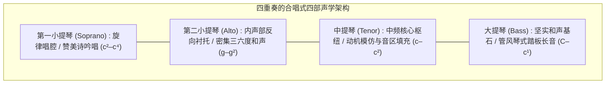

# 合唱式织体

<p class="doc-subtitle">弦乐四重奏如何在高度对位化的织体中吸纳合唱与管风琴式的多声部齐响与声部导向？</p>

在西方室内乐传统中，[弦乐四重奏](../../ensembles/string-quartet-acoustic-role-differentiation.md)自海顿与莫扎特以降，普遍被确立为四件均质乐器之间机智敏捷、分工鲜明的“谈话体”（Conversational Polyphony）。第一小提琴通常引领高音旋律，大提琴奠定低音跳进，内声部则承担穿针引线的伴奏织体或对位副旋律。然而，约翰内斯·勃拉姆斯（Johannes Brahms）在其历经近二十年严苛自我审视、直至 1873 年方正式面世的《C 小调第一弦乐四重奏》（Op. 51 No. 1）中，为弦乐四重奏注入了截然不同的音乐维度——**合唱式织体（Chorale-like Texture / Polyphonic Hymnody）**。

勃拉姆斯自青年时代起便深入研读并校订舒茨（Heinrich Schütz）、加布里埃利（Giovanni Gabrieli）、巴赫（J. S. Bach）等早期大师的复调声乐合唱与管风琴管栓对位文献。当他面对弦乐四重奏这一缺乏木管色彩反差、铜管持续声能与打击乐冲击力的纯弦乐媒介时，并未盲目移植管弦乐式的粗暴震音与双音轰鸣，而是将古老的多声部合唱（Chorale）与经文歌（Motet）构架内化于弦乐织体：四把提琴被分别赋予高音（Soprano）、中音（Alto）、次中音（Tenor）与低音（Bass）的人声歌唱属性，严格遵循横向[声部导向](../counterpoint/suspension-mechanics-and-voice-leading.md)（Stimmführung），依托密集和声排列、严谨平稳级进、下行挂留解耦以及管风琴式的持续低音（Pedal Point），在室内乐的有限物理空间中凝聚出重力般的交响厚度与宗教圣咏式的崇高感。

---

## 一、织体形态学：从提琴均质性到“合唱—管风琴”声学模型

四把提琴共享完全相同的摩擦发音物理原理：马毛弓与琴弦的粘滞-滑移摩擦驱动面板共振，产生富含全泛音列的均质音响。阿兰·贝尔金（Alan Belkin）在配器研究中指出，弦乐家族内部的自然交融赋予了织体无缝平滑的优势，但过度均质化极易诱发听觉上的“声部粘连”（Timbral Conflation）。勃拉姆斯在四重奏中并未试图刻意掩盖均质性，而是巧妙借用合唱队的四部齐鸣（SATB）与管风琴的脚踏低音体系，建立了多层次的织体网络：



### 1. 均质摩擦发音与管风琴式泛音强化

当四把弦乐器以相同的运弓压力与接触点同时发音时，封闭的室内声场会激发显著的交感共振（Sympathetic Resonance）。特别是当和弦构成音与空弦基音（小提琴的 G-D-A-E、中提琴与大提琴的 C-G-D-A）重合时，未按弦的空弦会发生被动共振，极大拓宽泛音谱系。

勃拉姆斯高度重视这一物理特质，在合唱式织体中频繁将四个声部收拢在紧密音区内。不同于古典时期以八度加倍为主的管弦乐思维，这里的四部和声完全依靠三和弦与七和弦的原位及转位紧凑排列，使四把提琴的泛音柱紧密咬合，产生如同教堂管风琴拉开主栓（Principal 8'）与混合音栓（Mixture）般的庄严音响。

### 2. 密集排列与严格声部导向

在古典四重奏中，第二小提琴常与第一小提琴相隔六度或八度，中提琴与大提琴则偏向低中音区，整体织体呈开离排列（Open Position）。而在合唱式织体中，勃拉姆斯强行推行**密集排列（Close Position）**：

- **声部音程控制**：上方三声部（第一小提琴、第二小提琴、中提琴）之间的纵向音程通常被严格限制在四度、三度乃至二度之内；
- **反向平稳进行**：为防止密集排列导致音响浑浊，声部之间严格采用反向进行（Contrary Motion）与斜向进行（Oblique Motion），彻底根绝平行五度与八度；
- **内声部的旋律化**：第二小提琴与中提琴不再是填充和声的死音，每一个音符都承担着平稳级进的歌唱功能，深契巴赫[合唱风格](../../composers/bach/chorale/cadential-voice-clock-and-phase-decoupling.md)的复调规范。

### 3. 合唱织体在奏鸣曲动力结构中的制动与锚定

在奏鸣曲式展开部或主部主题的飞速演进中，动机的高度分裂与调性的剧烈游移会产生巨大的离心力。此时，若继续使用琐碎的对位对话，乐曲极易滑向结构失控。

合唱式织体在此扮演了**结构制动器（Formal Decelerator）**与和声锚点的关键角色。当连续切分与十六分音符奔流骤然凝固为整齐划一的四部合唱长音时，听觉上的[和声节奏](../harmony/harmonic-rhythm-and-syntactic-pacing.md)被瞬间拉长，为戏剧性冲突确立了无可动摇的基石。

---

## 二、第一乐章实证：激荡动机中的合唱式和声锚定（mm. 1–60）

第一乐章为 $3/2$ 拍的 Allegro。在宏大的 C 小调奏鸣构架中，勃拉姆斯通过合唱织体与激荡动机的交替碰撞，展现了极致的结构张力。

### 1. 狂暴主部后的经文歌式祈祷段（mm. 11–18）

乐章开篇（mm. 1–10），第一小提琴由小字一组急剧跃升至小字二组（$c^1\text{–}d^1\text{–}e\flat^1\text{–}g^1\text{–}c^2\text{–}e\flat^2$），下方由大提琴突进的 $C$ 音低音脉冲与中提琴抽搐般的和弦衬托，情绪极端焦躁。而在第 10 小节全休止与属和弦制动后，第 11 小节织体骤然变异为沉静庄严的四部合唱经文歌：

```lilypond title="勃拉姆斯 弦乐四重奏 Op.51 No.1 第一乐章" location="Allegro，mm.11–18" id="brahms-op51no1-i-mm11-18"
\version "2.26.0"
\language "english"

% 勃拉姆斯 c 小调第一弦乐四重奏 Op.51 No.1 第一乐章，主部尾声的四部合唱经文歌。
% 据 OpenScore StringQuartets（CC0-1.0）MXL 核对后自编码摘录。

global = {
  \time 3/2
  \tempo "Allegro" 2 = 76
}

violinOne = {
  \global
  \clef treble
  \key c \minor
  f''2( df''2 c''2) |
  f''2~( \tuplet 3/2 { f''4 e''4 f''4 bf''4 f''4 df''4) } |
  f''2( df''2 c''2) |
  f''2~( \tuplet 3/2 { f''4 e''4 f''4 d'''4 b''4 f''4) } |
  e''1. |
  f''1. |
  e''1. |
  ef''1. |
}

violinTwo = {
  \global
  \clef treble
  \key c \minor
  r2\p f'4.( g'8 af'4. f'8) |
  df''2~( df''4 c''4 df''4 bf'4) |
  c''4 r4 f'4.( g'8 af'4. f'8) |
  d''2( cs''4 d''4 f''4 b'4) |
  c''2( af'2 g'2) |
  c''2~( \tuplet 3/2 { c''4 b'4 c''4 f''4 c''4 af'4) } |
  c''2( af'2 g'2) |
  c''2~( \tuplet 3/2 { c''4 b'4 c''4 a''4 ef''4 c''4) } |
}

viola = {
  \global
  \clef alto
  \key c \minor
  f4.( g8 af2 f4) r4 |
  bf4.( df'8 f'2 f4) r4 |
  f4.( g8 af2 f4) r4 |
  b4.( d'8 g'2 g4) r4 |
  g4.( b8 c'2) r2 |
  r2 af2( c'2) |
  g4.( b8 c'2) r2 |
  r2 a2( c'2) |
}

cello = {
  \global
  \clef bass
  \key c \minor
  af,1. |
  bf,1. |
  af,1. |
  g,1. |
  g,2~( g,4. b,8 c2) |
  af,4.( c8 f2 af,4) r4 |
  g,2~( g,4. b,8 c2) |
  fs,4.( b,8 c2 fs,4) r4 |
}

\score {
  \new StaffGroup <<
    \new Staff { \set Staff.midiInstrument = "violin" \violinOne }
    \new Staff { \set Staff.midiInstrument = "violin" \violinTwo }
    \new Staff { \set Staff.midiInstrument = "viola" \viola }
    \new Staff { \set Staff.midiInstrument = "cello" \cello }
  >>
  \layout { ragged-right = ##f }
  \midi { }
}
```

分析其内部细微的声部编排，展现出精妙的对位构架：
- **第一小提琴（Soprano）**：承担定旋律（Cantus）般的长气息吟唱。在 mm. 11–13 奏出宽广平稳的下行级进（$f^2\text{–}d\flat^2\text{–}c^2$），随后在 mm. 15–18 连续以长达整小节的全音符系留（$e^2, f^2, e^2, e\flat^2$），如同合唱队中高悬的持续长音；
- **大提琴（Bass）**：以沉稳的大全音符构筑低音基座，稳固锚定在 $A\flat_2$（m. 11, 13）与属音 $G_2$（m. 14），并在 mm. 15–18 以平缓的低音线条（$G_2\text{–}B_2\text{–}C_3$）支撑调性转折；
- **第二小提琴与中提琴（Alto & Tenor）**：在内外声部之间交织出细腻的模进对位。中提琴在第 11 小节唱出柔和的拱形旋律（$f\text{–}g\text{–}a\flat\text{–}f$），第二小提琴以八分音符形成轻柔的错位呼应。

从和声级数演化观察，该段呈现了极其典型的巴洛克经文歌阻碍终止与偏离处理：
- 第 11 小节：以 $iv^6$（低音 $A\flat_2$ 上的 F 小调第一转位）柔和切入，避开了主和弦的强力敲击，代之以下属功能的平缓缓冲；
- 第 12–14 小节：通过第二小提琴与中提琴的半音滑移，和弦依次流经副属和弦与属功能复合体，大提琴在第 14 小节牢牢锚定在低音属音 $G_2$；
- 第 15–18 小节：主音 $C$ 上的平静交替并不急于完成封闭终止，而是借由第一小提琴全音符系留（$e^2\text{–}f^2\text{–}e^2\text{–}e\flat^2$）制造典型的 $4-3$ 与 $7-6$ 挂留，在调性交替中平稳引入向关系大调（降 E 大调）的转折潜流。

这种古老的经文歌织体不仅化解了开篇前 10 小节积累的巨大动力惯性，更在听觉上拉开了一个深邃的纵深空间，实现了典型的[音响平面分层](planes-of-tone-layering.md)。

### 2. 过渡段的动机裂变与和声聚拢（mm. 21–34）

紧随合唱祈祷段之后，织体在第 21 小节重新分裂。大提琴与第一小提琴交替以减七和弦琶音碎片向上试探，但在第 27–30 小节通向副题的关键过渡区，四件乐器再次聚拢为四部半音化齐响。

中提琴与第二小提琴在小字一组严密锁定内声部三度，大提琴以八度低音下潜（$E\flat_2\text{–}G\flat_2\text{–}B\flat_2$），有力支撑了第一小提琴从小字二组向小字三组高位（$e\flat^3\text{–}g\flat^3$）的攀爬，为副题的展开构筑起极具弹性的和声跳板。

### 3. 副部音响层：管风琴踏板与高音重奏（mm. 35–42）

进入呈示部副题区（降 E 小调 / 降 E 大调），合唱思维进一步与器乐重奏技术深度融合：

```lilypond title="勃拉姆斯 弦乐四重奏 Op.51 No.1 第一乐章" location="Allegro，mm.35–42" id="brahms-op51no1-i-mm35-42"
\version "2.26.0"
\language "english"

% 勃拉姆斯 Op.51 No.1 第一乐章，降 E 小调副部：中提琴脉冲踏板与四部密集和声。
% 据 OpenScore StringQuartets（CC0-1.0）MXL 核对后自编码摘录。

global = {
  \time 3/2
  \tempo "Allegro" 2 = 76
}

violinOne = {
  \global
  \clef treble
  \key c \minor
  r8 d''8 d''8 ef''8 f''2~( f''8 gf''8) gf''8 f''8 |
  r8 ef''8 ef''8 f''8 gf''2~( gf''8 bf''8) bf''8 af''8 |
  r4 gf''4( bf''4 ef'''4 df'''4 gf'''4) |
  f'''4( ef'''4 df'''4 ef'''4 df'''4 cf'''4) |
  bf''4( gf''4) ef''4( cf''4) bf''4( gf''4) |
  ef''4( cf''4) bf''4( f''4) ef''4( c''4) |
  bf'8( af'8) af'8\staccato d''8\staccato d''8\staccato cf''8\staccato cf''8\staccato f''8\staccato f''8\staccato d''8\staccato d''8\staccato af''8\staccato |
  af''8\staccato d''8\staccato d''8\staccato gf''8\staccato gf''8\staccato ef''8\staccato ef''8\staccato bf''8\staccato bf''8\staccato gf''8\staccato gf''8\staccato ef'''8\staccato |
}

violinTwo = {
  \global
  \clef treble
  \key c \minor
  r8 f'8 f'8 gf'8 af'2~( af'8 bf'8) bf'8 af'8 |
  r8 gf'8 gf'8 af'8 bf'2~( bf'8 gf'8) gf'8 f'8 |
  r4 ef'2( bf'4 gf''4 bf''4) |
  af''4( gf''4 f''4 gf''4 f''4 ef''4) |
  df''4( bf'4) gf'4( ef'4) df''4( bf'4) |
  gf'4( ef'4) df''4( bf'4) a'4( ef'4) |
  d'4 d'4(\staccato r4 d'4\staccato r4 d'4)\staccato |
  r4 gf'4(\staccato r4 ef'4\staccato r4 ef'4)\staccato |
}

viola = {
  \global
  \clef alto
  \key c \minor
  bf8\staccato bf'8\staccato bf'8\staccato bf8\staccato bf8\staccato bf'8\staccato bf'8\staccato bf8\staccato bf8\staccato bf'8\staccato bf'8\staccato bf8\staccato |
  bf8\staccato bf'8\staccato bf'8\staccato bf8\staccato bf8\staccato bf'8\staccato bf'8\staccato bf8\staccato bf8\staccato bf'8\staccato bf'8\staccato bf8\staccato |
  gf'8\staccato bf'8\staccato bf'8\staccato gf'8\staccato ef'8\staccato gf'8\staccato gf'8\staccato ef'8\staccato gf'8\staccato df'8\staccato df'8\staccato gf'8\staccato |
  af8\staccato af'8\staccato af'8\staccato af8\staccato af8\staccato af'8\staccato af'8\staccato af8\staccato af8\staccato af'8\staccato af'8\staccato af8\staccato |
  gf'8\staccato gf8\staccato gf8\staccato gf'8\staccato gf'8\staccato gf8\staccato gf8\staccato gf'8\staccato gf'8\staccato gf8\staccato gf8\staccato gf'8\staccato |
  gf'8\staccato gf8\staccato gf8\staccato gf'8\staccato f'8\staccato f8\staccato f8\staccato f'8\staccato f'8\staccato f8\staccato f8\staccato f'8\staccato |
  bf4 f'4(\staccato r4 f'4\staccato r4 cf''4)\staccato |
  r4 bf'4(\staccato r4 bf'4\staccato r4 gf'4)\staccato |
}

cello = {
  \global
  \clef bass
  \key c \minor
  bf'1( d'2) |
  bf'2( c'2 d'2) |
  ef'2 gf2 bf2 |
  df2 f2 af,2 |
  bf,2 cf2 df2 |
  ef2 f2 f,2 |
  bf,4( cf'4)(\staccato r4 af4\staccato r4 f4)\staccato |
  r4 bf4(\staccato r4 gf4\staccato r4 ef4)\staccato |
}

\score {
  \new StaffGroup <<
    \new Staff { \set Staff.midiInstrument = "violin" \violinOne }
    \new Staff { \set Staff.midiInstrument = "violin" \violinTwo }
    \new Staff { \set Staff.midiInstrument = "viola" \viola }
    \new Staff { \set Staff.midiInstrument = "cello" \cello }
  >>
  \layout { ragged-right = ##f }
  \midi { }
}
```

- **中提琴作为“管风琴音栓”**：在 mm. 35–36 中，中提琴在 $B\flat$ 与 $b\flat$ 之间持续演奏八分音符的八度跳跃震颤，宛如管风琴轻柔的 8 尺与 4 尺音栓共振；
- **大提琴高音区歌唱**：大提琴破例脱离低音声部，上升至小字一组次中音区（$b\flat\text{–}d^1$），以悠长歌唱性与小提琴形成对位；
- **两把小提琴的平行三六度**：第一与第二小提琴并肩运行（$d^2\text{–}e\flat^2\text{–}f^2\text{–}g\flat^2$ 与 $f^1\text{–}g\flat^1\text{–}a\flat^1\text{–}b\flat^1$），随后在 mm. 37–40 汇聚为四部严谨的半音化和声块（降 E 小调至降 D 大调、降 C 大调），如同教堂赞美诗般纯净而致密。

### 4. 呈示部结束群的全奏管风琴式齐鸣（mm. 53–60）

在呈示部终结处（mm. 53–60），四件乐器全员发力，将合唱织体推向巅峰。大提琴演奏极低八度双音（$A\flat_1\text{–}A\flat_2$），中提琴与第二小提琴以双音织密中频，第一小提琴在高音区呼啸，形成如同全管风琴（Tutti Organ）般的轰鸣巨响。

在 mm. 58–60 的连续下行终止中，四件乐器以整齐划一的附点节奏级进下行，四条旋律线在严格的反向与斜向对位中归于平息，展现出早期威尼斯乐派复合唱（Cori Spezzati）在室内乐中的绝妙投射。

---

## 三、终曲乐章实证：赞美诗起句与交织圣咏（mm. 1–80）

第四乐章（Allegro, $2/2$ 拍）展现了合唱织体在动力终曲中的统御力与神圣感。

### 1. 严峻的同度圣咏起句与四部和声块（mm. 1–12）

终曲的开头毫无华丽的引子，直接展现为一段严峻、甚至带有苦修色彩的圣咏式起句：

```lilypond title="勃拉姆斯 弦乐四重奏 Op.51 No.1 第四乐章" location="Allegro，mm.1–12" id="brahms-op51no1-iv-mm1-12"
\version "2.26.0"
\language "english"

% 勃拉姆斯 Op.51 No.1 第四乐章，四部同度圣咏起句与紧凑和声对位。
% 据 OpenScore StringQuartets（CC0-1.0）MXL 核对后自编码摘录；
% 该 MXL 第三、四乐章连续编号，此处 mm.1–12 对应源文件印刷小节号 145–156。

global = {
  \time 2/2
  \tempo "Allegro" 2 = 92
}

violinOne = {
  \global
  \clef treble
  \key c \minor
  f'''4.( g'''8) g'''4.( af'''8) |
  af'''4( b''4) r4 c''4( |
  af'2) g'8( d''8) d''8( f''8) |
  c''2 b'8( d''8) d''8( b''8) |
  b''2 c'''4( g''4 |
  f''4 ef''4) cs''4( g''4) |
  fs''8( cs''8) cs''8( d''8) d''2~ |
  d''8( cs''8) cs''8( d''8) d''2~ |
  d''8( e''8) e''8( f''8) f''2~ |
  f''8( e''8) e''8( f''8) f''2~ |
  f''8( e''8) e''8( f''8) f''8( e''8) e''8( f''8) |
  f''8( g''8) g''8( af''8) af''8( c'''8) c'''8( f'''8) |
}

violinTwo = {
  \global
  \clef treble
  \key c \minor
  f''4.( g''8) g''4.( af''8) |
  af''4( b'4) r2 |
  r4 c'4( d'2) |
  r4 f'4( d'2) |
  r4 d''4( g'2) |
  r4 c''4( g'2) |
  a'4\staccato r4 r4 fs'4\staccato |
  g'4\staccato r4 r4 g'4\staccato |
  <d' a'>4\staccato r4 r4 <d' a'>4\staccato |
  <d' b'>4\staccato r4 r4 b'4\staccato |
  c''4.( b'8) b'4.( c''8) |
  c''4 r4 r2 |
}

viola = {
  \global
  \clef alto
  \key c \minor
  f'4.( g'8) g'4.( af'8) |
  af'4( b4) r2 |
  c8( ef8) ef8( af8) d8( g8) g8( d'8) |
  f8( af8) af8( c'8) g8( b8) b8( d'8) |
  g8( d'8) d'8( g'8) g8( c'8) c'8( g'8) |
  g8( c'8) c'8( ef'8) ef8( g8) g8( cs'8) |
  d'4\staccato r4 r4 a4\staccato |
  bf4\staccato r4 r4 <bf d'>4\staccato |
  <a f'>4\staccato r4 r4 f'4\staccato |
  g'4\staccato r4 r4 d'4\staccato |
  f'4.( g'8) g'4.( af'8) |
  af'4 r4 r2 |
}

cello = {
  \global
  \clef bass
  \key c \minor
  f'4.( g'8) g'4.( af'8) |
  af'4( b4) r2 |
  c2 b,2 |
  af,2 g,2 |
  f,2 ef,2 |
  c,2 ef,2 |
  d,4\staccato r4 r4 d,4\staccato |
  g,4\staccato r4 r4 g,4\staccato |
  d4\staccato r4 r4 d4\staccato |
  g4\staccato r4 r4 g4\staccato |
  af4.( g8) g4.( f8) |
  f4 r4 r2 |
}

\score {
  \new StaffGroup <<
    \new Staff { \set Staff.midiInstrument = "violin" \violinOne }
    \new Staff { \set Staff.midiInstrument = "violin" \violinTwo }
    \new Staff { \set Staff.midiInstrument = "viola" \viola }
    \new Staff { \set Staff.midiInstrument = "cello" \cello }
  >>
  \layout { ragged-right = ##f }
  \midi { }
}
```

- **同度圣咏起句（mm. 1–2）**：全曲第一小节以四度跨越的齐奏同音起动：四件乐器以三跨八度绝对齐奏（Violin I 在小字三组 $f^3\text{–}g^3\text{–}g^3\text{–}a\flat^3$，Violin II 在小字二组，Viola 与 Cello 在小字一组）轰然敲响附点切分动机，宛如早期教会圣咏的会众齐唱式引导句（Intonation）；
- **主调合唱块落地（mm. 3–6）**：齐奏宣叙之后，乐曲立刻转入严格的四部合唱和声：第一小提琴唱出下行叹息二度（$a\flat^1\text{–}g^1, c^2\text{–}b^1$），大提琴以严谨的阶梯下行低音相对应（$C\text{–}B_1, A\flat_1\text{–}G_1, F_1\text{–}E\flat_1$），内声部以密集的八分音符音阶流动填补空隙；
- **四部同向收拢（mm. 11–12）**：在第一分句尾端，四部乐器完全舍弃装饰性外音，化作最质朴纯粹的四声部主调柱式行进（Violin I: $f^2\text{–}e^2\text{–}f^2$；Violin II: $c^2\text{–}b^1\text{–}c^2$；Viola: $f^1\text{–}g^1\text{–}a\flat^1$；Cello: $a\flat\text{–}g\text{–}f$），以清晰的反向进行构成坚不可摧的调性闭锁。

### 2. 展开性动力重奏与对位演进（mm. 13–32）

紧接主部合唱陈述之后，主调和声块迅速解离为密集的赋格化展开。在 mm. 13–20 中，第一小提琴的高音圣咏动机被第二小提琴与中提琴以八度倒影与下行级进接过。

四件乐器在十六分音符琶音与四分音符和声骨架之间高速穿梭，合唱织体的内在声部导向此时转化为复调织体的骨架支撑，确保了高速运动中的和声清澈度。

### 3. 低音踏板上的无词歌圣咏（mm. 33–50）

进入副题发展区域，织体再次放缓：
- 大提琴在第 33 小节稳固扎根于大字一组的极低音 $C_1$ 踏板音，长达数小节不作移动；
- 第二小提琴与中提琴以质朴的三度和声缓缓起步（$c^1\text{–}a\flat, b\flat\text{–}g$），第一小提琴随后在上方两小节后以卡农模仿切入；
- 这种在超低空踏板音上展开的弱奏无词歌合唱，使弦乐四重奏呈现出巴赫管风琴慢板前奏曲般的宁静冥想。

### 4. 持续属音上的圣咏合唱与悲壮叹息（mm. 71–80）

在展开与过渡的激烈交织后，第 71–80 小节进入了全乐章最具合唱崇高感的时刻：

```lilypond title="勃拉姆斯 弦乐四重奏 Op.51 No.1 第四乐章" location="Allegro，mm.71–80" id="brahms-op51no1-iv-mm71-80"
\version "2.26.0"
\language "english"

% 勃拉姆斯 Op.51 No.1 第四乐章，大提琴属踏板音上方的三声部圣咏合唱。
% 据 OpenScore StringQuartets（CC0-1.0）MXL 核对后自编码摘录；
% 此处 mm.71–80 对应源文件印刷小节号 215–224。

global = {
  \time 2/2
  \tempo "Allegro" 2 = 92
}

violinOne = {
  \global
  \clef treble
  \key c \minor
  f'4. g'8 g'4.( af'8) |
  af'2( f'4) r8 f'8 |
  bf'2( e'4) r8 e'8 |
  af'4( g'4 d'4 ef'4) |
  e'2( f'4) bf4( |
  af'4 f'4 cs'4 d'4) |
  d''4( bf'4 e'4 f'4) |
  ef''4( d''4 c''4 bf'4~) |
  bf'4 af'2 g'4~ |
  g'4 f'2 f'4 |
}

violinTwo = {
  \global
  \clef treble
  \key c \minor
  d'2 d'2 |
  d'2. r8 d'8 |
  df'2. r8 df'8 |
  c'2 cf'4( bf4) |
  cs'2( d'4) r4 |
  d'2( f'2~ |
  f'2 bf'2~) |
  bf'4 ef'2( g'4) |
  f'2( e'2 |
  c'2 ef'2) |
}

viola = {
  \global
  \clef alto
  \key c \minor
  af4.( g8) g4.( f8) |
  f2( af4) r8 af8 |
  g2( bf4) r8 bf8 |
  f4( af2 g4) |
  gf2( f4) r4 |
  bf4 bf2 bf4~ |
  bf4 d'2 bf4~ |
  bf4 bf2( df'4) |
  c'2 bf2 |
  c'2 c'2 |
}

cello = {
  \global
  \clef bass
  \key c \minor
  r4\p bf,2 bf,4~ |
  bf,4 bf,2 bf,4~ |
  bf,4 bf,2 bf,4~ |
  bf,4 bf,2 bf,4~ |
  bf,4 bf,2 bf,4~ |
  bf,4 bf,2 bf,4( |
  af,4) af,2 af,4( |
  g,4) g,2 e,4 |
  f,2 g,2 |
  af,2 a,2 |
}

\score {
  \new StaffGroup <<
    \new Staff { \set Staff.midiInstrument = "violin" \violinOne }
    \new Staff { \set Staff.midiInstrument = "violin" \violinTwo }
    \new Staff { \set Staff.midiInstrument = "viola" \viola }
    \new Staff { \set Staff.midiInstrument = "cello" \cello }
  >>
  \layout { ragged-right = ##f }
  \midi { }
}
```

- **踏板低音的定海神针**：大提琴在小字大组 $B\flat_1$ 上持续保持震颤重音脉冲（mm. 71–76），扮演管风琴脚踏键盘（Pedal Bass）的宏大基底；
- **上三声部的三位一体圣咏**：悬浮在持续低音之上的三件弦乐器，形成了一首无词的弦乐圣咏。第一小提琴重现起句的附点圣咏动机（$f^1\text{–}g^1\text{–}g^1\text{–}a\flat^1$），第二小提琴与中提琴以严格的二分音符长音与反向级进予以和声填充；
- **半音化挂留与最终叹息（mm. 77–80）**：随着低音逐渐脱离踏板下潜至 $G_1\text{–}E_1\text{–}F_1$，上方声部展开了一系列沉重下沉的连续和声解决（Violin I 从 $e\flat^2\text{–}d^2\text{–}c^2\text{–}b\flat^1$ 叹息下行至 $b\flat^1\text{–}a\flat^1\text{–}g^1\text{–}f^1$），其内部和声牵引与古典[挂留音机制](../counterpoint/suspension-mechanics-and-voice-leading.md)完全同构，将乐段推向沉静而极具张力的结构高潮。

该处和声进程生动展现了古典和声骨架与浪漫主义半音色彩的完美融合：
- 第 71–73 小节：在低音持续 $B\flat$（关系大调属音）的巨大重力牵引下，上方声部以质朴的三和弦第一转位构建神圣宁静的祈祷氛围；
- 第 74–76 小节：半音化叹息动机介入，内声部出现 $C\flat$ 与 $D\flat$ 的交错下行，调性在降 E 小调与降 B 小调之间摇曳，张力随切分节奏不断蓄积；
- 第 77–80 小节：大提琴毅然脱离持续音下潜，全曲以那不勒斯六和弦（$\flat\text{II}^6$）色彩与变音属七和弦交叠，在第 80 小节以最纯粹的下行叹息完成收束，为展开部的暴烈重现做好了绝佳的心理能量压抑。

---

## 四、技法启示：弦乐四重奏的多声部密实化法则

勃拉姆斯在 Op. 51 No. 1 中展现的合唱式织体，不仅是一种历史主义风格的致敬，更为当代弦乐室内乐写作提供了极为实用的技法指南：

1. **密集排列与开放排列的动态张力**：室内乐常因过度追求各个声部的宽阔开离而显得单薄苍白。勃拉姆斯证明，适时将四个声部紧密压缩在两个八度以内（如第一小提琴与大提琴音程控制在十度到十五度之内），能极大强化弦乐声场的声学凝聚力与和声冲击力。在特定高潮节点，结合双音（Double-stops）使四件乐器呈现六至八个声部的丰满共鸣，能激发出管弦乐般的宏大音响。

2. **用“横向声部自主”抵抗“纵向同质泥泞”**：打破弦乐均质粘连的最高境界，不是刻意使用异质弓法，而是确保每一个内声部都具备如同合唱歌手般可独立演唱的横向旋律线条。当听者的耳朵能在密实和声中捕捉到中提琴与第二小提琴的优雅起伏时，整体声场便获得了深沉的通透感与层次美。

3. **低音功能的分离与角色置换**：大提琴不必时刻充当唯一的低音柱石。通过将其暂时解放为高音歌唱声部，将低音支柱移交给中提琴乃至第二小提琴的低弦，或将大提琴固定为管风琴式的长音踏板，能够打破传统主调伴奏的机械单调，为弦乐四重奏赋予浩瀚的多维声学纵深。

4. **节拍重音与声部时钟的交错对位**：合唱式织体并不意味着节奏呆滞。通过在平稳和声块中嵌入跨小节切分、三对二赫米奥拉（Hemiola）以及声部间的先后呼吸停顿，能够在保持崇高圣咏庄严性的同时，赋予室内乐绵延不绝的生命律动。

5. **音栓化多层声场调度（Stop-like Orchestration）**：在纯弦乐四重奏中，可以将不同乐器在特定音区的组合视同管风琴的不同音栓组合。例如“两把小提琴低音区三度＋中提琴高八度”能模拟出柔和的木质音管质感，而“大提琴泛音＋中提琴空弦＋小提琴极高音”则能模拟出辽远的天使音栓（Vox Angelica），极大拓展了四重奏的音色调色盘。

6. **调性锚定与声部相位解耦**：当外部调性剧烈震荡时，合唱织体通过内部声部的先后错动（Phase Decoupling），使终止式的期待感被层层延长，既保持了古典逻辑的严密，又赋予了浪漫主义晚期的无尽旋律感。
