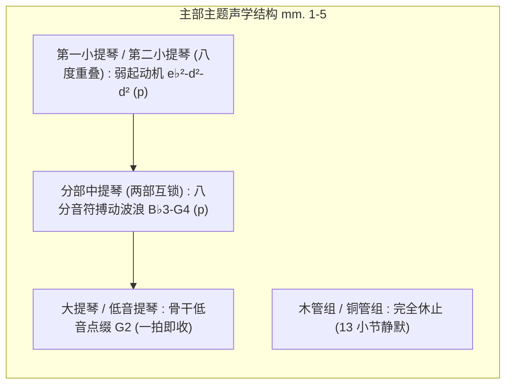
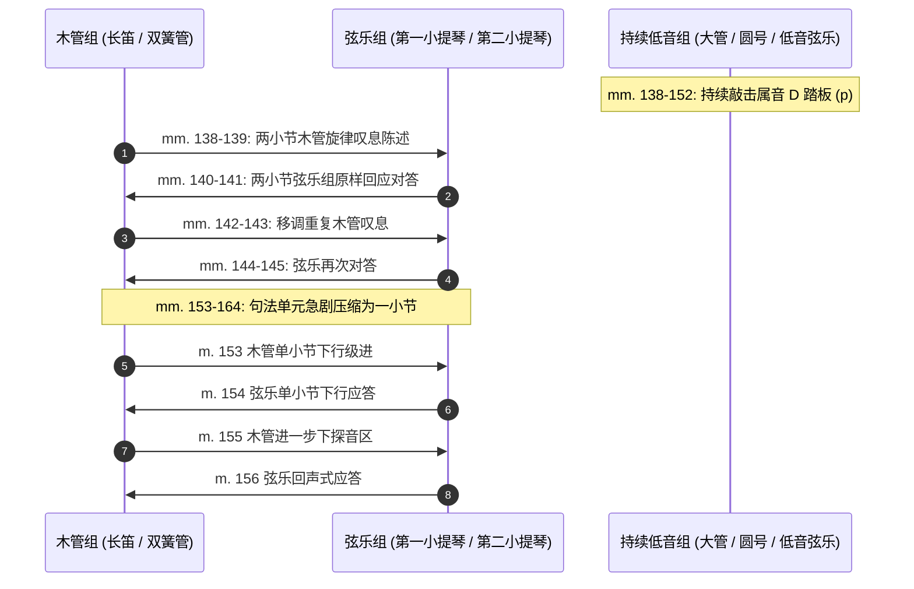

# 句法与配器

<p class="doc-subtitle">莫扎特 K.550 的句法与配器</p>

沃尔夫冈·阿马德乌斯·莫扎特于 1788 年夏创作的《G 小调第四十交响曲》（K.550），是古典主义晚期交响文献中句法凝练与配器戏剧化的巅峰代表。在第一乐章极快板（Molto allegro）中，莫扎特摒弃了 18 世纪交响乐开篇惯用的庄严慢板引子与全奏号角式强奏（Tutti），直接切入充满不安律动的室内乐化音响空间。

本乐章的第一版本编制精炼而紧凑：单簧管尚未加入，仅由一支长笛、双簧管两支、大管两支、两支不同定调的自然圆号（分别定调于降 B alto 与 G），以及弦乐五部（分为两部的小提琴、分部中提琴、大提琴与低音提琴）构成。莫扎特并未将管弦乐队视为单一的和声扩音器，而是让乐器的音色、音区与起奏时机深度参与到[乐句扩展](../structure/phrase-expansion-and-structural-skeleton.md)与奏鸣曲式的结构铰接之中。

---

## 一、伴奏先行与动机延宕：主部主题的音响剥离

古典主义经典主题通常以旋律与低音同步起奏确立拍点与调性，但 K.550 第一乐章打破了这一常态。莫扎特在主部主题开端构建了极具张力的“伴奏先行”音响层。

```lilypond title="莫扎特 第40交响曲 K.550 第一乐章" location="Molto allegro，mm.1–14" id="mozart-k550-i-mm1-14"
\version "2.26.0"
\language "english"

% 莫扎特 g 小调第 40 交响曲 K.550 第一乐章，主部主题（弦乐）的陈述—延续—终止句法。
% 据 OpenScore 转写体核对后自编码摘录；该底本许可待确认，仅作学术引用。

global = {
  \time 2/2
  \tempo "Molto allegro" 2 = 88
}

violinOne = {
  \global
  \clef treble
  \key bf \major
  r2 r4\p ef''8( d''8) |
  d''4 ef''8( d''8) d''4 ef''8( d''8) |
  d''4( bf''4) r4 bf''8( a''8) |
  g''4 g''8( f''8) ef''4 ef''8( d''8) |
  c''4 c''4 r4 d''8( c''8) |
  c''4 d''8( c''8) c''4 d''8( c''8) |
  c''4( a''4) r4 a''8( g''8) |
  fs''4 fs''8( ef''8) d''4 d''8( c''8) |
  bf'4 bf'4 r4 bf''8( a''8) |
  a''4( c'''4 fs''4 a''4) |
  g''4( d''4) r4 bf''8( a''8) |
  a''4( c'''4 fs''4 a''4) |
  g''4( bf''4 a''8 g''8 f''8 ef''8) |
  d''1 |
}

violinTwo = {
  \global
  \clef treble
  \key bf \major
  r2 r4\p ef'8( d'8) |
  d'4 ef'8( d'8) d'4 ef'8( d'8) |
  d'4( bf'4) r4 bf'8( a'8) |
  g'4 g'8( f'8) ef'4 ef'8( d'8) |
  c'4 c'4 r4 d'8( c'8) |
  c'4 d'8( c'8) c'4 d'8( c'8) |
  c'4( a'4) r4 a'8( g'8) |
  fs'4 fs'8( ef'8) d'4 d'8( c'8) |
  bf4 bf4 r4 bf'8( a'8) |
  a'4( c''4 fs'4 a'4) |
  g'4( d'4) r4 bf'8( a'8) |
  a'4( c''4 fs'4 a'4) |
  g'4( bf'4 a'8 g'8 f'8 ef'8) |
  d'1 |
}

viola = {
  \global
  \clef alto
  \key bf \major
  <g bf>8 <g bf>8 <bf g'>8 <bf g'>8 <g bf>8 <g bf>8 <bf g'>8 <bf g'>8 |
  <g bf>8 <g bf>8 <bf g'>8 <bf g'>8 <g bf>8 <g bf>8 <bf g'>8 <bf g'>8 |
  <g bf>8 <g bf>8 <d' g'>8 <d' g'>8 <g bf>8 <g bf>8 <d' g'>8 <d' g'>8 |
  <g bf>8 <g bf>8 <bf d'>8 <bf d'>8 <g bf>8 <g bf>8 <bf g'>8 <bf g'>8 |
  <a ef'>8 <a ef'>8 <ef' a'>8 <ef' a'>8 <a ef'>8 <a ef'>8 <ef' a'>8 <ef' a'>8 |
  <a ef'>8 <a ef'>8 <ef' a'>8 <ef' a'>8 <a ef'>8 <a ef'>8 <ef' a'>8 <ef' a'>8 |
  <a d'>8 <a d'>8 <d' c''>8 <d' c''>8 <a d'>8 <a d'>8 <d' c''>8 <d' c''>8 |
  <a c'>8 <a c'>8 <c' a'>8 <c' a'>8 <a fs'>8 <a fs'>8 <fs' a'>8 <fs' a'>8 |
  <g d'>8 <g d'>8 <d' g'>8 <d' g'>8 <g d'>8 <g d'>8 <d' g'>8 <d' g'>8 |
  <a ef'>8 <a ef'>8 <ef' fs'>8 <ef' fs'>8 <a ef'>8 <a ef'>8 <ef' fs'>8 <ef' fs'>8 |
  <g d'>8 <g d'>8 <d' g'>8 <d' g'>8 <g d'>8 <g d'>8 <d' g'>8 <d' g'>8 |
  <a ef'>8 <a ef'>8 <ef' fs'>8 <ef' fs'>8 <a ef'>8 <a ef'>8 <ef' fs'>8 <ef' fs'>8 |
  <g d'>1 |
  bf2. a4 |
}

cello = {
  \global
  \clef bass
  \key bf \major
  g,4 r4 r2 |
  g4 r4 r2 |
  g,4 r4 r2 |
  g4 r4 r2 |
  g,4 r4 r2 |
  g4 r4 r2 |
  fs,4 r4 r2 |
  d4 r4 r2 |
  g,4 r4 r2 |
  c1( |
  bf,1 |
  c1 |
  bf,1) |
  e1 |
}

\score {
  \new StaffGroup <<
    \new Staff { \set Staff.midiInstrument = "violin" \violinOne }
    \new Staff { \set Staff.midiInstrument = "violin" \violinTwo }
    \new Staff { \set Staff.midiInstrument = "viola" \viola }
    \new Staff { \set Staff.midiInstrument = "cello" \cello }
  >>
  \layout { ragged-right = ##f }
  \midi { }
}
```

### 1. 伴奏骨架的时间超前与音区悬空

在第 1 小节，全部高音木管与铜管保持静默，第一小提琴与第二小提琴亦空置三拍。首先进入的是分部中提琴与低音声部：

- **分部中提琴**：第一中提琴在第 1 小节第 1 拍切入 $B\flat3 \to G4$ 的连续八分音符律动；第二中提琴则交织演奏 $G3 \to B\flat3$。两部中提琴构成了暗淡、柔和且持续震颤的三度/六度中频背景。
- **低音声部**：大提琴与低音提琴在第 1 小节第 1 拍仅给出一个孤立的四分音符强拍音 $G2$，随后空置两拍，彻底抽离了厚重的持续低音支点。

这种配器安排将节拍骨架提前一小节置于听众耳中，造成一种“空间早已就绪、主体随后浮现”的悬空感。中提琴细碎的八分音符起伏形成了低能级[音响平面分层](planes-of-tone-layering.md)，为主题的进入铺垫了极度敏锐的动力底色。

### 2. 乐句结构的句法展开与动机碎裂

威廉·卡普林（William Caplin）在古典曲式理论中将具有“陈述—延续—终止”特征的八小节原型界定为规范乐句（Sentence）。莫扎特在此处的主部主题（mm. 1–14）展示了典型的句法有机扩展：

- **基本乐思陈述（mm. 1–3）**：第一小提琴在第 1 小节弱起切入下行小二度叹息动机（$e\flat^2 \to d^2 \to d^2$），第二小提琴相隔同度或八度以平行轮廓跟随，呈示两度下行后回旋至主和弦；
- **重复与对称（mm. 3–5）**：基本乐思在次中音区重复，停顿在半终止属和弦（D 和弦）上；
- **动机碎裂与节奏加速（mm. 5–9）**：延续乐段将两小节的基本乐思肢解为一小节的下行动机粒子（$c^2 \to b\flat^1 \to b\flat^1$ 与 $a^1 \to g^1 \to g^1$），和声节奏相应加速；
- **终止扩展（mm. 9–14）**：弦乐组展开连绵的八分音符上行与下行音阶冲刺，直至第 14 小节突兀地悬停在属持续长音上。



整个前 13 小节，弦乐组完全自足，管乐组保持绝对静默。这种长时间的音色压抑，使得随后木管组的介入具有不可替代的句法标点意义。

### 3. 木管八度齐奏与乐句标点

在第 14 小节第 2 拍，弦乐组突然驻足于长音和弦上，保持在属音 $D$ 的悬空状态。

正在此时，长笛、第一双簧管与第一大管跨越三个八度（长笛 $f\sharp^5$、双簧管 $f\sharp^4$、大管 $f\sharp^3$），以纯净的八度齐奏（Octave Unison）以极弱力度吹出下行回旋装饰音型：
$$f\sharp \to g \to a \to b\flat \to c \to b\flat \to a \to g \to f\sharp$$
木管组在长达 13 小节的静默后突然以三八度穿透性的音色介入，不仅接过了旋律线条的动力，更以优雅而清澈的管乐色彩完成了对弦乐叹息的回答，起到了古典句法中清晰的呼吸切分与功能过渡。

---

## 二、双调性自然圆号配置：突破泛音列限制的和声支柱

在无阀键时代的管弦乐配器中，自然圆号受制于物理泛音列，难以在小调作品中提供充分的转调与半音和声支撑。莫扎特在 K.550 中采用了极为超前的“双调性配对”（Dual Crooking）策略：第一圆号定调于降 B alto，第二圆号定调于 G。

```lilypond title="莫扎特 第40交响曲 K.550 第一乐章" location="Molto allegro，mm.16–24" id="mozart-k550-i-mm16-24"
\version "2.26.0"
\language "english"

% 莫扎特 K.550 第一乐章，主部群全奏爆发与 B♭ 调、G 调双圆号合流（圆号按记谱音写，带移调声明）。
% 据 OpenScore 转写体核对后自编码摘录；该底本许可待确认，仅作学术引用。

global = {
  \time 2/2
  \tempo "Molto allegro" 2 = 88
}

flute = {
  \global
  \clef treble
  \key g \minor
  fs''4 r4\f cs'''2( |
  d'''4) r4 cs'''2( |
  d'''4) r4 cs'''2( |
  d'''4) cs'''4\staccato d'''4\staccato cs'''4\staccato |
  d'''2 r2 |
  r1 |
  r1 |
  r1 |
  r1 |
}

oboeOne = {
  \global
  \clef treble
  \key g \minor
  r2\f <g'' bf''>2( |
  <fs'' a''>4) r4 <g'' bf''>2( |
  <fs'' a''>4) r4 <g'' bf''>2( |
  <fs'' a''>4) <g'' bf''>4\staccato <fs'' a''>4\staccato <g'' bf''>4\staccato |
  <fs'' a''>2 r2 |
  r1 |
  <bf' bf''>1~ |
  <bf' bf''>1 |
  <c'' bf''>1 |
}

clarinetOne = {
  \global
  \clef treble
  \transposition bf
  \key a \minor
  gs'4 r4\f <ds'' fs''>2( |
  <e'' gs''>4) r4 <ds'' fs''>2( |
  <e'' gs''>4) r4 <ds'' fs''>2( |
  <e'' gs''>4) <ds'' fs''>4\staccato <e'' gs''>4\staccato <ds'' fs''>4\staccato |
  <e'' gs''>2 r2 |
  r1 |
  r1 |
  r1 |
  r1 |
}

bassoon = {
  \global
  \clef bass
  \key g \minor
  fs4 r4\f <bf e'>2( |
  <a fs'>4) r4 <bf e'>2( |
  <a fs'>4) r4 <bf e'>2( |
  <a fs'>4) <bf e'>4\staccato <a fs'>4\staccato <bf e'>4\staccato |
  fs'2(\p c'2 |
  bf2 a2) |
  bf4 r4 r2 |
  r1 |
  <ef' g'>1 |
}

hornOne = {
  \global
  \clef treble
  \transposition bf
  \key a \minor
  r2\f c''2( |
  e''4) r4 c''2( |
  e''4) r4 c''2( |
  e''4) c''4\staccato e''4\staccato c''4\staccato |
  e''2 r2 |
  r1 |
  r1 |
  r1 |
  r1 |
}

hornTwo = {
  \global
  \clef treble
  \transposition g
  \key c \minor
  r2\f c''2( |
  d''4) r4 c''2( |
  d''4) r4 c''2( |
  d''4) c''4\staccato d''4\staccato c''4\staccato |
  d''2 r2 |
  r1 |
  r1 |
  r1 |
  r1 |
}

violinOne = {
  \global
  \clef treble
  \key g \minor
  d''2 r4\f d'8 d'8 |
  d'2 r4 d'8 d'8 |
  d'2 r4 d'8 d'8 |
  d'4 d'8 d'8 d'4 d'8 d'8 |
  d'2 r4\p ef''8( d''8) |
  d''4 ef''8( d''8) d''4 ef''8( d''8) |
  d''4( bf''4) r4 bf''8( a''8) |
  g''4 g''8( f''8) ef''4 ef''8( d''8) |
  c''4 c''4 r4 f''8( ef''8) |
}

violinTwo = {
  \global
  \clef treble
  \key g \minor
  d'2 r4\f d'8 d'8 |
  d'2 r4 d'8 d'8 |
  d'2 r4 d'8 d'8 |
  d'4 d'8 d'8 d'4 d'8 d'8 |
  d'2 r4\p ef'8( d'8) |
  d'4 ef'8( d'8) d'4 ef'8( d'8) |
  d'4( bf'4) r4 bf'8( a'8) |
  g'4 g'8( f'8) ef'4 ef'8( d'8) |
  c'4 c'4 r4 f'8( ef'8) |
}

viola = {
  \global
  \clef alto
  \key g \minor
  a2 r4\f d'8 d'8 |
  d'2 r4 d'8 d'8 |
  d'2 r4 d'8 d'8 |
  d'4 d'8 d'8 d'4 d'8 d'8 |
  d'2 r2 |
  r1 |
  <g bf>8 <g bf>8 <d' g'>8 <d' g'>8 <g bf>8 <g bf>8 <d' g'>8 <d' g'>8 |
  <g bf>8 <g bf>8 <bf d'>8 <bf d'>8 <g bf>8 <g bf>8 <bf g'>8 <bf g'>8 |
  <g bf>8 <g bf>8 <bf g'>8 <bf g'>8 <g bf>8 <g bf>8 <bf g'>8 <bf g'>8 |
}

cello = {
  \global
  \clef bass
  \key g \minor
  d2 r4\f d8 d8 |
  d2 r4 d8 d8 |
  d2 r4 d8 d8 |
  d4 d8 d8 d4 d8 d8 |
  d2 r2 |
  r1 |
  g,4 r4 r2 |
  g4 r4 r2 |
  ef,4 r4 r2 |
}

\score {
  \new StaffGroup <<
    \new Staff { \set Staff.midiInstrument = "flute" \flute }
    \new Staff { \set Staff.midiInstrument = "oboe" \oboeOne }
    \new Staff { \set Staff.midiInstrument = "clarinet" \clarinetOne }
    \new Staff { \set Staff.midiInstrument = "bassoon" \bassoon }
    \new Staff { \set Staff.midiInstrument = "french horn" \hornOne }
    \new Staff { \set Staff.midiInstrument = "french horn" \hornTwo }
    \new Staff { \set Staff.midiInstrument = "violin" \violinOne }
    \new Staff { \set Staff.midiInstrument = "violin" \violinTwo }
    \new Staff { \set Staff.midiInstrument = "viola" \viola }
    \new Staff { \set Staff.midiInstrument = "cello" \cello }
  >>
  \layout { ragged-right = ##f }
  \midi { }
}
```

### 1. 泛音互补与关键音级锁定

降 B alto 圆号与 G 调圆号的记谱音均为 C 调记谱，其实际发音与乐团音响形成独特的声学嵌合：

| 乐器定调 | 记谱音（Notation） | 实际发音（Sounding） | 在 g 小调中的和声角色 |
| :--- | :--- | :--- | :--- |
| **圆号 I (in B♭ alto)** | C5 (第 8 泛音) | $B\flat4$ | g 小调的主三和弦小三度音；降 B 大调主音 |
| **圆号 I (in B♭ alto)** | E5 (第 10 泛音) | $D5$ | g 小调的属音；主和弦五音 / 属和弦根音 |
| **圆号 II (in G)** | C5 (第 8 泛音) | $G4$ | g 小调的主音；绝对音高基石 |
| **圆号 II (in G)** | D5 (第 9 泛音) | $A4$ | g 小调的上主音；属和弦五音 |

莫扎特选择高音降 B（B-flat alto）而非低音降 B（B-flat basso），具有深刻的声学考量。Alto 定调的附加管较短，管身发音比记谱实际低大二度，其第 8 泛音落在光辉透明的 $B\flat4$ 高音区；若采用 B-flat basso 则会低大九度落在 $B\flat3$ 次中音区，极易与中提琴及大提琴发生低频浑浊冲突。

通过这一精巧的配置，莫扎特让两支圆号在小调主和弦中同时奏响各自的基干泛音，合奏出 $G4 + B\flat4$ 的小三度骨干音程，彻底克服了单一调性自然圆号无法在小调主三和弦中发声的物理缺陷。

### 2. 第 16 小节全奏爆发的声学冲击

在第 15 小节末尾，音乐由单薄的室内乐弱奏骤然翻转。第 16 小节第 3 拍，整个乐队在强奏（Forte）中全面爆发：

- 和声上切入导七和弦（[减七和弦](../harmony/diminished-seventh-enharmonic-pivot.md) $C\sharp - E - G - B\flat$），作为属和弦的强力副属导和弦；
- 配器上，圆号 I 吹响实音 $B\flat4$，圆号 II 吹响实音 $G4$，弦乐组全员进行双音撕裂式运弓，长笛与双簧管刺入高音区，大管与弦乐低音以密集的下行级进重击节拍；
- 第 17 小节解决至属和弦（D 大调三和弦）时，圆号 I 转换为实音 $D5$，圆号 II 转换为实音 $A4$。两支圆号恰好构成了属和弦的纯五度框架（$D - A$）。

这种音色突变与[音色对比与形式铰接](timbral-contrast-and-formal-articulation.md)机制紧密结合，将前期积累的内敛情绪瞬间释放为摧枯拉朽的交响风暴。随后的第 22–28 小节，双簧管与圆号以高八度长音钉死持续中音，小提琴在下方进行充满摩擦力的半音音阶攀升，将音乐推向主部主题群的完满收束。

---

## 三、木管与弦乐的色彩对答：展开部重属准备与还原

奏鸣曲式展开部向再现部的过渡阶段（Retransition / Rückleitung）是对作曲家句法掌控力与配器布局能力的严苛考验。在 K.550 第一乐章第 101–164 小节的展开部中，莫扎特通过动机构造与乐器声组的分离，完成了音乐戏剧性的梯级跃迁。

```lilypond title="莫扎特 第40交响曲 K.550 第一乐章" location="Molto allegro，mm.138–149" id="mozart-k550-i-mm138-149"
\version "2.26.0"
\language "english"

% 莫扎特 K.550 第一乐章，属准备段木管与弦乐的一小节交替下行对话。
% 据 OpenScore 转写体核对后自编码摘录；该底本许可待确认，仅作学术引用。

global = {
  \time 2/2
  \tempo "Molto allegro" 2 = 88
}

flute = {
  \global
  \clef treble
  \key bf \major
  cs'''2 r2 |
  r2 r4\p f''8( ef''8) |
  ef''4\staccato f''8( ef''8) ef''4\staccato ef''4\staccato |
  r2 r4 gf''8( f''8) |
  f''4\staccato gf''8( f''8) f''4\staccato f''4\staccato |
  r2 r4 g''8( f''8) |
  f''4\staccato g''8( f''8) f''4\staccato f''4\staccato |
  r2 r4 af''8( g''8) |
  g''4\staccato af''8( g''8) g''4\staccato g''4\staccato |
  r1 |
  r4 b''8 c'''8 c'''4 r4 |
  r1 |
}

oboeOne = {
  \global
  \clef treble
  \key bf \major
  <cs'' e''>2 r2 |
  r1 |
  r1 |
  r1 |
  r1 |
  r1 |
  r1 |
  r1 |
  r1 |
  r1 |
  r1 |
  r1 |
}

violinOne = {
  \global
  \clef treble
  \key bf \major
  a''4\staccato a''4\staccato r4\p bf''8( a''8) |
  a''4\staccato bf''8( a''8) a''4\staccato bf''8( a''8) |
  a''4\staccato a''4\staccato r4 c'''8( bf''8) |
  bf''4\staccato c'''8( bf''8) bf''4\staccato c'''8( bf''8) |
  bf''4\staccato bf''4\staccato r4 c'''8( b''8) |
  bf''4\staccato c'''8( b''8) b''4\staccato c'''8( b''8) |
  b''4\staccato b''4\staccato r4 d'''8( c'''8) |
  c'''4\staccato d'''8( c'''8) c'''4\staccato d'''8( c'''8) |
  c'''4\staccato c'''4\staccato r4 bf''8( a''8) |
  a''4 bf''8( a''8) a''4 bf''8( a''8) |
  a''4 r4 r4 g''8( fs''8) |
  fs''4 g''8( fs''8) fs''4 g''8( fs''8) |
}

violinTwo = {
  \global
  \clef treble
  \key bf \major
  <cs' e'>2 r2 |
  r1 |
  r1 |
  r1 |
  r1 |
  r1 |
  r1 |
  r1 |
  r2 r4\p ef''4~ |
  ef''4 ef''2 ef''4~ |
  ef''4 r4 r4 c''4~ |
  c''4 c''2 c''4 |
}

viola = {
  \global
  \clef alto
  \key bf \major
  a2 r2 |
  r1 |
  r1 |
  r1 |
  r1 |
  r1 |
  r1 |
  r1 |
  r2 r4\p c''4~ |
  c''4 c''2 c''4~ |
  c''4 r4 r4 a'4~ |
  a'4 a'2 a'4 |
}

cello = {
  \global
  \clef bass
  \key bf \major
  a2 r2 |
  r1 |
  r1 |
  r1 |
  r1 |
  r1 |
  r1 |
  r1 |
  r2 r4\p g'8( fs'8) |
  fs'4 g'8( fs'8) fs'4 g'8( fs'8) |
  fs'4 r4 r4 ef'8( d'8) |
  d'4 ef'8( d'8) d'4 ef'8( d'8) |
}

\score {
  \new StaffGroup <<
    \new Staff { \set Staff.midiInstrument = "flute" \flute }
    \new Staff { \set Staff.midiInstrument = "oboe" \oboeOne }
    \new Staff { \set Staff.midiInstrument = "violin" \violinOne }
    \new Staff { \set Staff.midiInstrument = "violin" \violinTwo }
    \new Staff { \set Staff.midiInstrument = "viola" \viola }
    \new Staff { \set Staff.midiInstrument = "cello" \cello }
  >>
  \layout { ragged-right = ##f }
  \midi { }
}
```

### 1. 展开部开端的调性重置与复调对位撕扯

在第 101 小节呈示部反复结束后，进入展开部的第 102 小节突然陷入弱奏。木管组首次以纯四部管乐合唱式和声独立发声：长笛吹响高音 $d^3$，第一双簧管吹响 $b^2$，两支大管分别托住 $d^1$ 与 $B1$。

这组静止的长音和声将音乐由前一小节的降 B 大调辉煌落幕强行拉入升 f 小调的阴郁色彩中。随后在第 115–133 小节，莫扎特运用了精湛的八度二部倒影对位：

- 第一小提琴在高音区引领叹息动机原型，第二小提琴与中提琴以密集十六分音符提供对位支撑；
- 大提琴、低音提琴与大管在低音区以沉重有力的跳进呈示逆向反行动机（Inverted Motive）；
- 长笛与双簧管切入持续的长音切分音，如同悬挂在复调巨浪之上的和声缆绳，保持了多声部对位在复杂调性游移中的音响凝聚力。

### 2. 属准备阶段的句法压缩与音色交替

在展开部后半段（第 134–137 小节），低音声部敲击出强烈的八分音符属准备踏板（A 音持续音，作为属调 D 的重属和弦持续低音）。当第 138 小节正式确立向主调 g 小调的再现准备时，音乐展现了高度规范的句法液化与对话：



在第 138–152 小节中，木管组（长笛与双簧管）与小提琴组保持着规整的两小节应答模式；然而到了第 153 小节，随着重力向再现部逼近，对话单元被骤然压缩为一小节：

- 木管与小提琴一小节一换，叹息音型从高音区一路瀑布式跌落：$e\flat^3 \to d^3 \to c^3 \to b\flat^2 \to a^2 \to g^2$；
- 伴奏声部中的大管与圆号死死钉在属音 $D$ 的踏板上，形成巨大的向心引力；
- 第 160–164 小节，对答进一步解体。木管的声音彻底消散，低音踏板亦在第 163 小节第 4 拍隐退；
- 第 164 小节，孤立的第一小提琴在静默的虚空中独奏出两声弱起叹息音 $e\flat^2 \to d^2$（pianissimo），在声学真空状态中无缝滑入第 165 小节主部主题的原样再现。

这种将配器编制从“全乐队对抗”逐级剥离为“木管弦乐隔小节对答”，再精简至“单一声部独奏弱起”的递进过程，展现了莫扎特如何将管弦乐音色作为驱动奏鸣曲式句法演进的核心手段。

---

## 四、配器对古典奏鸣曲层级功能的动力学塑造

通过对 K.550 第一乐章具体谱面的实证分析，可以总结出古典晚期配器与句法呼吸的三项核心互动法则：

1. **结构声学分层替代外在和声填充**：莫扎特在主题呈示阶段有意限制乐队编制的厚度，以稀疏而富有动感的[中提琴声部写作](viola-writing-and-orchestral-voicing.md)与轻质低音代替轰鸣的全奏低音，从而为主部与连接部的戏剧性爆发保留了巨大的声动力级差空间。
2. **乐器物理极限的功能化转译**：利用[自然圆号](natural-horn-writing-and-harmonic-series.md)的双调性定调组合，将原本属于技术局限的泛音断层转化为构建和声骨架与音色色彩的结构性工具。
3. **句法压缩与音色过滤同步递进**：在展开部再现准备段落中，形式结构的紧缩（从两小节压缩至一小节）与配器色彩的过滤（全管弦乐 $\to$ 对答 $\to$ 单一小提琴）呈现严格的正相关，配器不再是单纯的乐曲涂色，而是直接参与确立曲式层级呼吸的主动力量。

### 4. 室内乐化音响与古典交响思维的范式转换

K.550 展现的配器观念标志着 18 世纪末交响思维的重要转折。在早期曼海姆乐派的配器常规中，管乐器往往局限于加强弦乐线条或在强奏全奏中充当齐奏填充。而莫扎特在 K.550 中舍弃了小号与定音鼓这一传统小调交响曲制造军乐威严感的外在声学手段，换取了高度通透的半音化声部空间。

弦乐组的声部解耦（如分部中提琴的自律运动）、木管声组的独奏化性格对答，以及无阀铜管在严苛泛音约束下的精准落点，使得整个乐队既具备交响性的洪流冲击，又保留了四重奏式的精致对位肌理。这种将配器色彩与句法结构融为一体的有机逻辑，直接启迪了贝多芬与舒伯特等后继者对管弦乐媒介的深层探索。
