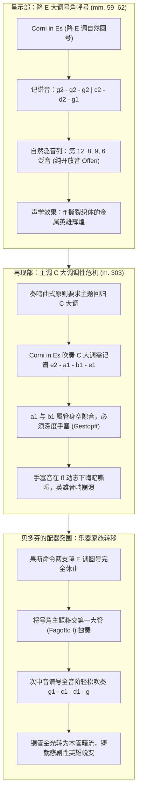

# 自然圆号写作

古典交响乐与室内乐中自然圆号的移调管身、泛音列音区与手塞音物理限制如何塑造作曲家的配器语法？

在现代双排阀键圆号（Valve Horn）成为管弦乐团标准配置之前，18 世纪中叶至 19 世纪初的海顿、莫扎特与贝多芬交响作品完全建立在自然圆号（Natural Horn / Inventionshorn）的物理声学机制之上。与长笛、双簧管等具有全音阶音孔的木管家族，或具有平滑伸缩滑管的长号不同，自然圆号在结构上是一根无阀键、无指孔、两端贯通的盘旋金属圆锥管。演奏者完全凭借唇部肌肉张力（Embouchure）与呼吸气流速度激发管内驻波，乐器在声学上只能发出一组由管长严格决定的自然泛音列（Harmonic Series）。

这一严苛的物理边界并未限制配器大师的艺术表现，反而催生了古典管弦乐中最具凝聚力的配器语法：移调管身的选择直接界定了交响乐章的音响色彩；泛音列纵向间距的自然疏密决定了管弦中频织体的排列法则；手塞音（Hand-stopping）带来的明暗音色二重性成为了动力性张力的重要源泉；而自然音的不完备性甚至直接重塑了古典奏鸣曲式的配器指派与主题移交逻辑。

---

## 1. 物理机理：移调接管与自然泛音列可用音

自然圆号的管身展开长度通常达 3.6 至 5.4 米。因气鸣乐器的空气柱共振基频与有效管长成反比（$f_1 = v / 2L$），乐器制造者无法在一根固定管身的圆号上吹奏所有调性的调内音。为适应不同调性的作品，演奏者必须在号嘴与管身之间插拔不同长度的附加弯管，即移调接管（Crooks / Stimmbögen）。

### 1.1 移调接管的光谱分布
古典管弦乐中最常用的移调管构成了完整的音响光谱：
- **低音降 B 管（B♭ basso）**：展开管长约 5.4 米，基频为 B♭1。管身极长，发音低沉宏大但起奏迟滞，实音比记谱音低大九度；
- **C 调低音管（C basso）**：管长约 4.8 米，基频为 C2。声音庄严厚重，实音比记谱音低纯八度；
- **D 调管（in D）**：管长约 4.3 米，基频为 D2。常用于田园与庆典风格，实音比记谱音低小七度；
- **降 E 调管（in Es / E♭）**：管长约 4.0 米，基频为 E♭2。实音比记谱音低大六度，是古典交响曲中塑造崇高英雄气质的基准管身；
- **E 调管（in E）**：管长约 3.8 米，基频为 E2。实音比记谱音低小六度，音色温润内敛；
- **F 调管（in F）**：管长约 3.6 米，基频为 F2。实音比记谱音低纯五度，被公认为发音灵敏度与音色厚度融合度最佳的黄金基准管；
- **G 调管（in G）**：管长约 3.2 米，基频为 G2。实音比记谱音低纯四度，音色清澈明亮；
- **A 调管（in A）**：管长约 2.8 米，基频为 A2。实音比记谱音低小三度，穿透力极强；
- **高音降 B 管（B♭ alto）**：管长约 2.7 米，基频为 B♭2。管身短小轻灵，发音尖锐，实音比记谱音仅低大二度。

在记谱法上，古典传统一律采用无升降号的“C 调记谱”（Notation in C）。无论插何种移调管，五线谱上的中央 C 始终对应管身的第 4 泛音，而记谱音与实际听觉音高（Sounding Pitch）的音程差完全由移调管决定。

### 1.2 泛音列可用音与音准偏差
自然圆号在物理上激发的自然泛音列（第 1 至 16 泛音）呈现出极其清晰的音区阶梯化特征：

| 泛音序数 | 记谱音高 | 纯律音分 | 音分偏差（相对于平均律） | 声学特性与配器可用度 |
| :--- | :--- | :--- | :--- | :--- |
| **第 1 泛音** | C (Pedal) | 0 | 0 | 基音（超低音），在狭窄管身中极难起奏，合奏基本不用 |
| **第 2 泛音** | c | 1200 | 0 | 纯八度，低音支柱，常作为第一/第二圆号低音八度根音 |
| **第 3 泛音** | g | 1902 | +2 | 纯五度，极为纯净的属音支持，与低音构成空心五度 |
| **第 4 泛音** | c1 | 2400 | 0 | 中央 C，中音区起点，双圆号和声核心支撑音 |
| **第 5 泛音** | e1 | 2786 | -14 | 自然大三度，比平均律低 14 音分，形成极纯协和大三和弦 |
| **第 6 泛音** | g1 | 3102 | +2 | 纯五度，开放音，号角主题的核心骨干音 |
| **第 7 泛音** | b♭1 | 3369 | -31 | **声学陷阱**：偏低 31 音分，不可长音裸露，需手塞微调 |
| **第 8 泛音** | c2 | 3600 | 0 | 高八度主音，高低圆号音区分界线，音色极其坚实 |
| **第 9 泛音** | d2 | 3804 | +4 | 大二度，开放旋律音，构成大调第二级自然音 |
| **第 10 泛音** | e2 | 3986 | -14 | 自然大三度，高音歌唱音，常与第 8 泛音构成三度平行 |
| **第 11 泛音** | f#2 / f2 | 4151 | -49 / +51 | **中立四度**：居于 F 与 F# 正中，作 F 需深塞（下微调约 49 音分），作 F♯ 需唇部上顶微调（手塞只能降音高） |
| **第 12 泛音** | g2 | 4302 | +2 | 极辉煌的高音纯五度，特强（ff）号角呼号顶点音 |
| **第 13 泛音** | a2 | 4441 | -27 / +41 | 偏离均质音律严重，极不稳定，仅偶尔用于快速花腔 |
| **第 14 泛音** | b♭2 | 4569 | -31 | 偏低 31 音分（同第 7 泛音高八度），通常被作曲家回避 |
| **第 15 泛音** | b2 | 4688 | -12 | 纯律导音，比平均律稍低，具有向第 16 泛音强烈的向上倾向 |
| **第 16 泛音** | c3 | 4800 | 0 | 极高音 C，第一圆号极限华彩音，需要极高的唇部控制力 |

---

## 2. 声学妥协：手塞音技术与音色明暗双重人格

约 1750 年，德累斯顿宫廷圆号演奏家安东·约瑟夫·汉佩尔（Anton Joseph Hampel）系统化了手塞音技术（Stopftechnik / Hand-stopping）：演奏者将右手伸入喇叭口（Bell），通过改变右掌在管口的遮蔽面积与深度，实时改变管口声学阻抗与有效空气柱长度。

### 2.1 阻抗跃迁与波长位移机制
在物理声学机制上，手塞音并非简单的“捂住消音”，而是精确的边界调控：
- **半塞音（Half-stopping）**：手掌部分遮蔽喇叭口时，管口等效声学辐射阻抗剧烈升高，管内驻波波腹向内位移，管身等效声学长度变长，从而使泛音音高产生下行微调（可降低半音至全音），用以填补泛音级进空隙；
- **全塞音（Full-stopping）**：手掌肌肉完全密封喇叭口，管口声学边界条件由“开管”骤变为“闭管”，驻波节点被迫固定在手掌切面，迫使空气柱激发出基频上移半音的全新驻波模式。

### 2.2 开放音与手塞音的明暗二重性
这种边界干涉导致了剧烈的音色与动态二元对立：
- **开放音（Offen / Open notes）**：喇叭口完全敞开，驻波能量毫无阻碍地向外辐射，声音饱满明亮、高次谐波丰富、穿透力极强，能够承受特强（ff）的强奏，散发经典的“猎号呼号”（Fanfare）与宏伟史诗感；
- **手塞音（Gestopft / Stopped notes）**：由于手掌肌肉与软组织吸收了大量 1000 Hz 以上的高频泛音，能量集中在 1.5–2 kHz 的鼻音共振峰，高频辐射被剧烈衰减 6 至 10 分贝。音质因而变得晦暗、神秘、带鼻音且声音穿透力骤减，最大动态通常仅能达到中弱（mp）或弱（p）。

古典大师非但没有回避这种音色裂变，反而将其内化为交响思维中的明暗对照法（Chiaroscuro）。在莫扎特的四首圆号协奏曲（K. 417, 447, 495 等）与贝多芬的作品中，开放音常用于展示英雄性、明朗的主题陈述与和声骨架，而手塞音则被赋予内省、疑虑或悲剧性的半音偏转色彩。

### 2.3 圆号五度（Hornquinten）的声学特许
在双圆号声部写作中，古典对位理论家（如福克斯、基恩伯格、科赫）严格禁止的平行五度与平行八度，在自然圆号上获得了一条著名的声学豁免准则——**圆号五度（Hornquinten / Quintes de cor）**：
- 高声部沿第 5、4 泛音下行（e1-d1-c1）；
- 低声部沿第 3、4、5 泛音上行（g-c1-e1）；
- 声部在交汇瞬间产生的隐伏五度与平行音响，完全顺应了自然泛音列的天然音程阶梯，成为整个 18 世纪交响乐中最具辨识度的田园性号角声学符号。

---

## 3. 实证分析：声部专精与贝多芬交响作品实测

为应对自然泛音列跨越四个八度的巨大音域差异，古典管弦乐形成了严格的双圆号声部专精分工：
- **第一圆号（Cor alto）**：专攻高音区（第 8 至第 16 泛音）。使用口径较小（内径约 16 mm）、杯深较浅的号嘴，擅长轻巧高亢的旋律穿透与高阶泛音华彩；
- **第二圆号（Cor basse）**：专攻低音区（第 2 至第 8 泛音）。使用较宽较深（内径约 18 mm、深度达 30 mm）呈漏斗型的号嘴，具备极强的低音起奏控制力，擅长大跳琶音与极宽音程的跃进支撑。

### 3.1 贝多芬 Op. 67 第一乐章：号角主题与再现部大管代偿
在贝多芬《第五交响曲》（Op. 67）第一乐章中，圆号的物理与调性约束成为了推动配器逻辑发展的最强动力。

呈示部转入关系大调（降 E 大调）的连接部（m. 59–62），贝多芬要求两支降 E 调圆号（Corni in Es）以特强（ff）吹响著名的第二主题号角引子。查看该段总谱记谱音：
m. 59 拍起：八分休止后连续三个八分音符 g2，随后在 m. 60–62 分别奏出持续两拍并带突强（sf）的 c2、d2，最终回落收束在持续的 g1 长音上。

对齐自然泛音列可知：
- 记谱音 g2 对应降 E 调管身的第 12 泛音（实音 b♭1）；
- 记谱音 c2 对应第 8 泛音（实音 e♭1）；
- 记谱音 d2 对应第 9 泛音（实音 f1）；
- 记谱音 g1 对应第 6 泛音（实音 b♭）。

谱例待补：贝多芬 Op. 67 第一乐章，m. 59–62（降 E 圆号号角呼号，记谱音与纯自然开放泛音对齐）

整段英雄性的号角主题没有包含一个手塞音，全部由第 6、8、9、12 级自然开放泛音一气呵成，因而获得了撕裂全奏织体的极致金属亮泽。

然而，当乐章进入再现部（m. 303 处），奏鸣曲式原则要求第二主题必须回归主调（C 大调）。此时乐团中的圆号依然插着降 E 调接管（更换接管需要数十秒，无法在中途临时更换）。若要在降 E 调圆号上吹出 C 大调的旋律（实音 g1-g1-g1 | c1-d1-g），对应的记谱音必须转换为 e2-a1-b1-e1。其中 a1 与 b1 必须使用深度手塞音。若强行使用手塞音在 ff 动态下演奏，声音不仅极度晦暗嘶哑，且音准极易崩溃，完全无法支撑英雄号角的宏大声势。

贝多芬在此展现了惊人的配器果断性：在再现部 m. 303，他果断命令两支降 E 调圆号完全休止，将原本属于圆号的标志性号角主题完整移交给了第一大管（Fagotto I）独奏！大管在次中音谱号上以高音区全开奏出实音 g1-c1-d1-g，不仅完美解决了 C 大调全音阶的声学障碍，更由于乐器材质从铜管转为簧管，为再现部的暗流涌动增添了一抹阴郁的木质共鸣。这一历史事实在 19 世纪末曾引发剧烈争论（汉斯·冯·彪罗与古斯塔夫·马勒曾因现代阀键圆号的普及而主张改回圆号演奏），但当代历史知情考证（HIP）证明，贝多芬的大管代偿正是受制于物理边界后完成的音色创造。

### 3.2 贝多芬 Op. 67 第二乐章：降 A 大调中的 C 调圆号突入
在第二乐章（Andante con moto，降 A 大调）中，贝多芬为两支圆号指定的管身竟是 **Corni in C**（C 调圆号），而非乐章主调的降 A 调接管。

在古典配器中，降 A 低音管（As basso）长达近 5 米，发音迟钝且音色过于灰暗。因此贝多芬放弃在主调中让圆号伴奏，而是选用了明亮的 C 调管身。在乐章呈现优雅沉静的降 A 大调主部双簧管与中提琴旋律时，圆号声部完全保持长休止。然而，一旦音乐通过等音转调突然爆发出辉煌灿烂的 C 大调副主题（如 mm. 29–38、mm. 79–86 与 mm. 147–156），两支 C 调圆号立即以 ff 全力切入，以纯开放泛音（c1-e1-g1-c2-d2-e2-g2）连续轰鸣：

谱例待补：贝多芬 Op. 67 第二乐章，mm. 29–38（C 调圆号在 C 大调副主题中的纯开放泛音织体）

这种“跨调性接管预伏”手法，使圆号化身为一把专为调性跃迁准备的声学重锤，在最关键的结构标点处为乐队注入不可替代的光芒。

### 3.3 贝多芬 Op. 92 第二乐章：E 调圆号的声学胶水与手塞歌唱
在《第七交响曲》（Op. 92）第二乐章（Allegretto，A 小调）中，贝多芬选用了 **Corni in E**（E 调圆号）。

在小调交响乐章中，作曲家面临着极其棘手的调性配器矛盾：若选用 A 调圆号，其管身的第 5 泛音天然为大三度音升 C（实音 c#1），与 A 小调主和弦的三音 C 发生尖锐对冲；若强行吹奏自然音 C，必须通过深度手塞。贝多芬精妙地改用 E 调圆号，利用其第 4 泛音与第 8 泛音（记谱 c1 与 c2），在实音上精确对应 A 小调的属音 e 与 e1。

乐章开头第 1–2 小节，贝多芬正是以双簧管、单簧管、大管与两支 E 调圆号吹响弱奏（p-pp）的属和弦长音踏板。圆号圆润温和的圆锥形声波在此扮演了不可或缺的“声学胶水”（Acoustic Glue），将异质的木管双簧、单簧与弦乐背景完美熔融为整体。

而在乐章转入 A 大调的歌唱性副主题（m. 36–40）时，第一圆号在持续的弦乐与单簧管背景中，奏出了一段包含下行级进的迷人连音线条（记谱音 f2-e2-d2-c2-b1-a1-g1）。在该段中，开放音（g1, c2, d2, e2）与手塞音（a1, b1, f2）交错滑过，轻柔的动态与手塞音特有的微弱阻尼感相互融合，展示了自然圆号如人声叹息般微妙细腻的抒情维度。

谱例待补：贝多芬 Op. 92 第二乐章，m. 36–40（E 调圆号的属音踏板与手塞歌唱旋律；mm. 1–3 与本库既有 Op. 92 第二乐章谱例重叠，补谱时改为链接）

---

## 4. 现代配器写作的实践启示

即便在现代双排阀键圆号（F/B♭ Double Horn）已彻底解决半音阶音准问题的今天，理解自然圆号的物理约束依然是现代配器实践的基石准则：

1. **声学胶水法则（The Acoustic Glue Rule）**：圆号作为铜管家族中唯一的深锥形截面乐器，其中频（200–600 Hz）泛音包络具有强烈的吸附性与包容性。在管弦乐分层中，两支圆号的持续八度或五度长音是填平弦乐跳弓与木管断奏之间空间裂隙的最优声学介质。
2. **临界频带与低区避让**：古典自然圆号在低音区（第 2–4 泛音）的开阔间距提醒我们，在编写铜管低声部时，切忌在中低频区（250 Hz 以下）安排密集的三度或二度和声音程，否则由空气柱高非线性失真产生的拍频将直接摧毁声场的通透度。
3. **明暗色彩的参数化仿真**：在虚拟管弦乐（Virtual Orchestration）与现代编配中，若需重现古典主义的本真质感，不应将圆号仅仅视为均质的持续音发生器，而应依据历史上的手塞音音位动态调节低通滤波截止频率（Cutoff）与共振峰（Formant），使音阶跑动中自然浮现出明暗交织的呼吸感。
4. **四圆号声部交叉排列律（Interlocking Voicing）**：在四支圆号的和声排列中，古典配器遵循 1/3 声部负责高音、2/4 声部负责低音的交错原则（即从高到低音高排列为 Horn 1, Horn 3, Horn 2, Horn 4）。这种排列能够使两对圆号在音色与起奏动态上保持高度平衡，避免由于高低号嘴物理特性悬殊导致的声场偏斜。
5. **移调调性的固有性格**：不同的移调管身不仅是音高的转换，更是管长与空气柱响应特性的具象化呈现。降 E 调的崇高庄严、D 调的苍劲挺拔与 F 调的温润歌唱，依然构成了交响调性美学中最具说服力的物理注脚。
6. **乐器物理边界驱动配器创新**：贝多芬在 Op. 67 中因圆号无法吹奏 C 大调号角而移交大管的范例证明，面对乐器的物理瓶颈，最卓越的解决策略往往不是通过妥协音色强行奏出，而是通过转移至全新乐器家族，在曲式结构的关键节点激发令人难忘的音响惊喜。
