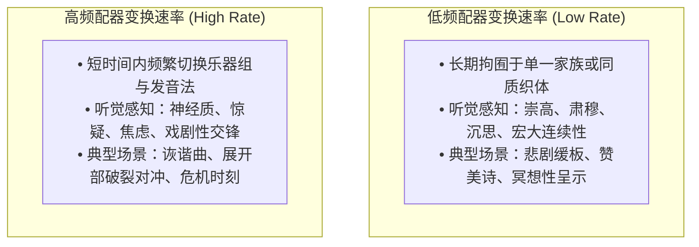
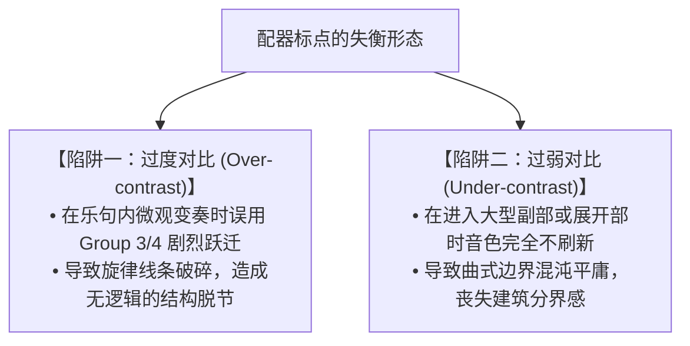
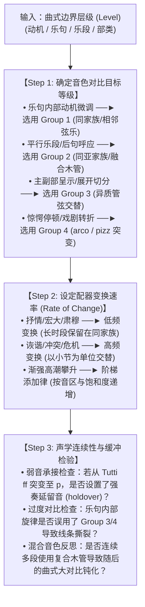

# 音色对比阶梯

<p class="doc-subtitle">管弦乐配器变换速率与对比阶梯如何作为独立声学参数，执行曲式边界的标点功能？</p>

在传统曲式与作曲技法教学中，分析者往往将目光高度聚焦于**和声终止式（Cadences）**、**调性布局（Tonal Plan）**与**动机发展（Motivic Development）**，而将配器视作乐思写定之后用来涂抹色彩的“外衣”。

然而在真实的管弦乐与大型器乐思维中，**音色（Timbre）本身就是一种强有力的、可直接感知的“曲式标点”（Formal Punctuation）**。一段音乐何时应当呼吸、何时应当呈现边界切分、何时应当保持一气呵成的连续性，不仅取决于调性与和声的终结，更取决于管弦乐音色在时间轴上的**对比幅度（Degree of Contrast）**与**变换速率（Rate of Orchestral Change）**。

---

## 一、配器变换速率（Rate of Orchestral Change）与结构张力

配器不仅关乎纵向空间的织体厚薄，更关乎横向时间流中的**色彩更替频次**。加拿大作曲家兼配器理论家阿兰·贝尔金（Alan Belkin）在其《艺术化配器法》（*Artistic Orchestration*）的“配器变换速率”（Rate of Orchestral Change, pp. 21–23）一章中指出，配器变换的快慢直接调控着作品的结构呼吸与情感张力。



### 1. 低频变换速率：宏大连续性的构建
当作曲家有意将音色变换频率降至最低、使音乐长期浸润在同一种乐器家族中时，听众的注意力便完全从表层的色彩刺激中剥离，沉入深层的旋律呼吸与和声进行中。
- 例如**马勒《第四交响曲》第三乐章（Ruhevoll）**的开篇，音乐整整 25 小节完全保留在弦乐组内部（mm. 1–25），中提琴、大提琴与小提琴在纯净的拉弦中缓缓展开，从而确立了无与伦比的安详、宽广与永恒感。

### 2. 高频变换速率：微观动荡与戏剧裂变
与此相反，当管弦乐色彩在极短的时间刻度内（每隔一至两小节甚至每隔一拍）频繁倒手时，听觉神经将持续处于兴奋与辨识状态，从而诱发强烈的不安定感与戏剧张力。
- 例如**马勒《第四交响曲》第二乐章（In gemächlicher Bewegung）第 34–46 小节**：独奏小提琴（采用了高全音特殊定弦 Scordatura）的怪诞旋律，与带弱音器的圆号（Stopped horns，第 43 小节突入）、紧随其后的木管组以及弦乐轻拨弦展开高密度的短兵相接。配器变换的频密发生，直接造就了该乐章标志性的神经质与骷髅舞曲式的讽刺色彩。

---

## 二、贝尔金的五级音色对比阶梯（Scales of Contrast）

如何精准掌控曲式切分的尺度？贝尔金在讨论音色连续性与对比度时提出了著名的配器公理（*Artistic Orchestration*，"Degree of continuity/contrast of timbre" 一章）：
> **“音色变化的幅度必须与曲式所需的对比度精确匹配：大乐段的分界需要比乐句内动机更强烈的配器对比。音色深刻影响着对音乐曲式的感知：过大的对比会造成不恰当的音乐断裂；过小的对比则会剥夺音乐必要的标点感。”**  
> (*The degree of timbral change must correspond to the degree of formal contrast required: A major section break requires more orchestral contrast than a new motive within a phrase. Timbre strongly affects the perception of musical form: Too great a contrast will create an inappropriate break in the music; too small a contrast will deprive the music of necessary punctuation.*)

为了提供可量化的评估准则，贝尔金在假设旋律线完全相同的前提下，根据乐器发声机理、泛音结构与垂直融合能力，将前后相继出现的两个音色之间的感知反差划分为**五级对比阶梯（Group 1 至 Group 5）**：

| 对比等级 | 感知强度 | 乐器交接典型场景 | 推荐对应的曲式功能 |
| :--- | :--- | :--- | :--- |
| **Group 1** | **极微弱或难以察觉** (Imperceptible / Very mild) | 1. 同一乐器内部非极端音区转换（如中音长笛接高音长笛）<br>2. 弦乐相邻乐器交替（第一小提琴接第二小提琴或中提琴）<br>3. 小号与长号的同质铜管交替 | 乐句内部动机微调、呼应句的微观呼吸、保持最高连续性 |
| **Group 2** | **温和至中度对比** (Mild to moderate) | 1. 同一木管亚家族交替（长笛接中音长笛、双簧管接英国管）<br>2. 同一乐器跨入极端音区（如单簧管从 Chalumeau 跃入极高音）<br>3. 能良好垂直融合的异质木管（单簧管/大管中音区、长笛/双簧管高音区）<br>4. 良好融合的木管与铜管（大管接圆号）<br>5. 圆号接小号或长号 | 平行乐段的后句、半终止（HC）停顿后的承接、副题材料的微调呈示 |
| **Group 3** | **显著对比** (Marked contrast) | 1. 垂直和弦中无法良好融合的异质木管交替（如低音双簧管接低音长笛）<br>2. 不易融合的木管与铜管交替<br>3. 木管组与弦乐组之间的完整交替<br>4. 铜管组与弦乐组之间的交替 | 呈示部主副部主题切换、展开部段落起始、大型倒装句式切分 |
| **Group 4** | **异质性压倒相似性** (Contrast attracts more attention than similarity) | 发声物理机制彻底改变：如**弦乐拉弦（arco）骤然交替为弦乐拨弦（pizzicato）** | 剧烈的结构性停顿、假再现、突发性戏剧变故、黑色幽默转折 |
| **Group 5** | **极端异质对比** (Extreme contrast) | 仅能保留单一参数（如节奏）模仿，音高/音色彻底脱钩：如**长笛旋律交替为军鼓纯节奏敲击** | 现代主义音响碎裂、象征性结构坍塌、极端超现实并置 |

---

## 三、配器标点的双向陷阱与声学缓冲律

在运用音色对比构建曲式时，创作者与生成模型最易陷入两极化的陷阱：



### 1. 背景恒定效应（Background Constancy）
贝尔金在解析旋律与伴奏的相对对比时指出了一条重要的声学掩蔽与中和原理：**如果多声部织体中的背景伴奏平面保持完全不变，那么前景旋律即使发生音色更替，其实际感知到的对比度也会被大幅削弱。**
- *创作应用*：若希望在乐段之间实现平滑过渡，可以让大提琴或弦乐长音伴奏横跨乐段边界，而仅在上方更替独奏木管（如长笛切换为双簧管）；若希望实现刀削般的曲式切分，则前景与背景必须**同步进行家族级音色突变**。

### 2. 混合音色的“钝化”风险（The Blunting of Mixed Timbres）
大量使用混合音色（Mixed timbres，例如长笛与双簧管齐奏、单簧管与圆号齐奏）虽然能获得丰厚的厚度，但由于复合音色失去了单一乐器锋利的声学轮廓，长期使用会导致随后的**曲式大对比难以产生冲击力**。贝尔金特别强调，卓越的配器大师往往在关键对比到来前，先将乐队还原为纯净的独奏单一色彩。

### 3. 大全奏到极弱的听觉适应缓冲（强奏乐器延留现象）
贝尔金在讨论极端动态落差时强调了人类听觉的物理适应机制：**在经历高能量的强奏全奏（Tutti *ff*）后，人耳鼓膜与神经需要数个节拍的恢复时间。若音乐立刻无缓冲地切入极弱（*p*），最初的数个弱奏音符往往会被耳朵完全漏听。**
- *工程规范*：从全奏突然刹车到室内乐弱奏时，可采用贝尔金所述的强奏延留机制（*one or two instruments will be held over from the fortissimo passage for a few beats*，下文称 holdover／延留），由一至两件中音域乐器在强奏收尾处保留半拍至一拍的极弱持续长音，充当听觉缓冲垫。

---

## 四、经典管弦乐作品案例深度解构

### 案例一：贝多芬《第七交响曲》Op. 92 第二乐章（mm. 1–26）
**机制：纯弦乐家族内部的低频配器速率与 Group 1 阶梯微调**

贝多芬著名的 A 小调快板乐章展现了古典乐派如何通过将配器变换速率压制至极限，来建立坚不可摧的崇高与深沉连续性：

- **配器安排**：木管与圆号只在开篇露一次面：双簧管、单簧管（A）、大管与圆号（E）以 f→pp 的 a 小调主和弦点出调性，到 m.3 第 2 拍即收束退场；此后直到 m.26，全部发音只剩**中提琴、大提琴与低音提琴**，那个沉重而带有催眠特质的节奏型（长-短-短-长-长）由这三声部在阴郁的中低音区以弱奏呈示；
- **微观阶梯推进**：换声部极慢。第二小提琴直到 m.27 才接过主题，第一小提琴 m.51 才进入，二者都在本段的 26 小节之外；在此之前音色毫无割裂，整段音乐如同石雕般坚固沉穆，为后续木管与全奏的层层展开积蓄了结构潜能。

```lilypond title="贝多芬 第七交响曲 Op.92 第二乐章" location="Allegretto，mm.1–10（音乐会音高记谱）" id="beethoven-op92-ii-mm1-10"
\version "2.26.0"
\language "english"

global = {
  \key a \minor
  \time 2/4
  \tempo "Allegretto" 4 = 76
}

flauti = {
  \global
  \clef treble
  \set Staff.midiInstrument = "flute"
  R2 | R2 | R2 | R2 | R2 | R2 | R2 | R2 | R2 | R2 |
}

oboi = {
  \global
  \clef treble
  \set Staff.midiInstrument = "oboe"
  <c'' e''>2\f\> ~ | <c'' e''>2\! ~ | <c'' e''>4\pp r4 |
  R2 | R2 | R2 | R2 | R2 | R2 | R2 |
}

clarinetti = {
  \global
  \clef treble
  \set Staff.midiInstrument = "clarinet"
  <e' a'>2\f\> ~ | <e' a'>2\! ~ | <e' a'>4\pp r4 |
  R2 | R2 | R2 | R2 | R2 | R2 | R2 |
}

fagotti = {
  \global
  \clef bass
  \set Staff.midiInstrument = "bassoon"
  <a c'>2\f\> ~ | <a c'>2\! ~ | <a c'>4\pp r4 |
  R2 | R2 | R2 | R2 | R2 | R2 | R2 |
}

corni = {
  \global
  \clef treble
  \set Staff.midiInstrument = "french horn"
  <e e'>2\f\> ~ | <e e'>2\! ~ | <e e'>4\pp r4 |
  R2 | R2 | R2 | R2 | R2 | R2 | R2 |
}

violinoOne = {
  \global
  \clef treble
  \set Staff.midiInstrument = "violin"
  R2 | R2 | R2 | R2 | R2 | R2 | R2 | R2 | R2 | R2 |
}

violinoTwo = {
  \global
  \clef treble
  \set Staff.midiInstrument = "violin"
  R2 | R2 | R2 | R2 | R2 | R2 | R2 | R2 | R2 | R2 |
}

viola = {
  \global
  \clef alto
  \set Staff.midiInstrument = "viola"
  R2 | R2 |
  e4\p^\markup { \large \italic "ten." } e8\staccato e8\staccato |
  e4\staccato( e4\staccato) |
  e4 e8\staccato e8\staccato |
  e4\staccato( e4\staccato) |
  e4 e8\staccato <d fs>8\staccato |
  <e g>4\staccato( <e g>4\staccato) |
  <d g>4 <c g>8\staccato( <d g>8\staccato) |
  <e g>4 r4 |
}

violoncello = {
  \global
  \clef bass
  \set Staff.midiInstrument = "cello"
  R2 | R2 |
  c4\p^\markup { \large \italic "ten." } c8\staccato c8\staccato |
  b,4\staccato( b,4\staccato) |
  b,4 b,8\staccato b,8\staccato |
  c4\staccato( c4\staccato) |
  c4 c8\staccato c8\staccato |
  c4\staccato( c4\staccato) |
  b,4 a,8\staccato( b,8\staccato) |
  c4 r4 |
}

contrabass = {
  \global
  \clef bass
  \set Staff.midiInstrument = "contrabass"
  R2 | R2 |
  a,4\p^\markup { \large \italic "ten." } a,8\staccato a,8\staccato |
  gs,4\staccato( gs,4\staccato) |
  e,4 e,8\staccato e,8\staccato |
  a,4\staccato( a,4\staccato) |
  a,4 a,8\staccato a,8\staccato |
  a,4\staccato( a,4\staccato) |
  g,4 g,8\staccato( g,8\staccato) |
  c4 r4 |
}

\score {
  <<
    \new StaffGroup <<
      \new Staff \flauti
      \new Staff \oboi
      \new Staff \clarinetti
      \new Staff \fagotti
      \new Staff \corni
    >>
    \new StaffGroup <<
      \new Staff \violinoOne
      \new Staff \violinoTwo
      \new Staff \viola
      \new Staff \violoncello
      \new Staff \contrabass
    >>
  >>
  \layout { ragged-right = ##f }
  \midi { }
}
```

为便于读谱，单簧管（A）与圆号（E）在这里按音乐会音高记谱；小号与定音鼓在该段全休止，未列入。

---

### 案例二：贝多芬《第九交响曲》Op. 125 第一乐章开篇（mm. 1–35）
**机制：阶梯式渐强（Graduated Crescendo）与音色密度累加**

贝多芬在《第九交响曲》开篇确立了管弦乐由混沌走向爆发的原型范式，贝尔金在分析乐句结构配器时特别将其作为配器驱动渐强（Graduated Crescendo）的最高典范：

- **混沌起步（mm. 1–15）**：第二小提琴与大提琴先以 pp 的空五度震音（A–E）铺底，圆号以长音加入；第一小提琴 m.2、中提琴与低音提琴 m.4 进入，随后木管各组依次加入长音（单簧管 m.5、双簧管 m.9、长笛 m.11、大管 m.14，圆号 3/4 m.15），全程没有明确的三音，音色呈现极度原始、空旷的半透明态；
- **乐器逐级叠加入场**：据阿兰·贝尔金在《艺术化配器法》中对该段配器驱动渐强的专门剖析，声部并未一次性推大力度，而是逐级叠加入场（贝尔金指出的入场次序：低音弦乐下坠，继而中提琴，随后木管各组逐次进入）；
- **全奏爆发（mm. 16–35）**：m.16 小号与定音鼓加入，管乐家族全员就位，配器密度达到临界饱和，乐曲在 *ff* 中爆发出全奏下行大三和弦冲天巨浪（D 小调主部主题）。这种渐强不仅是动态的增强，更是**音色对比阶梯由单一空灵家族向全彩饱和全奏的物理爬升**。

贝多芬《第九交响曲》Op. 125 第一乐章 Allegro ma non troppo, un poco maestoso，mm. 1–35。

---

### 案例三：马勒《第四交响曲》第二乐章（mm. 34–46）与第三乐章开篇对比
**机制：高频配器变换速率（Group 2–3 震荡）与低频弦乐沉思的结构性对撞**

马勒展示了如何通过相邻两个乐章配器变换速率的剧烈反差，定义全曲的宏观戏剧张力：

- **第二乐章（mm. 34–46）**：独奏小提琴在高把位刺耳游走，第 43 小节被塞入金属消音器的圆号（Stopped horns）以尖锐鼻音突入，紧接着两小节后主旋律瞬间被推给高音木管组。配器在弦乐、弱音铜管、异质木管（Group 3 对比）之间频繁跳跃，其配器变换速率极高，构成了听觉神经的持续震荡；
- **第三乐章（开篇）**：进入 G 大调平静慢板后，马勒将配器变换速率骤降至零，开篇整整 25 小节完全不引入管乐与打击乐（mm. 1–25），全由弦乐内部声部交织。通过将变换速率从“极动”切换至“极静”，马勒无须依靠激烈的和声离调，仅凭配器速率的阻尼便完成了由“死神弄臣”到“天国慰藉”的灵魂升华。

马勒《第四交响曲》第二乐章 In gemächlicher Bewegung，mm. 34–46。

---

## 五、面向创作 Agent 的配器决策树与工程规则

在多轨生成模型或音乐创作 Agent（经由 OpenViking 检索与调用）进行管弦乐时间轴配器规划时，可执行以下**算法化编配决策流程**：



### 创作 Agent 编配时间轴检查清单（Checklist）
1. [ ] **曲式咬合检查**：当前总谱进入新乐段时，配器对比度是否与曲式层级匹配？是否在副部出现时仍穿着与主部相同的配器外衣？
2. [ ] **微观平滑检查**：同一乐句内部的动机转移，是否严格限制在 Group 1 或温和的 Group 2 之内？是否存在乐句未唱完就因乐器突变而断裂？
3. [ ] **全奏刹车检查**：在大型强奏结束紧接极弱段落处，是否有 1–2 件乐器提供短促的延留音（held over / holdover）以缓冲人耳的声学适应期？
4. [ ] **色彩纯度检查**：在准备制造重大曲式高潮或强烈对比之前，是否提前将混合音色收拢为纯净的单一乐器色彩？

---

## 参考文献与出处指引

- **Alan Belkin**: *Artistic Orchestration*, Chapters: "Rate of Orchestral Change" (pp. 21–23), "Degree of continuity/contrast of timbre" (pp. 23–25), "Interpreting the phrasing" (pp. 25–27).
- **Philharmonia Orchestra**: *Instrument Guides* (Clarinet, Flute, Violin).
