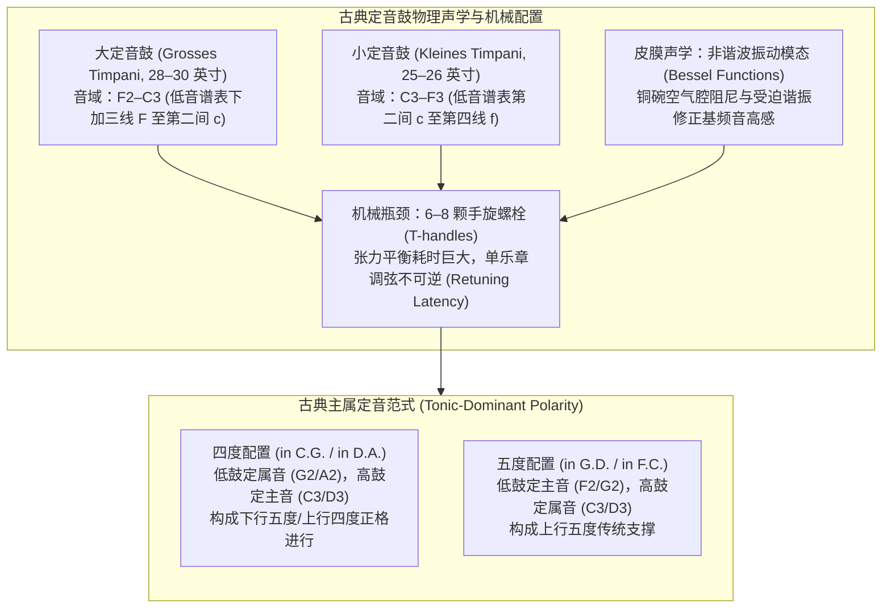

# 定音鼓写作

<p class="doc-subtitle">古典交响曲中定音鼓的双鼓定音、机械调弦延迟与固定音高约束如何重塑管弦乐的曲式标点、和声骨架与动机形态？</p>

在现代带有脚踏机械连杆（Pedal mechanism）的半音阶定音鼓问世之前，18 世纪至 19 世纪前期的古典管弦乐团完全受制于手动螺栓调音的手工定音鼓（Hand-screw Kettledrums）。这一时期的定音鼓由一对铜制半球形共鸣碗与羊皮或牛皮膜构成，其调音完全依赖鼓框外缘的 6 至 8 颗手旋螺栓（T-handles）。由于调整单面鼓的音高需要乐手逐一旋转各螺栓以确保皮膜张力均一，一次重新调音（Retuning）在嘈杂的舞台与持续演奏的乐章中通常需要 15 至 30 秒的绝对休止时间。

这种极为苛刻的机械调弦时间成本（Retuning Latency），迫使古典交响曲作曲家在单一乐章内只能使用两面音高固定的定音鼓。然而，正是这一严格的物理与声学边界，促使海顿、莫扎特与贝多芬发展出一套精妙绝伦的配器语法：定音鼓不仅从早期骑兵军乐的重音加倍工具蜕变为决定管弦总谱和声纯度的“底护栏”，更在贝多芬手中跃升为承载动机脉搏、跨调性戏剧突刺与曲式能量宏观调控的交响灵魂。

---

## 1. 物理声学与机械机理：双鼓尺寸、皮膜声学与主属定音

理解古典定音鼓配器法则的前提，在于把握其乐器制造史、圆形皮膜物理振动特性与调弦机械结构。



### 1.1 双鼓音域与尺寸分工
18 世纪末古典管弦乐队标准的定音鼓配置严格为**两面鼓（A Pair of Kettledrums）**，两鼓在尺寸与声学共鸣区间上形成了互补的分工：
- **大定音鼓（Grosses Timpani）**：直径约 28 至 30 英寸（约 70–75 厘米），共鸣腔体宽深，皮膜基频有效振动区间覆盖大字组 F 至小字组 c（**$F_2$–$C_3$**，即低音谱表下加三线至第二间）；
- **小定音鼓（Kleines Timpani）**：直径约 25 至 26 英寸（约 63–66 厘米），腔体紧致、膜面张力高，有效音域覆盖小字组 c 至小字组 f（**$C_3$–$F_3$**，即低音谱表第二间至第四线）；
- **合成音域**：两鼓结合形成一个跨度为纯八度（**$F_2$–$F_3$**）的物理声学区间。在此区间之外，皮膜若过于松弛则音高浑浊干瘪，若过于紧绷则音色发脆且极易撕裂。

### 1.2 圆形皮膜声学与击槌材质演进
在物理声学中，理想圆膜的自由振动模态由二维贝塞尔函数（Bessel functions）决定，其固有的泛音频率（如模态 01、11、21、02 等）呈现非整数比非谐波特性（Non-harmonic overtones）。定音鼓之所以能够发出人耳可清晰辨识的确定音高，完全依赖于**半球形铜碗封闭空气柱的弹性反作用力（Air cavity compliance）**与皮膜辐射阻抗的耦合，将非谐波泛音强行“拉向”接近整数倍的谐波关系。

与此同时，鼓槌（Mallets）的材质直接塑造了定音鼓的瞬态包络（Attack Transient）：
- **18 世纪早期木质槌头（Wood sticks）**：打击瞬态极为尖锐硬朗，高频爆破声显著，适合军乐中与木管、铜管齐奏齐鸣，但难以演奏平滑连绵的弱奏滚奏；
- **古典晚期毛毡与法兰绒包裹槌（Felt / Flannel-covered sticks）**：海顿晚期与贝多芬逐步推广带有布料包裹的软槌，大幅衰减了膜面接触的硬质杂音，释放了深沉圆润的中频基频，为弱奏（Pianissimo）神秘长脉搏与持续震音（Tremolo / Roll）提供了物理可能。

### 1.3 主属定音范式、记谱法与 Muta 调弦指令
在 18 世纪“十一人管弦乐”（Orchestra of 11：四部弦乐、一对双簧管/长笛、一对圆号、一对小号与定音鼓）的配器传统中，两面鼓的音高必须严格分配给调性中的**主音（Tonic）与属音（Dominant）**：
1. **四度配置（Quart-Stimmung）**：在 C 大调（in C. G.）或 D 大调（in D. A.）等调性中，大鼓调为低属音（$G_2$ 或 $A_2$），小鼓调为主音（$C_3$ 或 $D_3$）。此时两鼓构成纯四度音程，低属音向上跃进至主音形成极具下沉重力感的正格终止；
2. **五度配置（Quint-Stimmung）**：在 G 大调（in G. D.）或 F 大调（in F. C.）等调性中，大鼓调为主音（$F_2$ 或 $G_2$），小鼓调为高属音（$C_3$ 或 $D_3$），两鼓构成纯五度音程。

在记谱习惯上，古典前期作曲家普遍采用“C 调记谱法”（Notation in C）：无论实际调性为何，总谱上一律记为低音谱表第二间的 $c$ 与下加一间的 $G$，而在乐章起始处标注实音要求（如 `Timpani in D. A.` 或 `in B. F.`）。直到贝多芬时代，随着调性观念的精细化，按实际发音记谱才逐渐普及。

若交响曲跨乐章或在大型尾声前需要改变音高，总谱中必须显式标明换音指令（如 `Muta Timp. in C. G.`）。作曲家在此处必须为定音鼓乐手预留出长达数十小节的完全静默（Tacet），使乐手得以弯腰俯身，依靠微弱的人声哼唱音高，用扳手或 T 型手柄逐一校准各螺栓张力。

---

## 2. 配器语法的历史演进：从军乐加倍到曲式标点

在海顿早期与莫扎特前期，定音鼓的配器功能深受欧洲骑兵军乐（Cavalry kettledrums）传统的历史束缚。

### 2.1 军乐与庆典风格的附属加倍
定音鼓在早期交响乐中几乎总是与小号捆绑出现（*Clarini e Timpani*），专用于指涉军乐、凯旋与庆典风格（Fanfare / Celebratory Topic）：
- **全奏重音强化（Tutti Reinforcement）**：定音鼓仅在乐队全奏强奏（Tutti $f$ 或 $ff$）时敲击，与低音提琴、大提琴和管乐低音完全重合，充当增强外声部瞬态声压（Transient attack）的打击乐器；
- **终止式强拍打点**：在呈示部结束、展开部双强音或乐章终局的 I–V–I 终止式上击打四分音符或二分音符，功能极度单一。

### 2.2 和声纯度与声学遮蔽约束（The Harmonic Purity Constraint）
由于两面鼓的音高完全固定，定音鼓进入时必须遵循严格的和声避让法则：
- **声学遮蔽（Acoustic Masking）**：定音鼓的敲击产生巨大的低频能量（100–300 Hz），其衰减时间（Decay）显著长于小军鼓等无调打击乐器。如果总谱进入副属和弦（如 $V^7/V$）、下属和弦（$IV$）、那不勒斯和弦（$\flat II$）或减七和弦，定音鼓若敲击原有的主音或属音，不协和的低频驻波将彻底摧毁整个乐队的和声清晰度；
- **声学休止的必然性（Mandatory Tacet）**：这种物理特性确立了古典配器的铁律——**凡转入非主属和声区域，定音鼓必须完全休止（Tacet）**。因此，定音鼓在古典总谱中的大面积休止并非作曲家的疏漏，而是保障调性纯度的声学刚性要求。

### 2.3 海顿的破局：惊愕突刺与鼓声引子
在贝多芬之前，约瑟夫·海顿已经在伦敦交响曲时期（据通行总谱与配器文献记述）对定音鼓的传统角色发起了重要冲击：
- **《第 94 交响曲“惊愕”》（Hob. I:94，C 大调）第二乐章**（*Andante*，mm. 1–16）：在著名的清脆弦乐 $pp$ 歌唱性行板第 16 小节弱拍上，海顿突然令定音鼓联同全乐队爆发一个毫无预兆的 $ff$ 突变重音（Surprise Chord），将定音鼓从单纯的节奏背景升格为制造剧场声学震慑的先锋；
- **《第 103 交响曲“鼓声”》（Hob. I:103，降 E 大调）第一乐章**（*Adagio*，m. 1）：乐章破天荒地以一段长达数小节的无伴奏定音鼓独奏滚奏（Intrada / *Paukenwirbel*，单音滚奏起于弱奏随后膨胀）揭开全曲序幕。这是交响乐史上定音鼓首次以无伴奏独奏身份担纲整部大作的第一道声响，宣告了打击乐器独立曲式功能的觉醒。

### 2.4 贝多芬第一交响曲：弱奏附点与室内乐化
贝多芬在《C 大调第一交响曲》Op. 21 中进一步打破了定音鼓仅用于全奏强音的陈腐框架。在第二乐章（*Andante cantabile con moto*，F 大调，3/8 拍）的副部结束句（mm. 53–64）中，定音鼓调在 C 与 G（小鼓为 C，大鼓为 G）：

本段（mm. 53–64）见[《管乐交响化的织体机制》](../../styles/woodwind-symphonic-emancipation.md#score-beethoven-op21-ii-mm53-64)：定音鼓 in C. G. 以附点十六分音符结合三十二分音符敲击军乐仪仗节奏，与圆号和木管组形成室内乐式对答。

在此处，定音鼓脱离了粗暴的轰鸣，在 $p$ 与 $pp$ 的微弱力度中以纯净的附点节奏穿透弦乐背景。正如 Eastman 配器分析所指出，在抒情慢乐章中将定音鼓的军乐节奏转化为室内乐式的动机对话，标志着打击乐器开始获得独立的交响句法生命。

---

## 3. 贝多芬交响作品中的定音鼓革命与乐谱实证

通过对贝多芬交响曲原始分谱与总谱的逐小节实测，我们可以清晰透视定音鼓如何蜕变为结构构架的决定性支柱。

### 3.1 贝多芬 Op. 67 第一乐章：命运动机的打击乐骨架与属音蓄能
在《第五交响曲》Op. 67 第一乐章（*Allegro con brio*，C 小调，2/4 拍）中，定音鼓设定为 **Timpani in C. G.**（分谱实测 `timpani.ly`）：
- **动机渗透**：在呈示部主部主题狂飙中（mm. 18–22），定音鼓并非机械加倍下行低音，而是以 `r8 g,8[ g, g,] c4\f` 准确敲出“短-短-短-长”的核心命运动机骨架；
- **属和弦长锁定（Dominant Lock）**：在副部主题呈示之前（mm. 33–43），定音鼓以极具张力的属音 G 弱奏附点节奏与滚奏持续推进，为木管号角的切入完成高密度的声能储备；
- **尾声强奏狂飙**：在庞大的展开部末端与长达 130 小节的尾声终局（mm. 470–502），定音鼓以八分音符切分重音与强奏震音连击，将整个乐队推向悲壮狂暴的毁灭性高潮。

### 3.2 贝多芬 Op. 67 第二乐章：跨调性预设与爆发性副题
在《第五交响曲》Op. 67 第二乐章（*Andante con moto*，3/8 拍）中，贝多芬呈现了管弦乐史上最富远见的跨调性定音策略：
- **调性矛盾**：乐章主调为降 A 大调（A♭-C-E♭）。若按常规调音，定音鼓应定在 A♭ 与 E♭；但在当时的双鼓物理极限下，大字组降 A（$A\flat_2$）与大字组降 E（$E\flat_2$）超出了标准小鼓与大鼓的最佳共鸣张力，且两音对于古典小号的自然管身亦极为不利；
- **定音抉择**：贝多芬毅然将定音鼓设定为 **Timpani in C. G.**（实测分谱 `timpani.ly`）；
- **声学静默与爆发**：在降 A 大调的主题变奏与流动旋律中，因 C 音与 G 音无法为降 A 大调主和弦提供低音支撑（G 音构成尖锐大七度对冲），定音鼓在前 28 小节完全保持休止（28 小节整小节休止）；
- **C 大调副部轰鸣**：直至第 29 小节，音乐突然以莫大的英雄气概转入远关系上中音调 C 大调（同时是整部交响曲的主调），定音鼓瞬间在 $ff$ 爆发出震耳欲聋的长滚奏与八分音符重击（mm. 29–30：`c4.\ff^\trill g,8\staccato[ g,\staccato g,\staccato]`）。在随后的副题变奏中（mm. 31–38、79–86、147–156），定音鼓以密集的附点三十二分音符（`c16. c32 c8[ c c]`）成为撕裂降 A 大调阴翳、注入强光的动力引擎。

本段见[《自然圆号写作与泛音序列》](natural-horn-writing-and-harmonic-series.md#score-beethoven-op67-ii-mm25-38)（同谱例含定音鼓 in C. G. 的进入）。

### 3.3 贝多芬 Op. 67 第三至第四乐章过渡：弱奏长脉搏与声学悬疑
西方音乐史上最伟大的定音鼓独奏段落，出现在《第五交响曲》第三乐章（谐谑曲）向第四乐章（终曲）的无缝连接部（mm. 324–373）：
- **音响态势**：谐谑曲主题在低音提琴极其干瘪的拨弦与弦乐轻微的跳弓中逐渐消散，调性深陷 C 小调的冰冷幽暗，第一小提琴在 $ppp$ 的极致微弱中游移；
- **心跳脉搏（Pulsing Pedal）**：从第 324 小节起，定音鼓独奏以每小节一击的四分音符（音高为小字组 $C_3$），在 $pp$ 力度下敲击单音踏板长达 50 个小节；
- **声能蓄积与爆发**：这一持续敲击剥离了定音鼓的一切外在打击属性，演变为深渊中生命体的微弱心跳。从第 368 小节起，小提琴音型以半音阶阶梯式向上攀升，定音鼓随之启动惊心动魄的渐强（Crescendo）；在第 374 小节，定音鼓的滚奏与小提琴的冲刺在无休止过渡（*attacca*）中瞬间撞开第四乐章的大门，引爆 C 大调胜仗全奏（三支长号、短笛与低音大管首次加入管弦乐）。定音鼓在此完全担纲了曲式结构的“产婆”。

```lilypond title="贝多芬 第五交响曲 Op.67 第三乐章→第四乐章" location="Allegro，mm.324–373（实音记谱；定音鼓单音 C 的 pp 心跳长脉搏直接引爆第四乐章）" id="beethoven-op67-iii-iv-mm324-373"
\version "2.26.0"
\language "english"

% 据 CCARH MuseData 转写，学术用途。
% 底本 Timpani in C, G 自 m.325 起以单音 C 连击贯穿至 m.374（attacca 入第四乐章）。
% 底本 \*MM96（四分音符）。本谱例为实音记谱。

global = {
  \key c \minor
  \time 3/4
}

timpani = {
  \clef "bass"
  \tempo "Allegro" 4 = 96
  r2. | % m.324
  c4 r4 r4 | % m.325
  c4 c4 c4 | % m.326
  c4 r4 r4 | % m.327
  c4 c4 c4 | % m.328
  c4 r4 r4 | % m.329
  c4 r4 r4 | % m.330
  c4 r4 r4 | % m.331
  c4 r4 r4 | % m.332
  c4 r4 c4 | % m.333
  c4 r4 c4 | % m.334
  c4 r4 c4 | % m.335
  c4 r4 c4 | % m.336
  c4 c4 c4 | % m.337
  c4 c4 c4 | % m.338
  c4 c4 c4 | % m.339
  c4 c4 c4 | % m.340
  c4 c4 c4 | % m.341
  c4 c4 c4 | % m.342
  c4 c4 c4 | % m.343
  c4 c4 c4 | % m.344
  c4 c4 c4 | % m.345
  c4 c4 c4 | % m.346
  c4 c4 c4 | % m.347
  c4 c4 c4 | % m.348
  c4 c4 c4 | % m.349
  c4 c4 c4 | % m.350
  c4 c4 c4 | % m.351
  c4 c4 c4 | % m.352
  c4 c4 c4 | % m.353
  c4 c4 c4 | % m.354
  c4 c4 c4 | % m.355
  c4 c4 c4 | % m.356
  c4 c4 c4 | % m.357
  c4 c4 c4 | % m.358
  c4 c4 c4 | % m.359
  c4 c4 c4 | % m.360
  c4 c4 c4 | % m.361
  c4 c4 c4 | % m.362
  c4 c4 c4 | % m.363
  c4 c4 c4 | % m.364
  c4 c4 c4 | % m.365
  c4 c4 c4 | % m.366
  c8 c8 c8 c8 c8 c8 | % m.367
  c8 c8 c8 c8 c8 c8 | % m.368
  c8 c8 c8 c8 c8 c8 | % m.369
  c8 c8 c8 c8 c8 c8 | % m.370
  c8 c8 c8 c8 c8 c8 | % m.371
  c8 c8 c8 c8 c8 c8 | % m.372
  c8 c8 c8 c8 c8 c8 | % m.373
}

violinI = {
  \clef "treble"
  g'4 r4 r4 | % m.324
  c'2.~ | % m.325
  c'2.~ | % m.326
  c'2.~ | % m.327
  c'2.~ | % m.328
  c'2.~ | % m.329
  c'2.~ | % m.330
  c'2.~ | % m.331
  c'2.~ | % m.332
  c'2.~ | % m.333
  c'2.~ | % m.334
  c'2.~ | % m.335
  c'2.~ | % m.336
  c'2.~ | % m.337
  c'2.~ | % m.338
  c'2. | % m.339
  c'4 ef'4 af'4 | % m.340
  c''2 ef''4 | % m.341
  d''2 fs'4 | % m.342
  r4 r4 ef''4 | % m.343
  d''2 g'4 | % m.344
  r4 r4 ef''4 | % m.345
  d''2 a'4 | % m.346
  r4 r4 ef''4 | % m.347
  d''2 g'4 | % m.348
  r4 r4 ef''4 | % m.349
  d''2 fs'4 | % m.350
  r4 r4 ef''4 | % m.351
  d''2 g'4 | % m.352
  ef''2 d''4 | % m.353
  g'2 ef''4 | % m.354
  d''2 g'4 | % m.355
  e''2 d''4 | % m.356
  g'2 f''4 | % m.357
  e''2 a'4 | % m.358
  g''2 f''4 | % m.359
  a'2 a''4 | % m.360
  g''2 b'4 | % m.361
  b''2 a''4 | % m.362
  c''2 c'''4 | % m.363
  b''2 d''4 | % m.364
  d'''2 c'''4 | % m.365
  e''2 e'''4 | % m.366
  d'''2 f''4 | % m.367
  f'''8 f'''8 f'''8 f'''8 f'''8 f'''8 | % m.368
  f'''8 f'''8 f'''8 f'''8 f'''8 f'''8 | % m.369
  f'''8 f'''8 f'''8 f'''8 f'''8 f'''8 | % m.370
  f'''8 f'''8 f'''8 f'''8 f'''8 f'''8 | % m.371
  f'''8 f'''8 f'''8 f'''8 f'''8 f'''8 | % m.372
  f'''8 f'''8 f'''8 f'''8 f'''8 f'''8 | % m.373
}

viola = {
  \clef "alto"
  b4 r4 r4 | % m.324
  c2.~ | % m.325
  c2.~ | % m.326
  c2.~ | % m.327
  c2.~ | % m.328
  c2.~ | % m.329
  c2.~ | % m.330
  c2.~ | % m.331
  c2.~ | % m.332
  c2.~ | % m.333
  c2.~ | % m.334
  c2.~ | % m.335
  c2.~ | % m.336
  c2.~ | % m.337
  c2.~ | % m.338
  c2.~ | % m.339
  c2.~ | % m.340
  c2.~ | % m.341
  c2.~ | % m.342
  c2.~ | % m.343
  c2.~ | % m.344
  c2.~ | % m.345
  c2.~ | % m.346
  c2.~ | % m.347
  c2.~ | % m.348
  c2.~ | % m.349
  c2.~ | % m.350
  c2.~ | % m.351
  c2.~ | % m.352
  c2.~ | % m.353
  c2.~ | % m.354
  c2.~ | % m.355
  c2.~ | % m.356
  c2.~ | % m.357
  c2.~ | % m.358
  c2.~ | % m.359
  c2.~ | % m.360
  c2.~ | % m.361
  c2.~ | % m.362
  c2.~ | % m.363
  c2.~ | % m.364
  c2.~ | % m.365
  c2.~ | % m.366
  c2. | % m.367
  c'8 c'8 c'8 c'8 c'8 c'8 | % m.368
  c'8 c'8 c'8 c'8 c'8 c'8 | % m.369
  c'8 c'8 c'8 c'8 c'8 c'8 | % m.370
  d'8 d'8 d'8 d'8 d'8 d'8 | % m.371
  d'8 d'8 d'8 d'8 d'8 d'8 | % m.372
  d'8 d'8 d'8 d'8 d'8 d'8 | % m.373
}

cello = {
  \clef "bass"
  g,4 r4 r4 | % m.324
  af,2.~ | % m.325
  af,2.~ | % m.326
  af,2.~ | % m.327
  af,2.~ | % m.328
  af,2.~ | % m.329
  af,2.~ | % m.330
  af,2.~ | % m.331
  af,2.~ | % m.332
  af,2.~ | % m.333
  af,2.~ | % m.334
  af,2.~ | % m.335
  af,2.~ | % m.336
  af,2.~ | % m.337
  af,2.~ | % m.338
  af,2.~ | % m.339
  af,4 af,4 af,4 | % m.340
  af,4 af,4 af,4 | % m.341
  af,4 r4 r4 | % m.342
  r4 g,4 g,4 | % m.343
  g,4 r4 r4 | % m.344
  r4 fs,4 fs,4 | % m.345
  fs,4 r4 r4 | % m.346
  r4 g,4 g,4 | % m.347
  g,4 r4 r4 | % m.348
  r4 af,4 af,4 | % m.349
  af,4 r4 r4 | % m.350
  r4 g,4 g,4 | % m.351
  g,4 g,4 g,4 | % m.352
  g,4 g,4 g,4 | % m.353
  g,4 g,4 g,4 | % m.354
  g,4 g,4 g,4 | % m.355
  g,4 g,4 g,4 | % m.356
  g,4 g,4 g,4 | % m.357
  g,4 g,4 g,4 | % m.358
  g,4 g,4 g,4 | % m.359
  g,4 g,4 g,4 | % m.360
  g,4 g,4 g,4 | % m.361
  g,4 g,4 g,4 | % m.362
  g,4 g,4 g,4 | % m.363
  g,4 g,4 g,4 | % m.364
  g,4 g,4 g,4 | % m.365
  g,4 g,4 g,4 | % m.366
  g,8 g,8 g,8 g,8 g,8 g,8 | % m.367
  g,8 g,8 g,8 g,8 g,8 g,8 | % m.368
  g,8 g,8 g,8 g,8 g,8 g,8 | % m.369
  g,8 g,8 g,8 g,8 g,8 g,8 | % m.370
  g,8 g,8 g,8 g,8 g,8 g,8 | % m.371
  g,8 g,8 g,8 g,8 g,8 g,8 | % m.372
  g,8 g,8 g,8 g,8 g,8 g,8 | % m.373
}

\score {
  <<
    \new Staff = "Timp" {
      \set Staff.midiInstrument = "timpani"
      \global
      \timpani
    }
    \new Staff = "VlnI" {
      \set Staff.midiInstrument = "violin"
      \global
      \violinI
    }
    \new Staff = "Vla" {
      \set Staff.midiInstrument = "viola"
      \global
      \viola
    }
    \new Staff = "Vc" {
      \set Staff.midiInstrument = "cello"
      \global
      \cello
    }
  >>
  \layout { ragged-right = ##f }
  \midi { }
}
```

### 3.4 贝多芬 Op. 92 第二乐章：长达 74 小节的静默与动力爆发
在《第七交响曲》Op. 92 第二乐章（*Allegretto*，A 小调，2/4 拍）中，贝多芬为定音鼓指定了 **Timpani in A. E.**（分谱实音为大字组 $A_2$ 与小字组 $E_3$，低音谱表第一间与第三间）：
- **声学节制**：在开篇长达 74 小节的庞大呈示中，中提琴、大提琴与木管组反复展开著名的达克提尔（Dactyl，长-短-短：$\text{四分音符} + \text{两个八分音符}$）节奏主题。贝多芬拒绝将定音鼓提前投入，让其在后景中保持完全静默；
- **Tutti 高潮突刺**：直到第 75 小节全奏达到第一次高潮（*Fortissimo*），定音鼓才以雷霆万钧之势介入（`a,4\ff r e r e r a, r`），以刚健的八度与五度交替释放出积聚了 74 小节的巨大能量；
- **节奏型渗透**：在乐章后半段赋格段落收拢后（m. 183 起），定音鼓再度在 $p$ 极弱声压下直接承担达克提尔动机的敲击（`a,4\p r r a,8 a,`），并在进入尾声前（m. 214）以十六分音符滚奏（`r8 e16\cresc e e e e e`）再度卷起能量风暴。

### 3.5 贝多芬 Op. 93 与 Op. 125 中的“纯八度定音革命”
在晚期交响曲中，贝多芬彻底粉碎了定音鼓必须局限于四度或五度主属关系的教条，开创性地引入了**纯八度定音（Octave Tuning）**：
1. **《第八交响曲》Op. 93 第四乐章（Allegro vivace，F 大调）**：两面鼓被调为大字组 F 与小字组 f（**in F. f. 八度定音**）。在飞速跃动的终曲中，定音鼓模仿大管的动机，以纯八度大跳断奏直接参与主题旋律的陈述，将定音鼓完全纳入了谐谑曲幽默机智的对位网络中；
2. **《第九交响曲》Op. 125 第二乐章（Molto vivace 谐谑曲，D 小调）**：贝多芬再次指定 **Timpani in F. f.**（小三度音与大字组平行主音八度）。在乐章开篇的赋格呈示引子中，定音鼓独奏以尖锐的八度跳跃（f - F）劈开管弦声场；更重要的是，在著名的三小节节拍（*Ritmo di tre battute*）与四小节节拍（*Ritmo di quattro battute*）的高速变换中，定音鼓的重音击打成为了引导整个乐队划定曲式骨架的唯一节拍仲裁者；
3. **《第九交响曲》Op. 125 第一乐章再现部（Allegro ma non troppo，m. 301）**：全奏爆发雷鸣般的 D 大调 $ff$ Tutti，定音鼓以极罕见的长达数十小节的持续震音（D 滚奏）与弦乐大提琴、低音提琴的低音升 F 音强烈对冲，以震撼的声学风暴坚决捍卫 D 音的绝对引力中心。

```lilypond title="贝多芬 第九交响曲 Op.125 第二乐章" location="Molto vivace，mm.1–9（实音记谱；定音鼓 in F 的八度跳跃与弦乐八度动机）" id="beethoven-op125-ii-mm1-9"
\version "2.26.0"
\language "english"

% 据 CCARH MuseData 转写，学术用途。
% 底本 Timpani in F3, F2（定音 F 与 f 上下八度）；Corno 1,2 in D 与 Corno 3,4 in B♭ basso 已换算为实音。
% 本谱例为实音记谱。

global = {
  \key d \minor
  \time 3/4
}

timpani = {
  \clef "bass"
  \tempo "Molto vivace" 2 = 116
  r2. | % m.1
  r2. | % m.2
  r2. | % m.3
  r2. | % m.4
  f4. f,8 f,4 | % m.5
  r2. | % m.6
  r2. | % m.7
  r2. | % m.8
  r2. | % m.9
}

hornsI = {
  \clef "treble"
  r2. | % m.1
  r2. | % m.2
  r2. | % m.3
  r2. | % m.4
  r2. | % m.5
  d''4. d'8 d'4 | % m.6
  r2. | % m.7
  r2. | % m.8
  r2. | % m.9
}

violinI = {
  \clef "treble"
  d'''4. d''8 d''4 | % m.1
  r2. | % m.2
  a''4. a'8 a'4 | % m.3
  r2. | % m.4
  r2. | % m.5
  d''4. d'8 d'4 | % m.6
  r2. | % m.7
  r2. | % m.8
  r2. | % m.9
}

violinII = {
  \clef "treble"
  d'''4. d''8 d''4 | % m.1
  r2. | % m.2
  a''4. a'8 a'4 | % m.3
  r2. | % m.4
  r2. | % m.5
  d''4. d'8 d'4 | % m.6
  r2. | % m.7
  r2. | % m.8
  a''4. s4. | % m.9
}

viola = {
  \clef "alto"
  d''4. d'8 d'4 | % m.1
  r2. | % m.2
  a'4. a8 a4 | % m.3
  r2. | % m.4
  r2. | % m.5
  d'4. d8 d4 | % m.6
  r2. | % m.7
  r2. | % m.8
  r2. | % m.9
}

cello = {
  \clef "bass"
  d'4. d8 d4 | % m.1
  r2. | % m.2
  a4. a,8 a,4 | % m.3
  r2. | % m.4
  r2. | % m.5
  d4. d,8 d,4 | % m.6
  r2. | % m.7
  r2. | % m.8
  r2. | % m.9
}

\score {
  <<
    \new Staff = "Timp(F,f)" {
      \set Staff.midiInstrument = "timpani"
      \global
      \timpani
    }
    \new Staff = "Cor 1,2" {
      \set Staff.midiInstrument = "french horn"
      \global
      \hornsI
    }
    \new Staff = "VlnI" {
      \set Staff.midiInstrument = "violin"
      \global
      \violinI
    }
    \new Staff = "VlnII" {
      \set Staff.midiInstrument = "violin"
      \global
      \violinII
    }
    \new Staff = "Vla" {
      \set Staff.midiInstrument = "viola"
      \global
      \viola
    }
    \new Staff = "Vc" {
      \set Staff.midiInstrument = "cello"
      \global
      \cello
    }
  >>
  \layout { ragged-right = ##f }
  \midi { }
}
```

```lilypond title="贝多芬 第九交响曲 Op.125 第二乐章" location="Molto vivace，mm.195–205（实音记谱；定音鼓 in F, f 以三小节为周期确立重音）" id="beethoven-op125-ii-mm195-205"
\version "2.26.0"
\language "english"

% 据 CCARH MuseData 转写，学术用途。
% 本段局部为 F 大调（与乐章主调 D 小调共用同一调号：一个降号）。
% 定音鼓在 mm.195 / 198 / 201 / 204 各击一次，周期恰为三小节；本谱例为实音记谱。

global = {
  \key d \minor
  \time 3/4
}

timpani = {
  \clef "bass"
  \tempo "Molto vivace" 2 = 116
  f4. f,8 f,4 | % m.195
  r2. | % m.196
  r2. | % m.197
  f4. f,8 f,4 | % m.198
  r2. | % m.199
  r2. | % m.200
  f4. f,8 f,4 | % m.201
  r2. | % m.202
  r2. | % m.203
  f4. f,8 f,4 | % m.204
  r2. | % m.205
}

violinI = {
  \clef "treble"
  r2. | % m.195
  f''4 s2 | % m.196
  f'4 r4 r4 | % m.197
  r2. | % m.198
  f''4 r4 r4 | % m.199
  f'4 r4 r4 | % m.200
  r2. | % m.201
  f''4 r4 r4 | % m.202
  f'4 r4 r4 | % m.203
  r2. | % m.204
  f''4 r4 r4 | % m.205
}

viola = {
  \clef "alto"
  r2. | % m.195
  f'4 s2 | % m.196
  f4 r4 r4 | % m.197
  r2. | % m.198
  f'4 r4 r4 | % m.199
  f4 r4 r4 | % m.200
  r2. | % m.201
  f'4 r4 r4 | % m.202
  f4 r4 r4 | % m.203
  r2. | % m.204
  f'4 r4 r4 | % m.205
}

cello = {
  \clef "bass"
  r2. | % m.195
  f'4 s2 | % m.196
  f4 r4 r4 | % m.197
  r2. | % m.198
  f'4 r4 r4 | % m.199
  f4 r4 r4 | % m.200
  r2. | % m.201
  f'4 r4 r4 | % m.202
  f4 r4 r4 | % m.203
  r2. | % m.204
  f'4 r4 r4 | % m.205
}

\score {
  <<
    \new Staff = "Timp(F,f)" {
      \set Staff.midiInstrument = "timpani"
      \global
      \timpani
    }
    \new Staff = "VlnI" {
      \set Staff.midiInstrument = "violin"
      \global
      \violinI
    }
    \new Staff = "Vla" {
      \set Staff.midiInstrument = "viola"
      \global
      \viola
    }
    \new Staff = "Vc" {
      \set Staff.midiInstrument = "cello"
      \global
      \cello
    }
  >>
  \layout { ragged-right = ##f }
  \midi { }
}
```

---

## 4. 历史对照与现代配器启示

古典定音鼓在机械限制下迸发的配器智慧，为现代管弦乐配器与音效设计提供了不可替代的结构法则。

| 维度 | 古典手旋螺栓定音鼓范式（18–19 世纪初） | 现代踏板机械定音鼓范式（20 世纪至今） |
| :--- | :--- | :--- |
| **标准编制** | 一对两面鼓（大鼓 28–30″ + 小鼓 25–26″） | 四至五面鼓（32″, 29″, 26″, 23″, 20″） |
| **调音自由度** | 单乐章固定音高，调弦需 15–30 秒绝对休止 | 脚踏连杆瞬间滑音与任意半音阶自由转换 |
| **音高关系** | 严格的主属纯四/五度，或结构性纯八度 | 任意和弦低音、全音阶或微音程序列 |
| **织体功能** | 结构标点、和声底护栏、长脉搏蓄能、休止静默 | 旋律独奏、连续滑音（Glissando）、复调线条 |
| **配器铁律** | 非主属和声区域强制静默（Tacet）以防声学污染 | 可随时融入任意复杂现代和声织体 |

### 现代管弦乐编配的核心法则
1. **声学静默的力量（The Rhetoric of Tacet）**：打击乐器的威慑力很大程度上来源于其未敲击时的静默。在管弦乐写作中，切忌将定音鼓当作贯穿始终的节奏声部。唯有在乐段高潮、调性转换或宏观转折前保持长达数十小节的退隐，其切入才能产生震撼性的动力学落差。
2. **低频空间与临界频带避让（Low-Frequency Headroom）**：定音鼓在中低频区（100–250 Hz）具有极宽的共振峰与衰减尾音。在编写和声时，切忌让定音鼓与管乐低音或低音提琴形成密集的小三度或二度碰撞；定音鼓应严格作为纯五度或纯八度的支点，为乐队保留清澈的低频声学动态余量。
3. **弱奏脉搏的悬念构造（Pianissimo Suspense）**：当需要构建调性过渡或戏剧停滞时的心理焦虑感时，单音微弱打击（$p$–$pp$）是超越任何电子铺底长音（Pad）的有力工具。结合极其缓慢的渐强（Long Crescendo），能够唤起听众对音响空间终极爆发的原生期待。
4. **节拍重音的动机化脱钩**：定音鼓不仅是节奏对齐工具，更可承担独立动机的载体。通过赋予其附点三连音、切分、八度大跳或重音错位，能够使打击乐器跃升为管弦织体中与弦乐四部功能对等的对位发言者。
5. **力度响应的非线性音色塑形（Non-linear Timbral Dynamics）**：在现代编配与音效控制中，定音鼓的动态响应具有显著的非线性特征。弱奏时仅激发深沉基频，谐波极少；强奏时则瞬间激发高频金属冲击声。因此，在控制力度时应联动高低频滤波与敲击发音点，避免单纯通过音量增益缩放弱奏音色。
