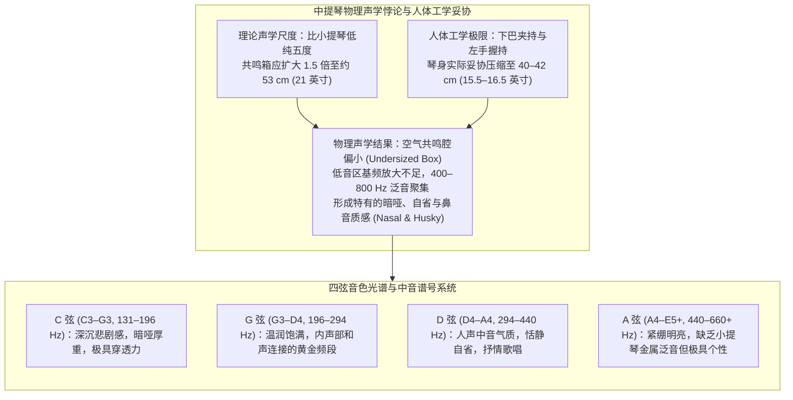

# 中提琴写作

古典室内乐与管弦乐中中提琴的声学形制妥协、音区音色分层与掩蔽矛盾如何推动其从内声部填充蜕变为独立交响声部？

在西方弓弦乐器家族中，中提琴（Viola / Bratsche）占据着最为特殊且充满矛盾的物理声学地位。作为连接小提琴高频光芒与大提琴深沉低音的中音声部，中提琴在古典前期的室内乐与管弦乐队中长期扮演着边缘化的“内声部和声垫料”（Harmonic Filler）角色：它或机械加倍大提琴以加固通奏低音线条（Col Basso），或在双小提琴下方以平庸的跳音与琶音填充三和弦三音。

然而，正是中提琴因人体工学与声学共鸣箱体积妥协所产生的独特“鼻音”（Nasal）与暗哑温润质感，促使海顿晚期、莫扎特与贝多芬逐步打破其作为从属声部的物理枷锁。中提琴不仅在弦乐四重奏中获得了率先领奏对位赋格的独立地位，更在贝多芬交响作品中演变为与大提琴同度歌唱、承载核心动机与中频动态缝合的关键交响生命体。

---

## 1. 物理形制悖论与声学特性：共鸣箱妥协与四弦音色光谱

理解中提琴在配器织体中的独特行为，必须首先揭示其制造史中难以调和的物理声学悖论。

### 1.1 人体工学与声学箱体的形制悖论
小提琴的四弦定音为 $G_3\text{–}D_4\text{–}A_4\text{–}E_5$（基频最低为 196 Hz），琴身标准长度约为 35.5 厘米（14 英寸）。而中提琴的定音严格比小提琴低纯五度，为 **$C_3\text{–}G_3\text{–}D_4\text{–}A_4$**（最低基频为 $C_3 \approx 130.8\text{ Hz}$）。

根据亥姆霍兹共鸣（Helmholtz Resonance）与弦乐器空气共鸣腔物理定律，共鸣箱体的线性尺度应与振动基频成反比。若要达到与小提琴同等饱满的空气共鸣效率，中提琴的共鸣箱长度理论上应当扩大 1.5 倍：
$$\text{理论琴长} \approx 35.5\text{ cm} \times 1.5 \approx 53.25\text{ cm}\ (21\ \text{英寸})$$

然而，长达 53 厘米的庞大琴身将彻底摧毁演奏者的生理极限——乐手无法再用下颌与肩部夹持琴体，左手更无法自如跨越中高把位。为了维持下巴持琴的演奏机动性，制琴师在巴洛克与古典时期不得不做出妥协，将中提琴琴身长度压缩在 **40 至 42 厘米（15.5 至 16.5 英寸）**之间。这一“共鸣箱尺寸先天不足”的声学妥协带来了三重决定性后果：
1. **基频共鸣欠阻尼**：低音 C 弦与 G 弦的最低基频无法获得充分的箱体放大，声音缺乏大提琴般洪亮的下潜声压；
2. **共振峰中频聚集**：琴体空气共鸣峰偏向 400–800 Hz 区间，产生一种略带沙哑、干涩却极其醇厚的独特“鼻音”（Nasal / Husky timbre）；
3. **高把位张力紧绷**：向高音区移动时，由于弦长与张力配比受限，A 弦高音区音色呈现出一种受压抑的戏剧张力，与小提琴开阔飞扬的高频泛音截然不同。

### 1.2 四弦音色光谱与中音谱号记谱
中提琴采用**中音谱号（Alto Clef，中央 C 位于第三线）**记谱。这一记谱法在声学空间与视觉上完美对称地锚定了中提琴的核心有效音区：低音下加一线为 $C_3$（空弦最低音），中线为 $C_4$（中央 C），上加一线为 $G_4$。在此区间内，中提琴几乎无需任何加线即可覆盖第一至第三把位的大部分音符。仅在进入高把位（通常高于 $C_5$）时，总谱才会切换为高音谱号以避免堆叠过多的上加线。

中提琴的四根琴弦呈现出泾渭分明的性格光谱：
- **C 弦（$C_3$–$G_3$）**：中提琴的灵魂所在。发音深沉、凝重，低音粗砺中带有神秘的悲剧性与内省特质；
- **G 弦（$G_3$–$D_4$）**：音色质朴温润，是管弦乐中与第二小提琴、大提琴进行三和弦中音填充与和声粘合的最优介质；
- **D 弦（$D_4$–$A_4$）**：最接近抒情女低音（Contralto）或男高音（Tenor）的温和音区，适合演奏自省、含蓄的对位旋律线条；
- **A 弦（$A_4$–$E_5+$）**：金属感上升但带有收紧的阻尼感，在高音突强（Sforzato）时具有锐利而略带凄厉的穿透力。

### 1.3 空弦交感共鸣与调性色彩亲和度
中提琴的四根空弦（$C_3, G_3, D_4, A_4$）构成了强烈的泛音共鸣网络。当作品处于 C 大调、G 大调或 D 大调等升号与自然调性时，空弦的交感共鸣（Sympathetic Resonance）被大量激发，使得中提琴呈现出难得的开阔明亮质感。

相反，在降 E 大调、降 A 大调或降 B 小调等降号调性中，由于调内核心骨干音（如 $E\flat, A\flat, B\flat$）均需按指阻尼，空弦共鸣几乎完全被切断，中提琴特有的暗哑、封闭与内省质感达到峰值。贝多芬在《第五交响曲》第二乐章（降 A 大调）中将抒情主题赋予中提琴与大提琴，正是精准利用了降号调性对中提琴空弦共鸣的物理抑制，营造出极度私密深情的音色氛围。

此外，中提琴琴弓（Bow）普遍比小提琴弓更重且马尾更宽（约 70–74 克），其起弓阻尼感更强，这使得低音区的发音带有一种独特的颗粒感，强化了运弓的呼吸起伏。

---

## 2. 织体束缚与声学掩蔽：从内声部和声垫料到莫扎特的调音突围

在古典早期的交响曲与四重奏中，中提琴长期受制于作曲家传统的机械分工习惯与声学掩蔽陷阱。

### 2.1 声学掩蔽的双重夹击（Acoustic Masking Dilemma）
由于中提琴的有效音域（130 Hz–1.1 kHz）处于弦乐四部的物理中间层，它在总谱中极易遭受来自上方与下方的**双重声学掩蔽**：
- **上方高频掩蔽（Violin Masking）**：第一、第二小提琴在高频段（1–4 kHz）拥有极高的声能辐射效率与丰富的泛音列。当中提琴在小字一组或小字二组（$C_4$–$G_5$）演奏时，若第一或第二小提琴在同一八度或高八度演奏密集织体，人耳的临界频带（Critical Band）机制将优先捕捉小提琴明亮的瞬态，中提琴的音色极易被完全淹没；
- **下方低频遮蔽（Cello Masking）**：大提琴拥有完全按声学比例制造的庞大共鸣箱体，起振灵敏度与低频能量远强于中提琴。若中提琴与大提琴在低音区演奏相同节奏的八度平行或四度重合，中提琴的微弱鼻音将被大提琴浑厚的声学能量直接吸纳同化。

### 2.2 早期配器惯例的降格囚笼与双音支撑
在巴洛克向古典主义过渡的数十年间，这种掩蔽矛盾导致作曲家普遍采用防御性配器：
1. **通奏低音八度加倍（Col Basso）**：总谱上常常仅简单标记 *Col Basso*，令中提琴机械高八度加倍大提琴线条，完全剥夺其中音声部的独立对位价值；海顿在早期的交响曲与室内乐中同样遵循这一惯性，直到《Op. 20“太阳四重奏”》才开始有意识地让中提琴摆脱低音附庸；
2. **和声垫料（Harmonic Padding）**：在古典早期主调织体中，中提琴被贬为单调的“阿尔贝蒂低音”（Alberti Bass）内声部击打者，专门在中音区重复敲击和弦三音或五音，充当缺乏旋律自主权的背景填充；
3. **双音和声支点（Double Stops）**：然而，中提琴的纯五度定弦赋予了其极易发音的双音能力。当第一、第二小提琴在上方做高空复调缠绕时，中提琴利用包含空弦的纯五度（如 $C_3\text{–}G_3$、$G_3\text{–}D_4$）或纯四度、六度双音，能够独自在大提琴上方支撑起完整的内声部和声骨架。

### 2.3 莫扎特的物理突围：K. 364 中的高半音变调调弦（Scordatura）
据乐器文献与莫扎特研究，自身兼擅小提琴与中提琴演奏的莫扎特对中提琴的声学困境有着深刻的物理直觉。在《降 E 大调交响协奏曲》（Sinfonia Concertante for Violin, Viola and Orchestra）K. 364 中，面对独奏中提琴与独奏小提琴同台竞争穿透力的难题，莫扎特采取了变调调弦（Scordatura in D）策略：
- **变调调弦与记谱**：乐队总谱采用降 E 大调（三个降号），独奏小提琴正常定弦演奏；但独奏中提琴四根弦全部向上调高半音（$C\text{–}G\text{–}D\text{–}A$ 调高为 $D\flat\text{–}A\flat\text{–}E\flat\text{–}B\flat$），记谱则采用带两个升号的 **D 大调记谱**；
- **声学增益机制**：琴弦张力调高后，不仅皮膜振动声压大幅上升，而且在 D 大调指法下，中提琴获得了大量空弦（Open Strings）的自然共振。借由提高弦张力与空弦谐振，莫扎特有效化解了中提琴因共鸣箱偏小导致的声学黯淡，使其得以在交响乐队的轰鸣中与独奏小提琴并驾齐驱。

---

## 3. 贝多芬作品中的中提琴功能解放与乐谱实证

贝多芬继承了海顿与莫扎特的室内乐遗产，在弦乐四重奏与交响曲中实现了中提琴从织体附属到核心交响主角的历史跃迁。

### 3.1 贝多芬 Op. 59 No. 3 终曲赋格：对位主干的率先独奏呈示
在《C 大调第九弦乐四重奏》Op. 59 No. 3 第四乐章（*Allegro molto*，2/2 拍，极速 $d = 84$ 乃至更快的常态演奏速度）中，贝多芬呈现了室内乐史上最震撼的中提琴解放宣言：
- **全曲无伴奏独奏呈示**：乐章开篇并未由第一小提琴或大提琴领奏，而是由中提琴在第 1 至 10 小节完全孤立地以 $pp$ 率先呈示长达 10 小节的赋格主题（Subject，自小字组二分音符 $g$ 起音，随后展开连绵不绝的八分音符极速跃动）；
- **音区与织体地位**：主题在小字组 $c$ 至小字一组 $c^1$ 之间飞速跃动，全部位于中提琴最敏捷、咬字最清晰的 G 弦与 C 弦中高把位；
- **对位层级确立**：直至第 11 小节，第二小提琴才在属音 $d^1$ 上进入答题（Answer），中提琴随即转入极速八分音符对题（Countersubject）。贝多芬在此确立了中提琴在严格复调对位中与第一小提琴绝对对等的戏剧主宰力。

谱例待补：贝多芬《第九弦乐四重奏》Op. 59 No. 3 第四乐章，mm. 1–10（中提琴在 Allegro molto 开篇以 pp 独奏呈示长达 10 小节的赋格主题，确立全曲终局的极速对位主干）

### 3.2 贝多芬 Op. 67 第二乐章：中提琴与大提琴同度齐奏歌唱
在《第五交响曲》Op. 67 第二乐章（*Andante con moto*，降 A 大调，3/8 拍）中，贝多芬开辟了管弦乐中音色混合的全新范式：
- **同度齐奏的音色融合（All'unisono con Violoncelli）**：乐章开篇第 1 至 8 小节，降 A 大调宽广如圣咏的第一主题并未交给小提琴或木管，而是指定由**中提琴与大提琴同度齐奏（Unison）**深情歌唱，音区从弱拍起音 $E\flat$ 向小字一组 $c^1$ 舒展展开；
- **声学互补机制**：大提琴在高把位提供浑厚的人声歌唱泛音，中提琴在中音区（Alto register）提供细腻沙哑的木质阻尼，两者的同度熔合产生了一种兼具厚重与伤感的天鹅绒般质感，成为交响慢乐章中最经典的音色配方；
- **中频运动平面的切换**：紧接着在第 25–28 小节与第 42–49 小节，中提琴迅速从旋律角色解耦，转入密集的连续三连音分解和弦与三十二分音符流动琶音，成为承载木管组第二主题陈述的中频动力推进器。

谱例待补：贝多芬《第五交响曲》Op. 67 第二乐章，mm. 1–8 与 mm. 25–33（中提琴在开篇与大提琴同度齐奏 dolce 歌唱第一主题，并在副题变奏中解耦转化为三连音分解和弦流动背景）

### 3.3 贝多芬 Op. 92 第二乐章：从低音脉搏到高把位对位副题的跨越
在《第七交响曲》Op. 92 第二乐章（*Allegretto*，A 小调，2/4 拍）中，中提琴展现了从低音节奏支柱到高音歌唱线条的全景式职能演进：
- **低音达克提尔脉搏（mm. 3–20）**：在开篇长达 20 小节的呈示中，中提琴使用中音谱号下方的低音区，与大提琴、低音提琴紧密咬合，以 $p$ tenuto 奏出著名的达克提尔核心节奏（四分音符接两个八分音符），奠定全曲冷峻暗涌的葬礼步伐；
- **跃升至高把位副旋律（mm. 21–26）**：当第二小提琴在第 21 小节接管主旋律时，中提琴突然跃出内声部，在小字一组高音区（$c^1\text{–}e^2$）唱出一道如泣如诉的长线条对位副旋律；
- **全奏十六分音符涌动（mm. 27–46）**：随着织体层层增厚，中提琴在第 27 小节转入十六分音符分解八度跳音，并在全奏爆发时以三连音重击缝合弦乐声场。

谱例待补：贝多芬《第七交响曲》Op. 92 第二乐章，mm. 21–26 与 mm. 27–36（中提琴在变奏中跃升至高把位唱出舒展的对位副旋律，随后转入十六分音符分解音型推动管弦全奏高潮）

### 3.4 贝多芬 Op. 131 第一乐章：晚期玄思中的赋格第三答题
在贝多芬晚期《升 c 小调第十四弦乐四重奏》Op. 131 第一乐章（*Adagio ma non troppo e molto espressivo*，升 c 小调，4/4 拍）中，中提琴成为寄托晚期哲学深思的核心载体：
- 第一小提琴弱奏呈示著名的四音核心动机（$g\sharp^1\text{–}b\sharp^1\text{–}c\sharp^2\text{–}a^1\text{–}g\sharp^1$）；在第二小提琴于属音答题后，中提琴在第 9 小节于主音 $c\sharp^1$ 上作为第三声部以极其静穆的 $p$ espressivo 切入；
- 中提琴特有的 C 弦与 G 弦暗哑质感在此被提炼为超脱世俗的灵性光泽，与大提琴在下沉低音区的进入形成深邃的音响景深，证明了中提琴在承载晚期严格复调思维中的不可替代性。

谱例待补：贝多芬 Op. 131 第一乐章，mm. 9–16（中提琴在 m. 9 以静穆的 p espressivo 呈示第三声部答题）；该乐章 mm. 1–8 见[《超乐章目的论》](../structure/teleological-multimovement-integration.md#score-beethoven-op131-i-mm1-8)的同一片段，全库只保留一份。

---

## 4. 历史对照与现代配器启示

中提琴在克服声学掩蔽与形制妥协的过程中积累的配器智慧，为现代管弦乐织体设计与弦乐写作提供了不可替代的结构法则。

| 维度 | 古典前期从属范式（18 世纪中叶） | 贝多芬成熟交响与室内乐范式（19 世纪初） |
| :--- | :--- | :--- |
| **织体角色** | 通奏低音加倍（Col Basso）或内声部跳音和声垫料 | 独立赋格呈示、核心动机承载、长线条对位副旋律 |
| **音区运用** | 局限于 G3–C5 中音安全区，避免高把位与深低音 | 充分开发 C 弦深沉悲剧感与高把位（>C5）紧绷张力 |
| **与大提琴关系** | 机械高八度跟随，声学上被大提琴吸纳同化 | 同度齐奏（Unison）制造复合音色，或形成对位声部分离 |
| **记谱与把位** | 仅用中音谱号，局限于第一把位 | 中音谱号与高音谱号灵活切换，跨越第三至第五把位 |
| **穿透力补偿** | 无补偿（极易被小提琴与大提琴双重掩蔽） | 借助音区拉开、反掩蔽配器与 Scordatura 变调调弦提升声能 |

### 现代管弦乐编配的核心法则

1. **中频塌陷防护律（The Mid-Range Safety Rule）**：在四部弦乐或全乐队管弦配器中，高音小提琴（>600 Hz）与低音提琴/大提琴低音（<150 Hz）之间存在着天然的“中频声学空洞”。中提琴的双音和弦（Double Stops）与中音持续踏板是填平这一空洞的最优声学介质，能有效避免乐队声场呈现“两头大、中间空”的脆裂感。

2. **反掩蔽的音区隔离原则（Register Isolation against Masking）**：当分配中提琴演奏核心旋律或对位主题时，切忌在同一八度内安排第二小提琴或大提琴进行密集的同节奏加倍。必须将伴奏声部推向高纯五度以上或低八度以下，为中提琴独特的 400–800 Hz 鼻音泛音留出干净的听觉频带。

3. **同度齐奏的音色增厚术（The Viola-Cello Unison Recipe）**：中提琴与大提琴同度齐奏（All'unisono）是管弦乐中创造“感伤、内省、天鹅绒质感”的黄金配方。中提琴补充了高频泛音的木质阻尼，大提琴提供了坚实的空气箱体共鸣，二者合力可形成远超单件乐器的抒情厚度。

4. **把位跨度与性格分配**：在现代编配中，必须依据旋律性格精确指派琴弦与把位：表达深沉悲剧感时强制使用 C 弦中低把位；表达静谧歌唱时选用 D 弦中音区；若需在强奏全奏中穿透，则将其引导至 A 弦高把位并辅以重音标记（Sforzato）。

5. **弱音器对共振峰的重塑（Muted Viola Acoustics）**：当在中提琴上使用弱音器（Con Sordino）时，琴码附加质量会强烈滤除 1 kHz 以上的尖锐成分，同时抑制 400–800 Hz 的鼻音峰值，使声音转变为一种极度空灵、宛如远方低语的蒙眬质感。在管弦乐夜曲或挽歌风格中，中提琴加弱音器的分部（Divisi a 2）长音是构建神秘内景空间的首选声部。

6. **管弦分部（Divisi a 2）的立体中频对位**：在全管弦乐队中，将中提琴分为两组（Divisi in 2）能够在大提琴低音线条之上构建出两个平行的内声部微型对位层，这不仅能够解放第二小提琴使其免于频繁兼顾内声部垫料，更能有效防止中频声场过于聚集引发的泥泞混浊。

7. **运弓发音点（Sul Ponticello 与 Sul Tasto）的音色极端化**：中提琴在靠近琴码演奏（Sul Ponticello）时，其空气共鸣腔偏小的物理特征反而转化为声学优势——基频被深度剥离，暴露出极为尖锐刺耳的玻璃质感非谐波金属高频；而在指板上方演奏（Sul Tasto）时，则呈现出类似于排箫或柔和长笛的空心笛音。在现代配器与音色设计中，这种物理极化音色是表达阴森恐惧或虚无超脱情绪的关键配器参数。

8. **声部交叉（Voice Crossing）的织体隐蔽性**：在四部弦乐中，中提琴向上超越第二小提琴的声部交叉，由于同质弓弦音色的高度融合性，听众几乎察觉不到外声部的机械突兀，反而能在中频区激发出独特的鼻音泛音色彩，适合用于副部呈示时的动机隐蔽移交。

9. **揉弦幅度（Vibrato Extent）的中频呼吸感**：由于中提琴共鸣箱较小，无揉弦（Senza Vibrato）的直音极易显得干瘪苍白，而过快过紧的揉弦又会引发声学颤音浑浊。在分配声学表情时，宜采用从直音缓慢展开为宽幅慢揉弦（Molto espressivo e vibrato）的呼吸动态，最大化唤醒木质箱体的共鸣余韵。
