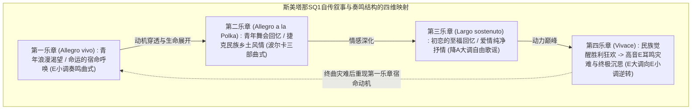

# 自传叙事与四重奏

斯美塔那《我的一生》如何在严密奏鸣构架中承载私密生命叙事与器乐戏剧冲突？

在 19 世纪浪漫主义音乐美学中，[弦乐四重奏](../../ensembles/string-quartet-acoustic-role-differentiation.md)长期被视为纯粹音乐（Absolute Music）与抽象对位思维的最高殿堂。无论是海顿的理性谈话模型，还是贝多芬晚期的超验哲学冥想，室内乐四重奏向来对具象的文学标题与交响诗式的外在描摹保持着高度谨慎。然而，捷克民族乐派奠基人贝德里赫·斯美塔那（Bedřich Smetana）于 1876 年历经完全失聪的沉重打击后，却打破了这一体裁神话，创作了带有鲜明自传性标题的《E 小调第一弦乐四重奏“我的一生”》（*Z mého života / From My Life*）。

斯美塔那在 1878 年致友人的书信中明确指出：“我的意图并非为了炫耀某种形式技艺，而是描摹我一生的生命历程。”然而，与柏辽兹《幻想交响曲》或李斯特交响诗依赖庞大管弦乐队的音色拼贴与戏剧性音响冲击不同，斯美塔那在仅有四把提琴的有限声学容器内，并未摧毁奏鸣曲式、波尔卡舞曲与慢板的古典宏观对称，而是将极为私密的生命叙事——青春的热烈渴望、青年时期的舞会沉醉、对原配妻子的深情眷恋、民族觉醒的胜利狂欢，以及终曲中耳聋耳鸣的毁灭性突变，深度熔铸于严格的声部对位与奏鸣曲式动力学之中。

本文立足于室内乐织体形态学与 OpenScore 机器可读底本，系统探讨斯美塔那如何通过核心动机的宿命隐喻、声部人格化分配、民间舞曲的动力推进与灾难性结构断裂，在弦乐四重奏中确立自传叙事与古典曲式的有机平衡。

---

## 一、标题叙事与四重奏体裁的形式辩证

当自传叙事被引入四重奏这一高度严谨的室内乐体裁时，作曲家面临着双重美学挑战：既不能沦为杂乱无章的散文式音响摹写，又不能让僵化的曲式框限扼杀生命的悲剧真实感。

### 1. 动机象征网络：中提琴的悲剧人格投影

在传统四重奏中，第一小提琴通常垄断绝大多数戏剧性主题的呈示权，中提琴则多作为内声部枢纽（参见 [中提琴写作](../sound/viola-writing-and-orchestral-voicing.md)）。但在《我的一生》第一乐章中，斯美塔那破天荒地将第一声部主导权授予了**中提琴**。

中提琴在提琴家族中具有独特的物理声学特质：其琴体箱体体积相对其低五度调弦（C-G-D-A）略微不足，因而在 C 弦与 G 弦展现出低沉、沙哑、略带鼻音的内省音色。斯美塔那正是利用这一音色质感，将中提琴塑造为作曲家“自我人格”与“宿命倾诉”的象征化身。中提琴那苍凉有力的下行大跳与长音叹息，赋予了全曲无可替代的悲剧性叙事底色。

### 2. 宏观套曲的目的论构型

不同于古典套曲的松散串联，斯美塔那在 SQ1 中展现了高度集成的[目的论统合](teleological-multimovement-integration.md)：
- **情绪向量的前进性**：从第一乐章的压抑求索、第二乐章的世俗狂欢、第三乐章的私密爱情，一路蓄能直至第四乐章的爱国艺术成就顶峰；
- **回溯性结构闭合（Retrospective Closure）**：第四乐章高潮处那声穿透骨髓的极高音 $e^3$ 泛音耳鸣，骤然击碎所有现实狂欢，将乐曲直接拉回第一乐章开篇的宿命动机。这种终局对开篇的回溯，使整部四重奏成为一个完整的生命闭环。

### 3. 严格对位对散文化描摹的形式规训

四重奏的自传性之所以未滑向松散杂乱的偶发记叙，根源在于斯美塔那对声部独立性与动机对位的绝对坚持：
- **纯器乐声学的形式自律**：不同于交响诗可依靠管弦乐音色涂抹（如圆号号角或打击乐重击），弦乐四重奏仅拥有四根同族琴弓与十六根琴弦。任何文学隐喻都必须被翻译为严格的导音解决、半音进行与织体分层；
- **奏鸣冲突的心理化转译**：主部主题的痛苦求索与副部主题的纯洁憧憬，并非平铺直叙的情节交代，而是严格服从奏鸣曲式调性张力（E 小调对比 G 大调）的动力学规律。

### 4. 室内乐自传传统的历史演进

在四重奏历史中，将作曲家的个人危机融入纯器乐并非全无先例：
- **贝多芬的形而上格言**：贝多芬在《A 小调第十五弦乐四重奏》（Op. 132）中写下著名的“病愈者对上帝的神圣感恩歌”（Heiliger Dankgesang），在 Op. 135 终曲题写“非如此不可吗？非如此不可！”（Muß es sein? Es muß sein!）；
- **舒伯特的死亡隐喻**：舒伯特在《D 小调第十四弦乐四重奏》（D. 810）中借用艺术歌曲《死神与少女》的主题变奏，寄托病痛中的绝望抗争；
- **斯美塔那的范式突破**：贝多芬与舒伯特的标题多局限于单一乐章或哲学格言，斯美塔那是音乐史上首位将整部四部结构完整建构为“全景自传编年史”的室内乐作曲家。四个乐章分别对应青年抱负、波尔卡舞会、纯洁初恋与失聪悲剧，将私密叙事与宏观套曲逻辑完成了空前的结构焊接。

---

## 二、第一乐章实证：宿命呼唤与奏鸣冲突（mm. 1–60）

第一乐章为 $4/4$ 拍的 Allegro vivo appassionata，E 小调，262 小节，展现了奏鸣曲式主部主题区从震颤惊雷到抒情歌唱的戏剧性建构。

### 1. 强奏齐鸣与中提琴宿命动机的苍凉呈示（mm. 1–16）

乐章开篇并未有任何传统门厅式的慢速引子，而是以全员极强击弦骤然引爆：

*谱例：斯美塔那《E 小调第一弦乐四重奏“我的一生”》第一乐章，mm. 1–16，低音震音背景上的中提琴宿命独奏主题*

- **声学背景层铺设（mm. 1–4）**：第 1 小节，四件乐器以全奏极强（$ff$）共同敲击 E 小调和弦；紧接着，大提琴死死驻留在大字一组空弦低音 $E_2$ 的持续全音符长音上，第一小提琴与第二小提琴在小字一组展开阴郁的附点十六分音符震音摇摆（$e^1\text{–}g^1$ 与 $g\text{–}b$）。这种由低频踏板与中频冷色震音构筑的背景，构成了典型而压抑的[音响平面分层](../sound/planes-of-tone-layering.md)；
- **中提琴破空而出的独奏（mm. 4–16）**：在密不透风的背景声场中，中提琴在小字一组弱起切入高音 $b^1$，并在第 5 小节以全音符强音（$forte$）唱出震惊全场的宿命核心动机：
  $$b^1 \rightarrow e^1 \rightarrow g^1 \rightarrow b \rightarrow e^1 \rightarrow b \dots$$
  音调包含了强烈的四度与六度大跳，随后在小字组深沉下潜。这一动机具有鲜明的朗诵调（Recitativo）特征，斯美塔那自述此段为“对未知的宿命呼唤与青年热血中不可抑制的向往”；
- **多声部微型回响**：在 mm. 11–16 中，第一小提琴与第二小提琴以极轻的弱奏叹息承接中提琴的尾声，形成犹如命运预兆般的声部间回音。

### 2. 宿命执念的移位与动力激化（mm. 17–30）

宿命动机并非一次性展现。在第 17 小节，全曲发生惊人的调性突变：
- 乐曲骤然落入降 E 大调 / C 小调和声场，大提琴将低音长音下移至大字一组 $E\flat_2$，构成突兀的三度低音下行偏离；
- 中提琴在高八度 $c^2$ 上再度发起宿命呼喊（mm. 21–25: $c^2\text{–}e\flat^1\text{–}g^1\text{–}c^1$），音程扩张展现出更为剧烈的情感挣扎；
- 两把小提琴的震音织体愈发紧密，第一小提琴与第二小提琴在小字一组与小字二组之间展开密集的半音下行模进，增强了调性漂移的惶恐感；
- 中提琴在第 26–30 小节展开连续八分音符级进攀爬，低音大提琴以加重顿音配合切分反冲，使压抑的心理能量呈阶梯式累积。

### 3. 第一小提琴的高音飞升与结构过渡（mm. 31–46）

第 31 小节起，音乐进入激烈的结构过渡段：

*谱例：斯美塔那《E 小调第一弦乐四重奏“我的一生”》第一乐章，mm. 31–46，第一小提琴高八度激情飞升与过渡推进*

- **声部主权移交**：第一小提琴终于接管旋律主权，在第 37 小节跃升至小字三组高位 $b^3$，以撕裂般的高八度全音符咆哮出宿命动机的激化形态；
- **声部间的织体对位**：第二小提琴与中提琴以连续后半拍切分音型逆向运动，大提琴则在低音区以沉重的顿音重击根音；
- **下层声部的同节奏推进**：下层声部退居为坚实的主调和声支撑，以密集的切分和弦推进，共同将奏鸣曲式的展开动能推向断裂点。

### 4. 抒情副题降临与艺术理想的声部编织（mm. 47–60）

在激烈的半音化冲刺后，第 47 小节突然迎来光明的调性转折：
- 音乐进入 G 大调副题区（Meno mosso），大提琴与中提琴在低音区稳健支撑，第一与第二小提琴在小字二组高位（$g^2\text{–}e^2$）唱出极为甜美的三六度平行歌唱（mm. 47–56）；
- 伴奏层采用柔和的波浪形琶音织体，摒弃了主部的尖锐击弦，形成明暗强烈的音响色彩对比；
- 这一柔美而纯净的旋律代表着斯美塔那青年时期对崇高艺术理想的向往与浪漫主义初恋的温暖憧憬，与开篇前 16 小节中提琴的悲怆宿命构成了黑白分明的戏剧性心理二元对抗。

---

## 三、第四乐章实证：民族狂欢与叙事断裂的铺垫（mm. 1–80）

第四乐章（Vivace, $2/4$ 拍，E 大调）展现了斯美塔那对捷克民族民间音乐语汇的高超转化，并为全曲最震撼的悲剧性叙事突变构建了不可或缺的心理与形式反衬。

### 1. 捷克民间舞曲 Skočná 的粗犷切分与狂欢引爆（mm. 1–24）

第四乐章开篇展现出一派狂热、质朴而阳光普照的捷克乡土狂欢场景：

*谱例：斯美塔那《E 小调第一弦乐四重奏“我的一生”》第四乐章，mm. 1–24，捷克民间舞曲狂欢主题与切分节奏*

- **波希米亚跳跃舞曲（Skočná）**：第一小提琴以飞快的十六分音符跳弓与重音切分领衔（mm. 1–8: $g\sharp^2\text{–}a^2\text{–}b^2\text{–}c\sharp^3\text{–}b^2$），运弓强调跳音（Martellato）与尖锐的落弓重音；
- **质朴的重奏敲击**：大提琴演奏粗犷的重音低音跳进（$E_3\text{–}F\sharp_3\text{–}G\sharp_3\text{–}A_3\text{–}G\sharp_3$），第二小提琴与中提琴以连续后半拍切分音型模拟民间风笛与乡村弦乐队的伴奏律动；
- **空弦共鸣与泥土气息**：小提琴与中提琴大量利用 G 弦与 D 弦的空弦共鸣，形成未经沙龙打磨的粗粝民间质感，使四重奏发出有如民间管乐队般的洪亮响度；
- **双小节切分骨架**：全乐章以强烈的二小节超节拍单元推进，前拍落音与后半拍重击形成鲜明的民间脚踏节律；
- **民族意识的觉醒**：斯美塔那在此处以欢腾的捷克民间音调，歌颂自己在民族音乐道路上的伟大成就与民众的狂热欢迎。

### 2. 舞曲动机的切分对抗与低音重击（mm. 25–49）

进入第 25 小节，狂欢能量进一步向全员扩散：

*谱例：斯美塔那《E 小调第一弦乐四重奏“我的一生”》第四乐章，mm. 25–49，舞曲动机交错对抗与粗犷低音推进*

- **切分重音的横向交错**：第一小提琴与中提琴在 B 大调上展开交错的二度锯齿状对位（mm. 25–32: $c\sharp^2\text{–}d\sharp^2\text{–}c\sharp^2\text{–}d\sharp^2$ 对比内声部），展现出强烈的[半音与节拍冲突](../rhythm/hemiola-and-metric-conflict.md)；
- **全员齐奏的踏步感**：大提琴在 mm. 33–36 以级进下行的大全音符连续跺步（$A_3\text{–}G\sharp_3\text{–}F\sharp_3\text{–}E_3$），四件乐器呈现出极具肉体动感与民间节日狂欢的原始生命力；
- **快速动机接力**：短小的二度颤音动机在四把提琴之间以极快速度轮转，织体密度达到白热化状态。

### 3. 民族觉醒的展开高潮与和声扩张（mm. 50–80）

在 mm. 50–80 中，舞曲主题进入调性扩张区：
- 调性由 B 大调向升 F 小调、升 C 大调乃至远关系调性连续冲刷（mm. 53–66），展现出交响化展开部的和声气魄；
- 弦乐四部在极快速度中交替进行十六分音符分解和弦与强音切分，声场在空间上被推展至极限；
- 织体密度由双声部对位迅速跃迁至全员密集和弦纵向挤压，声部间通过反向音阶运动扩大全音域跨度；
- mm. 67–80，低音区持续夯筑属功能长音，中高声部以狂飙突进的齐奏音型冲向呈示部终止式，形成盛大而不可动摇的民族庆典场景。

### 4. 狂欢动力对形式断裂的声学反衬机制

为何斯美塔那要在第四乐章前 80 小节倾注如此饱满无瑕的狂欢动能？
从叙事动力学考察，**前 80 小节建立的生命力越炽热，后文的毁灭便越具毁灭性**。

在乐章后半段（第 222 小节），正当全曲全奏狂欢达到白炽顶点时，整个乐队突然被一道绝对静止的减七和弦震音冰冻，第一小提琴在小字三组极高音上骤然拉响一声长达数十小节、尖锐刺耳的极高音 $e^3$ 泛音（Flageolet）。这是音乐史上最令人心碎的器乐自传象征——它具象地再现了 1874 年斯美塔那彻底失聪前夕脑海中日夜不绝的刺耳耳鸣！前 80 小节的盛大狂欢，在这一声超验的声学尖叫面前瞬间坍塌，为全曲引向失聪后的终极叹息奠定了不可逆的戏剧形式基础。

---

## 四、技法启示：叙事性室内乐的形式语法法则

斯美塔那《我的一生》为现代室内乐创作确立了处理“自传性叙事”与“严格曲式形式”之间复杂关系的典范法则：

1. **动机象征的提炼与人格化分配**：不要试图用音乐直接叙述文学情节，而应将具体事件升华为高度浓缩的音乐象征核。斯美塔那选择具有深沉内省音色的中提琴承担命运呼唤，准确实现了[乐思与编制媒介的双向选择](../../ensembles/bidirectional-selection-of-musical-ideas-and-medium.md)。
2. **利用民间节奏作为生命力的形式引擎**：当叙事需要表达集体欢庆或生命力爆发时，融入具有本土泥土气息的民间舞曲重音与切分律动，能有效打破传统室内乐沙龙化的优雅惰性，赋予音乐不可阻挡的形式前进感。
3. **极化反差作为戏剧断裂的前提**：要实现戏剧性突变或悲剧中断，必须在突变前构建足够坚固、持久且情绪饱满的正向动力场。第四乐章前 80 小节的狂欢越坚实，后文耳聋音符的降临才越显震撼。
4. **终极闭环的回溯性统合**：在多乐章自传叙事套曲中，终曲的解决往往不在于机械的辉煌结尾，而在于向开篇宿命动机的内省回归。通过跨乐章的主题召回，整部作品的叙事张力得以在宏观层面上获得深刻的形而上闭合。
