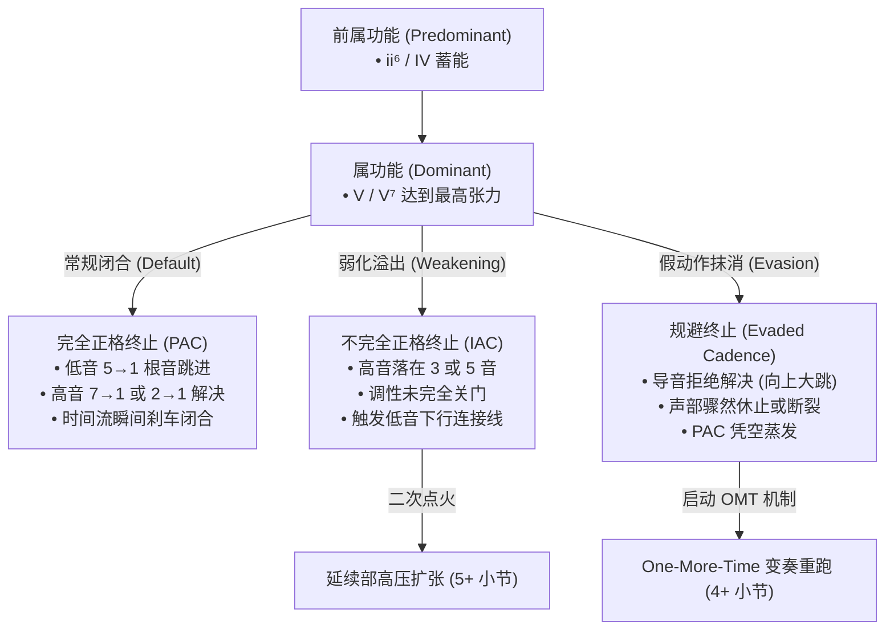

# 终止式延后与时间扩张：古典句法中的规避机制与“再来一次”技术

在调性音乐的传统认知中，**完全正格终止（Perfect Authentic Cadence, PAC）**往往被视作乐句终结与情感释放的最高裁决：导音（$\hat{7}$）或超主音（$\hat{2}$）收束于主音（$\hat{1}$），低音自属音（$\hat{5}$）强劲跃向主音（$\hat{1}$），垂直与水平的声部张力在此归零。

然而，在古典主义曲式教学与现代算法生成音乐的实践中，这种终结力却极易异化为一种审美桎梏——即所谓的**“方整性霸权（The Tyranny of the Four-Measure Phrase）”**（本文用语，探讨源自威廉·罗斯坦 William Rothstein 关于避免 19 世纪四小节超节拍单调均质化的论述）。如果一段音乐每到第 4 或第 8 小节就按部就班地降落于完全正格终止，整部作品将碎裂为一连串呆板封闭的“八小节香肠切片”，彻底丧失宏大的戏剧远景与悠长的呼吸引力。

维也纳古典乐派大师（海顿、莫扎特、贝多芬）之所以能够构建出气势磅礴、跌宕起伏的大型主题，其核心技法不仅在于乐句开端的动机孕育，更在于主题后半程**对终止式的蓄意推迟、假动作规避与时间拉伸（Delaying Cadential Arrival）**。本文依据 Open Music Theory (OMT) 中关于内部扩充（`internalExpansions.md`）、曲式功能（`themeFunctions.md`）与终止类型（`cadenceTypes.md`）的分析框架，系统解构古典句法如何通过“规避终止（Evaded Cadence）”、“终止弱化溢出（IAC Substitution）”与“再来一次（One-More-Time 句法机制）”技术，瓦解机械方整性，实现时间维度上的高阶张力控制。

---

## 1. 核心力学机制：终止预期的能级落差与时间传动

要理解古典作曲家如何拉伸时间，首先必须确立终止式在听觉心理学与和声动力学中的动态引力模型。

在古典乐段或乐句的推进中，前属功能（Predominant, 如 $ii^6$ 或 $IV$）与属功能（Dominant, $V$ 或 $V^7$）的相继出现，会使听者在心智中构建出极强烈的“下沉着陆”预期。依据 OMT 的界定，这种预期的处理方式决定了乐句的呼吸跨度：



### 1.1 常规闭合：能量的瞬间衰减
在标准的原型 8 小节乐句中，属和弦向主和弦的解决瞬间完成了能量泄放。音乐获得稳固平衡的同时，前进的动能也被消耗殆尽。

### 1.2 弱化溢出：未完成感促使动能再燃
当处于必须确立绝对主调权威的呈示部主部（Primary Theme / P）时，不完全正格终止（IAC）被视为一种“能级不足的假性收束”。虽然和声在根音上落实了 $I$ 级，但旋律声部停留在三音（$\hat{3}$）或五音（$\hat{5}$），无法产生终极闭合感。这股未被满足的张力会顺势“溢出”，催生低音声部的级进下行连接线条，迫使音乐重新启动第二波冲刺。

### 1.3 规避终止：心理声学悬崖与向心动能的反弹
规避终止（Evaded Cadence）是古典曲式中最富戏剧性的时间操控技术：前属与属和弦已完成了全部的加压准备，听觉完全确信主音着陆即将发生；然而在最后一瞬间，高音声部的导音突然向上跳跃（如 $\hat{7}$ 跳至高音 $\hat{6}$），或者声部突然落入静默休止。预期的 PAC 根本没有降临——它被彻底“抹消”了。

巨大的向心动能无处泄放，在心理声学上造成了如同“踩空台阶”般的强烈悬念。作曲家便顺理成章地启动**“再来一次”（One-More-Time 机制）**：将此前未完成收束使命的延续单元重新调用并变奏演进，从而在宏观上将时间尺度强行拉伸数个小节。

---

## 2. “再来一次”（One-More-Time）技术与规避终止实证

在主题后半程，规避终止与 One-More-Time 机制的结合是古典大师打破预设小节规模的最有效武器。

### 2.1 莫扎特《C大调第9钢琴奏鸣曲》K. 309 第三乐章（mm. 9–19）

在 K. 309 回旋曲乐章的主题群中，莫扎特构建了一个由两个乐句构成的**复合乐段（Compound Period）**。开端 8 小节作为先行部分在 m. 8 达成半终止（HC），随后大后继句（Large Consequent）在 m. 9 扬帆起航：

1. **原型预期（mm. 9–15）**：
   - mm. 9–12 呈现大呈示部，旋律明朗流淌；
   - mm. 13–15 启动延续功能（Continuation），右手以密集的十六分音符急速奔向属和弦，低音打出坚决的属持续音，一切迹象都预示着 m. 15 拍头将降落于辉煌的 C 大调 PAC；
2. **惊天规避（m. 15）**：
   - 在理应收束的 m. 15，高音声部的导音并未按常规平稳解决至主音，而是向上发生突兀的大跳；
   - 与此同时，左手低音并未稳定停靠在根音主和弦，整个完全正格终止被干净利落地抹消（Evaded Cadence）；
3. **“再来一次”的变奏拉伸（mm. 16–19）**：
   - 终止被规避后，莫扎特立刻启动 One-More-Time 变奏技术，将 mm. 13–15 的延续线条进行更为华丽、加花的变奏重演；
   - 这次“重新冲刺”成功积聚了更强大的向心动能，最终在 m. 19 坚决落实于完全正格终止（I:PAC）；
   - **时间重构**：原本预期的 4 小节后继单元被生生拉伸为整整 11 小节的宏大延续群，创造了超越方整格律的悠长戏剧呼吸。

> **谱例定位**
> - **作品**：沃尔夫冈·阿玛多伊斯·莫扎特《C大调第9钢琴奏鸣曲》K. 309，第三乐章 Rondo: Allegretto grazioso
> - **小节范围**：mm. 9–19
> - **声部编制与 GM 编号**：钢琴双手（GM 0: Acoustic Grand Piano）
> - **调性与拍号**：C 大调，2/4 拍
> - **结构说明**：mm. 9–12 复合乐段大后继句呈示；mm. 13–15 延续冲刺并在 m. 15 遭遇导音未解决与规避 PAC；mm. 16–19 启动 One-More-Time 变奏重跑，终在 m. 19 闭合于 I:PAC

```lilypond title="莫扎特 K.309 第三乐章 第 9–19 小节（NMA 印刷谱 10–20）" location="mm. 9–19"
\version "2.26.0"
\language "english"

\header {
  title = "Mozart: Piano Sonata No. 7 in C major, K. 309 (284b)"
  subtitle = "III. Rondo: Allegretto grazioso · mm. 9–19"
  composer = "Wolfgang Amadeus Mozart (1756–1791)"
  tagline = ##f
}


#(set-global-staff-size 17)

upper = {
  \clef "treble"
  \key c \major
  \time 2/4
  \set Score.currentBarNumber = #9
  \grace { f''16 } e''8( d''16 c''16 c''8 c''8) |
  \grace { b'32[ c''32 d''32] } c''4. c'''8 |
  \grace { b''16 } a''8( g''16 f''16 f''8 f''8) |
  \grace { e''32[ f''32 g''32] } f''4. a''8 |
  \grace { a''16 } g''8( f''16 e''16 e''8) g''8 |
  \grace { g''16 } f''8( e''16 d''16 d''8 f''8) |
  \grace { f''16 } e''8( f''16 d''16) c''8 b'8\trill |
  \grace { a''16 } g''8( f''16 e''16) e'''16\staccato cs'''16\staccato a''16 g''16 |
  \grace { g''16 } f''8( e''16 d''16) d'''16\staccato b''16\staccato g''16 f''16 |
  \grace { f''16 } e''8 a''16 f''16 e''16\staccato g''16\staccato f''16\staccato d''16\staccato |
  c''8 r8 \f c'16 e'16 g'16 c''16 |
}

lower = {
  \clef "bass"
  \key c \major
  \time 2/4
  c'16 e'16 g'16 e'16 c'16 e'16 g'16 e'16 |
  c'16 e'16 g'16 e'16 c'16 e'16 g'16 e'16 |
  c'16 f'16 a'16 f'16 c'16 f'16 a'16 f'16 |
  c'16 f'16 a'16 f'16 c'16 f'16 a'16 f'16 |
  c'16 e'16 g'16 e'16 cs'16 e'16 a'16 e'16 |
  d'16 f'16 a'16 f'16 b16 d'16 g'16 d'16 |
  << { <c' g'>8 d'8 e'8 d'8 } \\ { r8 f8 g4 } >> |
  c'16 e'16 g'16 e'16 cs'16 e'16 a'16 e'16 |
  d'16 f'16 a'16 f'16 b16 d'16 g'16 d'16 |
  << { <c' g'>8 d'8 c'8 b8 } \\ { r8 f8 g4 } >> |
  c'8 <g, g>8 <e, e>8 <c, c>8 |
}

\score {
  \new PianoStaff \with { instrumentName = "Piano" } <<
    \new Staff = "upper" \with { midiInstrument = "acoustic grand" } { \upper }
    \new Staff = "lower" \with { midiInstrument = "acoustic grand" } { \lower }
  >>
  \layout { }
  \midi { }
}
```

---

## 3. 终止弱化与动能溢出：贝多芬式的二次点火

与莫扎特式的优雅戏弄不同，青年贝多芬在运用终止延后时，展现出更为激烈的动力学对抗。

### 3.1 贝多芬《C大调第3钢琴奏鸣曲》Op. 2 No. 3 第一乐章（mm. 1–13）

该奏鸣曲的第一乐章主部主题是一个典型的古典乐句（Sentence）。按古典乐句的标准句法，开端 4 小节呈示句（BI 及其属和弦复述）之后，通常紧接 4 小节延续功能并直接通向完全正格终止，形成紧凑的 8 小节单元：

1. **原型前部（mm. 1–4）**：
   - mm. 1–2 呈现骨骼坚实的四分音符断奏主和弦基本乐念（BI）；
   - mm. 3–4 在属七和弦上做对位重复；
2. **延续与弱化溢出（mm. 5–8）**：
   - mm. 5–8 碎裂为十六分音符跳跃琶音，向心推力不断积聚；
   - **弱化落空（m. 8）**：在预期的收束小节（m. 8），和声虽然给出了 $V - I$ 解决，但上方声部并未落于主音而是停留于和弦三音，构成了能级较弱的不完全正格终止（IAC）；
   - 正如 OMT 在 `internalExpansions.md` 中所强调的：主部主题（P）肩负着确立作品调性地基的重任，极少以软弱的 IAC 结案。这个“能级不足”的终止不仅未能为音乐画上句号，反而像一个高压阀门突然泄压受阻；
3. **低音连接与高压扩张（mm. 8–13）**：
   - 贝多芬在 m. 8 的后半拍安排低音奏出一段**级进下行连接线（Descending Link）**，充当了驱动齿轮；
   - 右手顺势抓住这股动能，在高八度音区重新引爆十六分音符的狂暴模进，将延续功能硬生生再拉伸了整整 5 个小节；
   - 最终，全曲在 m. 13 的强拍，以双手齐奏的原位主和弦轰鸣出绝对无可争议的 I:PAC；
   - **时间重构**：原本 8 小节的简单乐句被改写为一个长达 13 小节的高压爆发单元，展示了终止式如何作为弹簧反冲装置，重构交响化钢琴作品的结构张力。

> **谱例定位**
> - **作品**：路德维希·凡·贝多芬《C大调第3钢琴奏鸣曲》Op. 2 No. 3，第一乐章 Allegro con brio
> - **小节范围**：mm. 1–13
> - **声部编制与 GM 编号**：钢琴双手（GM 0: Acoustic Grand Piano）
> - **调性与拍号**：C 大调，4/4 拍
> - **结构说明**：mm. 1–4 乐句呈示（BI + 重复）；mm. 5–8 延续冲刺，m. 8 降落为弱 IAC（高音停在三音）；mm. 8–13 低音下行连接线触发高八度延续部 5 小节剧烈扩张，至 m. 13 达成强力 I:PAC

```lilypond title="贝多芬 Op.2 No.3 第一乐章 第 1–13 小节" location="mm. 1–13"
\version "2.26.0"
\language "english"

\header {
  title = "Beethoven: Piano Sonata No. 3 in C major, Op. 2 No. 3"
  subtitle = "I. Allegro con brio · mm. 1–13"
  composer = "Ludwig van Beethoven (1770–1827)"
  tagline = ##f
}


#(set-global-staff-size 17)

D = \tweak Stem.direction #DOWN \etc
U = \tweak Stem.direction #UP \etc

\score {
  \new PianoStaff \with { instrumentName = "Piano" } <<
    \new Staff = "rh" \with { midiInstrument = "acoustic grand" } <<
    { \voiceOne {
  \clef "treble" \numericTimeSignature \time 4/4 \key c \major \oneVoice \tempo "Allegro con brio" \U <c'
    e'>2 _\p \U <b d'>16 _( [ \U <c' e'>16 \U <b d'>16 \U <c' e'>16 ) ] \U <d'
    f'>8 -. -. [ \U <c' e'>8 -. -. ] | % 1
  \U <b d'>4 -. -. \U <b g'>4 -. -. r2 | % 2
  \U <d' f'>2 \U <cs' e'>16 _( [ \U <d' f'>16 \U <cs' e'>16 \U <d' f'>16 ) ]
  \U <e' g'>8 -. -. [ \U <d' f'>8 -. -. ] | % 3
  \U <c'! e'>4 -. -. \U <e' c''>4 -. -. r2 | % 4
  \voiceOne \U c''2 _\p \U b'16 ^( [ \U c''16 \U b'16 \U c''16 ) ] \U d''8 -. [
  \U b'8 -. ] | % 5
  \U g'4 \oneVoice \U <e' c''>4 _\sf \voiceOne \U b'16 ^( [ \U c''16 \U b'16 \U
  c''16 ) ] \U d''8 -. [ \U b'8 -. ] | % 6
  \oneVoice \U g'4 ^( \U c''4 \voiceOne \U d'4 \U a'4 ) | % 7
  \U d'4 ^( \U g'4 \oneVoice \U <c' e'>4 ) e'4\rest | % 8
  e'4\rest \voiceOne \U g'2 ^( _\sf \U f'4 ) | % 9

  \barNumberCheck #10
  \oneVoice \U <c' e'>4 \voiceOne \U g'2 ^( _\sf \U f'4 ) | % 10
  \oneVoice \U <g c' e'>4 r4 \U <a c' e' a'>4 r4 | % 11
  \U <g c' e' g'>4 r4 s4 r4 | % 12
  \U c'16 [ _\ff \U e'16 \U g'16 \U c''16 ] \D e'16 [ \D e''16 \D e'16 \D e''16
  ] \D e'16 [ \D g'16 \D c''16 \D e''16 ] \D g'16 [ \D g''16 \D g'16 \D g''16 ]
} }
    { \voiceTwo {
  \clef "treble" \numericTimeSignature \time 4/4 \key c \major s1*4 | % 4
  \D e'2 \D f'2 | % 5
  e'4\rest s4 \D f'2 s2 \D <c' d'>2 | % 7
  \D b2 s2. \D e'4 \D d'4 \D d'4 s4 \D e'4 \D d'4 \D d'4 } }
  >>
    \new Staff = "lh" \with { midiInstrument = "acoustic grand" } <<
    { \voiceOne {
  \clef "bass" \numericTimeSignature \time 4/4 \key c \major \oneVoice <c g>1 | % 1
  \D <g, g>4 -. -. \D <g, g>4 -. -. r2 | % 2
  <g, b>1 | % 3
  \D <c g>4 -. -. \D <c g>4 -. -. r2 | % 4
  \voiceOne g1 ~ | % 5
  \U g4 \U g2. ~ | % 6
  \U g2 \U a2 | % 7
  \oneVoice \D g4 \U g,4 \tweak TupletBracket.stencil ##f \tuplet 3/2 {
    \D c8 [ \D g8 \D fs8 ] }
  \tweak TupletBracket.stencil ##f \tuplet 3/2 {
    \D f8 -. [ \D e8 -. \D d8 -. ] }
  | % 8
  s4 _\sf \voiceOne \U g2 ~ \U g4 | % 9

  \barNumberCheck #10
  \U g4 \U g2 ~ _\sf \U g4 | % 10
  \oneVoice \D g,4 \D c2 _\sf \D fs,4 | % 11
  s2 \voiceOne \U <d f! g b>4 r4 | % 12
  \oneVoice \U <c, e, g, c>4 \clef "treble" \U c'8 [ \U c'8 ] \U c'4 \U e'8 [ \U
  e'8 ] } }
    { \voiceTwo {
  \clef "bass" \numericTimeSignature \time 4/4 \key c \major s1*4 | % 4
  r4 \D c4 \D d4 \D g,4 | % 5
  r4 \D c4 \D d4 \D g,4 | % 6
  \D e4 \D c4 \D f4 \D d4 s1 | % 8
  \oneVoice \D c2 \voiceTwo \D b,16 _( [ \D c16 \D b,16 \D c16 ) ] \D d8 -. [ \D
  b,8 -. ] | % 9

  \barNumberCheck #10
  \D g,4 \D c4 \D b,16 _( [ \D c16 \D b,16 \D c16 ) ] \D d8 -. [ \D b,8 -. ] s1
  | % 11
  \oneVoice \D fs,4 \D g,2 ^\sf \voiceTwo \D <g,, g,>4 s4 \clef "treble" } }
  >>
  >>
  \layout { }
  \midi { }
}
```

---

## 4. 乐节内部扩充与“非标准长度”的力学辨析

在讨论终止式延后（乐句外部扩充）的同时，必须厘清其与另一种微观时间形变——**乐节内部扩充（Sub-phrase Expansion）**的理论界限。

### 4.1 乐节内部扩充：微观动机复述
依据 OMT 的界定，乐节内部扩充发生在 2 小节基本乐念（BI）或对比乐念（CI）的内部，其核心手法是通过动机的局部复述或简单加花，使乐节尺寸突破预期的 2 小节。

在**莫扎特《F大调回旋曲》K. 494（mm. 1–12）**中：
- 开端乐段（Period）在 m. 6 达成半终止（HC），在 m. 12 闭合于完全正格终止（PAC）；
- 这一主题之所以呈现出 6 + 6 的非对称规模，根本原因在于其先行句开端的基本乐念遭遇了**内部扩充**：在 m. 3 中，钢琴几乎原样复述了 m. 2 的下行旋律动机；
- 这种微观复述并不涉及终止式的规避或修改，它只是在句法前端延缓了乐思的行进，使得单个乐节扩充至 3 小节。

### 4.2 曲式学警示：不规则长度（Irregular Lengths）不等于扩充
理解曲式动力学的一大核心原则是：**并非所有非 8 小节的结构都源自“扩充（Expansion）”**。

在 OMT 对**莫扎特《C大调弦乐五重奏》K. 515 第一乐章**开端的深入剖析中，主部主题呈现为一个宏大的复合乐句（Compound Sentence）。其呈示部连续包含了三个复合基本乐念（CBI），每一个都由琶音与加花对比乐念构成：
- 该主题虽然具有超长、不规则的宏大跨度，但这完全是其内生句法设计的原生属性，而非在标准句型上后天剪裁、拉伸或规避终止的结果；
- **理论辨析准则**：唯有当谱面上明确存在**“原有方整预期被打破”、“动机重复导致预期尺寸溢出”或“终止式被推迟重跑”**的确凿力学证据时，曲式分析方可认定为发生了“扩充”。

> **【谱例占位】**
> - **作品**：沃尔夫冈·阿玛多伊斯·莫扎特《F大调回旋曲》K. 494
> - **小节范围**：mm. 1–12
> - **声部编制与 GM 编号**：钢琴双手（GM 0: Acoustic Grand Piano）
> - **调性与拍号**：F 大调，Alla breve 2/2 拍
> - **结构说明**：先行句（mm. 1–6，m. 3 重复 m. 2 形成 3 小节扩充 BI，m. 6 半终止 HC）；后继句（mm. 7–12，m. 12 达成完全正格终止 PAC）

---

## 5. 跨篇技法脉络与创作思维映射

终止式的延后与时间扩张技术，在整个维也纳古典乐派技法网络中构成了宏观时间设计的核心传动轴：

1. **与结构句法轴的联动**：
   - 在前篇[《混合乐段与古典主题句法的多维解耦》](hybrid-themes-and-syntax-decoupling.md)中，我们揭示了“动机组织”与“和声功能”如何在 8 小节框架内实现正交解耦；
   - 而本篇则进一步证明：**“曲式功能”与“物理小节尺度”同样可以解耦**。通过规避终止与 One-More-Time 机制，一个原本 4 小节的延续功能可以弹性膨胀至 8 小节乃至 12 小节，赋予音乐前所未有的呼吸维度。
2. **与节奏冲突轴的联动**：
   - 正如[《跨小节海米奥拉与节拍冲突：从终止制动到离心失重》](../rhythm/hemiola-and-metric-conflict.md)所解析的，海米奥拉是在微观小节网格中通过 3:2 比例撕扯物理重音；
   - 终止式的延后则是在宏观乐句维度上撕扯“超节拍（Hypermeter）”预期，二者共同构成了维也纳古典乐派征服时间的立体力学武器。
3. **与作曲家专题的联动**：
   - 在[《贝多芬钢琴奏鸣曲中慢引子的结构内嵌与动机渗透》](../../composers/beethoven/piano-sonatas/slow-introduction-integration.md)中，贝多芬通过原速召回慢引子暴力切断快板时间流；而在 Op. 2 No. 3 中，贝多芬则通过 IAC 弱化与低音连接线拉伸快板时间流——这体现了同一位交响巨匠在不同结构层级上对“时间连续性”的玩味与重塑。
4. **与复调对位轴的呼应**：
   - 与复调对位专题[《巴赫众赞歌终止式的声部时钟与相位解耦机制》](../../composers/bach/chorale/cadential-voice-clock-and-phase-decoupling.md)中所揭示的微观“四相时钟”相对照，古典乐派的终止规避是主调宏观调性张力在时间轴上的戏剧性投射。
