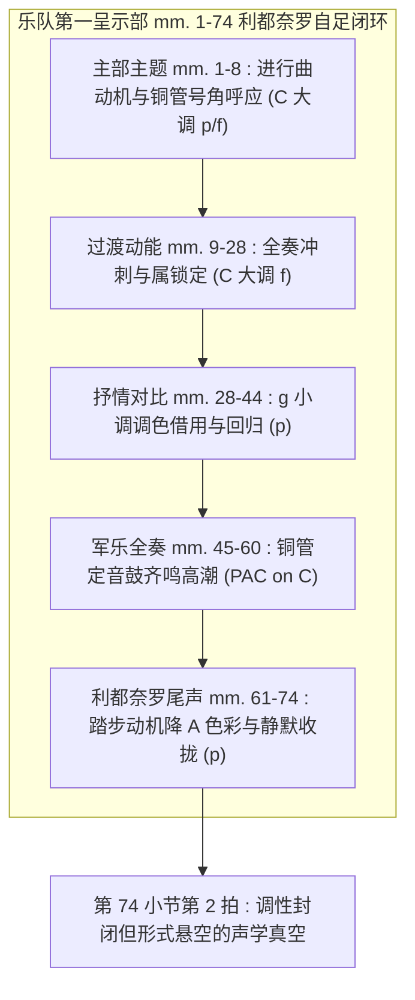
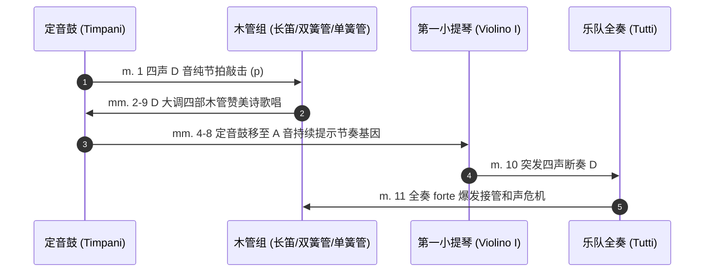

# 协奏原则

古典协奏曲的协奏原则与双重呈示部机制

在西方器乐曲式演变史中，“协奏原则”（Concertante Principle / das konzertierende Prinzip）代表着一种极富戏剧张力的结构组织逻辑。其词源可追溯至拉丁语 *concertare*，兼具“竞奏抗衡”与“协同合力”的双重意涵。进入 18 世纪后半叶，随着维也纳古典乐派在交响曲与奏鸣曲领域的成熟，以沃尔夫冈·阿马德乌斯·莫扎特与路德维希·凡·贝多芬为代表的作曲家，面临着一项极具野心的曲式综合课题：如何将巴洛克晚期托雷利（Giuseppe Torelli）、维瓦尔第（Antonio Vivaldi）与巴赫确立的利都奈罗（Ritornello）原则，与古典主义充满调性动力学、[内聚裂隙](medial-caesura-and-sonata-transition.md)与戏剧对比的奏鸣曲式深度熔铸为一体？

在詹姆斯·赫波科斯基（James Hepokoski）与沃伦·达尔西（Warren Darcy）的奏鸣曲理论中，这一经典构架被归类为“第五类奏鸣曲式”（Type 5 Sonata），亦即传统曲式学所称的“双重呈示部”（Double Exposition）。协奏曲绝非给独奏乐器配以伴奏的交响乐，亦非单纯放大音量的器乐独奏奏鸣曲；它本质上是**全奏集体的体制性陈述（Orchestral Tutti）**与**独奏个体的个性化修辞（Soloist）**之间展开的宏观权力对话。

---

## 一、乐队第一呈示部（R1）：五段式利都奈罗的调性自足性

在古典交响曲的呈示部中，音乐必须在能量驱动下打破主调平衡，跨越内聚裂隙强力调制属调或关系大调。然而，在古典协奏曲的第一呈示部（Ritornello 1 / R1）中，乐队却呈现出一种极为奇特的“调性自足闭合”：乐队不仅陈述多个性格截然不同的主题群，而且自始至终不离开主调，构成一个高度规整的五段式利都奈罗结构。

谱例待补：莫扎特 K.467 第一乐章 mm. 1–28（乐队第一呈示部进行曲动机与管乐对答）——本地仅存 CCARH MuseData md2 编码，本轮未做 MusicXML 核验，暂不嵌入。

### 1. 莫扎特 K.467 第一乐章的五段式全奏模块

莫扎特于 1785 年完成的《C 大调第二十一钢琴协奏曲》（K.467）第一乐章（快板，Allegro maestoso，4/4 拍），其乐队呈示部（mm. 1–74）展现了典范的五段式利都奈罗构造：

1. **主部主题群（mm. 1–8）**：
   - 第 1–4 小节：低音弦乐与两部小提琴以极轻的弱奏（$p$）奏出低沉而富有推进感的进行曲节奏型。低音提琴与大提琴在下行跳进（$C3 \to G2 \to C3 \to E3$）上形成断奏骨架，第一小提琴以平稳的八分音符回旋（$c^1 \to e^1 \to c^1$）展开叙述；
   - 第 5–8 小节：双簧管两支、大管两支、C 调圆号两支、C 调小号（Clarini）两支与定音鼓突然在强奏（$f$）中以军乐号角动机（$g^1 \to g^1 \to g^1 \to c^2$）强力呼应，形成弦乐幽暗质感与管乐辉煌齐鸣的声学对峙。
2. **动能过渡段（mm. 9–28）**：
   - 第一小提琴展开跨越两个八度的十六分音符音阶与琶音冲刺（$C6 \to B5 \to A5 \to G5 \dots$），低音声部以持续的八分音符步态推进；
   - 乐队在第 20–28 小节通过连绵的属和弦延长与半终止停顿（HC on G），积蓄起巨大的交响声能，但始终将调性牢牢锁定在主调 C 的引力场内。
3. **抒情对比群（mm. 28–44）**：
   - 弦乐组与木管组展开安详的歌唱性对话。极为引人注目的是，莫扎特在第 28 小节突然引入带降号色彩的 g 小调阴影（双簧管与第一小提琴奏响下行降 B 音），制造出短暂的内聚忧伤；
   - 该调性偏移并非真正的结构性转调，而是同主音小调的色彩借用，旋即于第 36 小节通过终止图式平稳回归 C 大调明朗音响。
4. **军乐全奏高潮（mm. 45–60）**：
   - 全体木管与铜管组开足马力，长笛与小号在高八度穿透齐奏，定音鼓以密集的滚奏轰击节拍，展现交响集体的宏大声能极限；
   - 该段落在主调上形成两次强烈的完全正格终止（PAC），彻底封死了向外转调的可能性。
5. **利都奈罗收束群（mm. 61–74）**：
   - 全奏能量逐渐回落，以安静的行进踏步节拍构建完全收拢；
   - 第 72–73 小节，低音弦乐突然下沉至孤立的降 A 音（$A\flat3$ 的那不勒斯和弦色彩），随后在第 74 小节第 2 拍以单薄的拨奏休止，在悬空中为独奏乐器的进入留出声学真空。

### 2. 预备期待与调性封闭的功能辩证

乐队第一呈示部之所以必须保持在主调范围，是由协奏曲的深层戏剧逻辑决定的：若乐队在第一呈示部中便完成了向属调的真正结构调制，那么随后登场的独奏乐器就将丧失“开辟全新调性天地”的核心剧场特权。

R1 的首要任务是**建立完备的材料库与调性牢固地基**，同时通过第 74 小节的收束弱化制造出巨大的听觉真空，将“谁将打破这一调性静止局面”的期待推向顶峰。

---

## 二、独奏介入的剧场性拓扑：独立引子与音色解耦

当乐队完成完整的五段式陈述并静止之后，独奏乐器的登场绝非亦步亦趋地重复乐队主题，而是以高度个体化的音色与织体打破既定秩序。

谱例待补：莫扎特 K.467 第一乐章 mm. 74–91（独奏钢琴独立引子与长颤音介入）——底本同上，仅 md2，暂不嵌入。

### 1. 莫扎特 K.467：自由即兴的华彩引子（Eingang）

在 K.467 的第 74 小节第 2 拍，独奏钢琴并未立即演奏第一主题的进行曲节奏，而是弹奏出一段完全游离于严谨节拍之外的抒情华彩引子：

- **半音微澜（mm. 74–79）**：钢琴右手以行云流水般的十六分音符分解音型，在 $G4$ 音周围展开优美的回旋装饰（$G4 \to A4 \to G4 \to F\sharp4 \to G4 \to D4 \to B4 \dots$），音区逐渐向上攀升；
- **持续长颤音（mm. 80–83）**：在第 80 小节，右手在光彩夺目的 $G5$ 音上拉开整整四小节的持续颤音（Trill），左手则以长音和弦铺垫极弱和声；
- **歌唱性过渡（mm. 84–90）**：钢琴随后以优美的装饰下行音阶与分解和弦，像歌剧女高音般完成一圈独奏炫技式环视；
- **主题正式接管（m. 91）**：直至第 91 小节，钢琴右手才以明亮的单音（$C5 \to E5 \to C5$）正式接过第 1 小节的主部进行曲主题，左手以活跃的八分音符阿尔贝蒂低音伴奏，开启了全新的音响动力。

莫扎特通过这段独立引入（Eingang），在剧场层面上宣告了独奏钢琴的“主权独立”：它不仅是乐队的对等伙伴，更是拥有专属时间自由与浪漫抒情维度的个体角色。

### 2. 贝多芬 Op.61：三八度飞跃的破空介入

如果说莫扎特的切入是歌剧式的从容登场，那么贝多芬在其《D 大调小提琴协奏曲》（Op. 61）第一乐章（mm. 89–100）中，则赋予了独奏介入更为激进的声学冲击力。

在长达 88 小节的庞大全奏利都奈罗以强烈的 D 大调完全终止落幕后，第 89 小节第 1 拍乐队全员止息。在绝对的声学静默中，独奏小提琴在第 2 拍破空切入：

- 独奏小提琴完全舍弃了长篇引子的舒缓铺陈，以倚音带出的分解八度（Broken Octaves）如阶梯般剧烈向上飞跃：
  $$A3/A4 \to C\sharp4/C\sharp5 \to E4/E5 \to G4/G5 \to A4/A5 \to C\sharp5/C\sharp6 \to E5/E6 \to G5/G6$$
- 从中提琴音区（$A3$）一口气飙升至小提琴极高音区（$G6$），随后在第 91 小节爆发带颤音的高音回旋与三连音琶音瀑布；
- 独奏小提琴以其锐利、穿透的裸露音响，瞬间撕裂了乐队构筑的厚重声学包裹，以个体英雄般的姿态夺取了整个音响空间的控制权。

---

## 三、动机基因与异化重塑：贝多芬 Op.61 的交响化协奏构思

贝多芬在继承莫扎特协奏曲构架的同时，将交响乐的统一动机思维推向了前所未有的深度。Op. 61 第一乐章展示了如何将一个非旋律性的纯节奏音型贯穿于双重呈示部的全过程。

谱例待补：贝多芬 Op.61 第一乐章 mm. 1–18（定音鼓节拍动机与第 10 小节小提琴 D♯ 半音突变）——本地无该曲机器可读谱（OpenScore 与 PDMX 均无协奏曲），暂不嵌入。

### 1. 定音鼓动机的结构锚定（mm. 1–2）

乐章开篇由定音鼓在绝对孤立的弱奏（$p$）中敲响四下纯四分音符节奏：
$$D3 \to D3 \to D3 \to D3 \to D3 (\text{第 2 小节强拍})$$
这一音型不含任何旋律起伏，完全由单纯的律动构成，紧接着长笛、双簧管与单簧管在第 2 小节以柔和的四部赞美诗合唱接续主部旋律。定音鼓在第 5 小节转移至属音 $A2$ 继续敲击，确立了纯五度的节拍骨架。该五连发节拍动机成为整部协奏曲的“动机基因”，在随后的全奏与独奏段落中无处不在。

### 2. 第 10 小节第一小提琴 $D\sharp$ 的异化突变

在开篇田园牧歌式的平和陈述中，第 10 小节突然爆发了古典协奏曲中最著名的声学异变：

- 弦乐组在第 1–9 小节中一直保持静默；在第 10 小节，第一小提琴突然切入四个断奏的八分音符：
  $$D\sharp4 \to D\sharp4 \to D\sharp4 \to D\sharp4$$
- 这一音型在节拍形态上严格复制了第 1 小节定音鼓的敲击骨架，但在音高上却是一个极度刺耳的半音离调音（升高半音的减五度音或升主音）；
- 这个 $D\sharp$ 音瞬间制造了强烈的和声危机感，引发了第 11 小节乐队全员在属七和弦上的强奏爆发。

这种将动力学突变隐藏在第一呈示部内层的构思，不仅丰富了[音响平面分层](../sound/planes-of-tone-layering.md)，更为独奏小提琴在第二呈示部中的动机转化埋下了深刻的戏剧伏笔。

---

## 四、双重呈示部的权力拓扑与调性离心力

当独奏乐器进入第二呈示部（Solo 1 / S1）后，古典协奏曲真正的奏鸣曲式动力学全面启动：

| 结构维度 | 乐队第一呈示部（R1，mm. 1–74 / 1–89） | 独奏第二呈示部（S1，mm. 75–140 / 89–223） |
| :--- | :--- | :--- |
| **调性策略** | 严格闭合于主调（Tonic Closure） | 启动主动离调（Modulating Bridge to Dominant） |
| **材料归属** | 公共仪式性主题库、军乐全奏号角 | 独奏专属抒情主题、即兴华彩与装饰变奏 |
| **织体关系** | 均质家族加倍、全奏块面轰鸣 | 独奏穿梭领衔、木管对答唱和、低音骨架支撑 |
| **终止目标** | 调性内正格终止，留下形式悬空 | 属调终极完全正格终止（EEC），迎来 R2 全奏接管 |

### 1. 动机权力的重组与协商

独奏乐器既接管乐队在 R1 中呈示的公共材料，又必然引入独奏特有的专属新主题。在莫扎特 K.467 中，钢琴在第 128 小节呈现了一支充满轻快跃动感的全新副部旋律，该旋律从未在乐队呈示部中出现，构成了独奏专属的“私密修辞空间”。在贝多芬 Op. 61 中，独奏小提琴在进入第二主题时，通过极高音区（$d^3 \to f\sharp^3$）纯净的连音歌唱，将乐队原本厚重的木管赞歌升华为空灵飘逸的个人独白。

### 2. 调性离心力的释放与终极闭合

不同于 R1 的主调闭环，S1 必须承担起奏鸣曲式的调制使命。在 K.467 第 109–120 小节与贝多芬 Op. 61 第 101–118 小节中，独奏乐器化身为强大的调性发动机，通过连绵的模进、快速和声节奏与华彩琶音，将调性强行拉离主调，最终稳固锚定在属调（G 大调 / A 大调）的完全正格终止之上。随后全奏乐队以强烈的第二利都奈罗（R2）冲刺高潮，完成对独奏阶段能量的集体回收与再确认。

### 3. 宏观曲式映射：利都奈罗与奏鸣曲式的多层嵌套

从宏观建筑学审视，维也纳古典协奏曲第一乐章通过四个利都奈罗（R1–R4）与三个独奏段（S1–S3）实现了交织嵌套：

1. **R1 与 S1（双重呈示部）**：集体陈述与个体离调；
2. **R2 与 S2（展开部）**：全奏确立属调界标，独奏随后向远达调性（如 K.467 游移至 g 小调、d 小调与 f 小调）展开复调冒险；
3. **R3 与 S3（再现部）**：全奏与独奏握手言和，共同在主调上回收并重构前述所有主题；
4. **华彩段（Cadenza）与 R4（尾声）**：独奏在主和弦终止四六和弦上爆发即兴终极炫技，随后全奏以短促有力的末次利都奈罗为整部作品盖上宏伟的集体印章。

这种在“公共仪式”（全奏利都奈罗）与“个体心灵”（独奏器乐修辞）之间建立的双向张力，确立了古典协奏原则历久弥新的艺术魅力。
