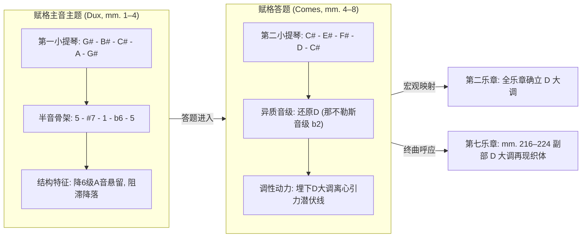
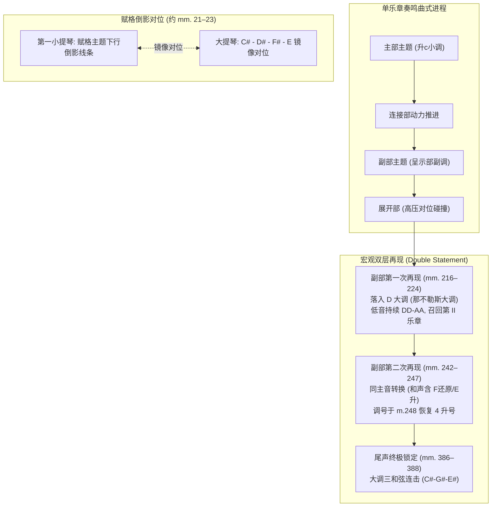

# 超乐章目的论

<p class="doc-subtitle">多乐章套曲如何通过开篇核心动机的逆向互补与全景式调性映射实现跨乐章的超曲式闭合？</p>

在传统多乐章器乐套曲（交响曲、弦乐四重奏、奏鸣曲）的创作与分析中，乐章往往被视作相对孤立的结构模块：第一乐章遵循奏鸣曲式确立主调，第二乐章转向下属或关系大调抒情，第三乐章提供舞曲律动，终乐章以回旋曲或快速奏鸣曲式热烈收尾。这种基于“快—慢—舞—快”速度对比与常规调性调配的装配逻辑，在古典早期确立了清晰的听觉秩序。然而，在大型严肃作品的构思中，模块化拼装容易导致乐章之间缺乏不可逆的时间推进必然性，作品沦为数个互不相干篇章的松散并置。

维也纳古典晚期（以贝多芬晚期四重奏为代表）重塑了多乐章套曲的内在结构。作曲家不再将套曲视作若干独立乐章的汇编，而是将其构建为一个由统一底层构图（Integral Groundplan）支配的有机连续体。通过在开篇埋设具有强烈半音张力的微观动机核心，并在后续乐章中将这一音级逐步放大为相异的调性空间与体裁面貌，最终在末乐章启动双层再现（Double Recapitulation）与逆向互补（Reverse Complement），将全曲的离心动能彻底回收并实现闭合。

本文依据凯文·巴里（Kevin Barry, 1990）对贝多芬《升 c 小调弦乐四重奏》（Op. 131）草稿本演进与结构决定元（Structural Determinants）的研究，结合机器可读原谱逐小节事实核验，解构多乐章套曲如何从开篇动机核心出发，经由调性映射与末乐章逆向再现，实现跨乐章的目的论统合。

---

## 1. 结构决定元：赋格主题中的动机胚胎与那不勒斯音级

超乐章目的论（Teleology）的核心前提是：整部多乐章作品的发展方向与终极解决，在作品开端的主题材料中就已经被预先确立。

贝多芬在 Op. 131 中打破了古典四重奏必以快速奏鸣曲式开篇的惯例，代之以一首内敛沉思的慢速赋格（第一乐章，Adagio ma non troppo e molto espressivo）。存世的二百余页草稿表明，贝多芬绘制了三次全曲整体构图草图，整个七乐章连续体均紧密围绕第一乐章赋格的主题与答题展开。



### 1.1 主题（Dux）的半音核心与声部悬留
第一小提琴在弱起第四拍进入的赋格主题（mm. 1–4）由五个音构成核心框架：$G\sharp\text{–}B\sharp\text{–}C\sharp\text{–}A\text{–}G\sharp$。这一线条内嵌了紧密的音程张力：
- 导音 $B\sharp$ 向主音 $C\sharp$ 的上行解决随后被下中音 $A$（降 6 级）打断；
- $A\text{–}G\sharp$ 的半音下行构成了悬留阻尼，使音乐在第一乐章开端就呈现出强烈的内省张力；
- 这一线条并非孤立的旋律，而是后续乐章调性关系与旋律变形的动机源泉。

### 1.2 答题（Comes）中的那不勒斯音级异化
在第 4 小节第四拍，第二小提琴在 $f\sharp$ 小调方向（即下属方向答题，Barry 论文称为 fugue answer）进入。第二小提琴在第 6 小节高点唱出**还原 D（$D\natural$）**：
$$C\sharp - E\sharp - F\sharp - \mathbf{D\natural} - C\sharp$$
这个还原 D 是主调升 c 小调的**降二度音级（那不勒斯音级，$\flat\hat{2}$）**。在赋格局部，它作为下属调的下中音出现；但从宏观结构来看，它在升 c 小调的中心调性上埋下了一个半音离心因素。

```lilypond title="贝多芬 第14弦乐四重奏 Op.131 第一乐章" location="Adagio ma non troppo e molto espressivo，弱起 + mm.1–8" id="beethoven-op131-i-mm1-8"
\version "2.26.0"
\language "english"


global = {
  \key cs \minor
  \time 2/2
  \tempo "Adagio ma non troppo e molto espressivo" 4 = 69
}

violinoI = {
  \global
  \clef treble
  \set Staff.midiInstrument = "violin"
  \partial 4
  gs'4\p( |
  bs'2 cs''2) |
  a'2.( gs'4 |
  fs'4 a'4 gs'4 fs'4) |
  e'4 fs'4 gs'2~ |
  gs'4 b'2 a'4~ |
  a'4 es'4 fs'4 a'4 |
  g'4 es'2 es''4 |
  fs''2( e''4 ds''4) |
}

violinoII = {
  \global
  \clef treble
  \set Staff.midiInstrument = "violin"
  \partial 4
  r4 |
  r1 |
  r1 |
  r1 |
  r2. cs'4\p( |
  es'2 fs'2) |
  d'2.( cs'4 |
  b4 d'4 cs'4 b4 |
  a4 b4 cs'4) bs4 |
}

viola = {
  \global
  \clef alto
  \set Staff.midiInstrument = "viola"
  \partial 4
  r4 |
  r1 |
  r1 |
  r1 |
  r1 |
  r1 |
  r1 |
  r1 |
  r2 r4 gs4\p |
}

violoncello = {
  \global
  \clef bass
  \set Staff.midiInstrument = "cello"
  \partial 4
  r4 |
  r1 |
  r1 |
  r1 |
  r1 |
  r1 |
  r1 |
  r1 |
  r1 |
}

\score {
  <<
    \new StaffGroup <<
      \new Staff \violinoI
      \new Staff \violinoII
      \new Staff \viola
      \new Staff \violoncello
    >>
  >>
  \layout { ragged-right = ##f }
  \midi { }
}
```

在第一乐章后半段的密接和应（Stretto）中，第二小提琴在第 94–95 小节再次强化这一带有还原 D 的答题变形；而在尾声（mm. 111–112），大提琴以强奏（$f$）在最低音区连续奏出大字一组与大字组的低音 $D\natural$（$DD\natural\text{–}D\natural$），随后滑入主音升 C。第一乐章并未彻底解决还原 D 的张力，而是将其作为未解决的调性线索留给后续乐章。

---

## 2. 调性映射：七乐章连续体的结构分布

Op. 131 的 7 个乐章严格不间断连奏（attacca）。各乐章的调性选择与第一乐章赋格音级存在直接的宏观呼应：

| 乐章编号 | 速度与体裁 | 确立调性 | 与主调（升 c 小调）关系 | 动机源起与结构功能 |
| :--- | :--- | :--- | :--- | :--- |
| **I** | Adagio ma non troppo（赋格） | 升 c 小调 | 主调（$i$） | 动机母体（确立 $C\sharp$ 与那不勒斯音 $D\natural$ 的张力） |
| **II** | Allegro molto vivace（轻快舞曲式） | **D 大调** | **那不勒斯大调（$\flat II$）** | 第一乐章答题 m. 6 与 m. 112 还原 D 的实体化展开 |
| **III** | Allegro moderato - Adagio（11小节宣叙调） | b 小调 $\to$ 升 f 小调 | 调性过渡链条 | 连接第二乐章 D 大调与第四乐章 A 大调 |
| **IV** | Andante ma non troppo（主题与变奏） | **A 大调** | **下中音大调（$VI$）** | 呼应赋格主题最高音 $A$（降 6 级音级的抒情变奏展开） |
| **V** | Presto（全曲极速谐谑曲） | E 大调 | 关系大调（$III$） | 赋格前半段动机紧缩向关系大调的动力释放 |
| **VI** | Adagio quasi un poco andante | 升 g 小调 | 属调（$v$） | 属方向收拢，为终曲建立属准备 |
| **VII** | Allegro（终曲奏鸣曲式） | **升 c 小调** | **终极回归主调（$i$）** | 动机倒影对位与跨乐章双层再现 |

这一布局呈现出清晰的组织逻辑：
1. **第二乐章的直接衔接**：第一乐章以升 C 音消逝后，第二乐章直接以 D 大调和弦切入，使第一乐章答题中的那不勒斯还原 D 扩展为一个完整的乐章；
2. **第四乐章的中心地位**：变奏曲式坐落在 A 大调上，呼应了赋格主题中的高点音 A，并在全曲中部提供了一段宽广的冥想空间；
3. **第五至第六乐章的动能回收**：E 大调 Presto 释放速度张力，随后第六乐章以 28 小节的升 g 小调过渡段建立属准备，将音乐引向终曲。

---

## 3. 终曲的逆向互补与双层再现机制

第七乐章（Allegro）不仅承担着单乐章奏鸣曲式自身的展开，更承担着整部作品的宏观再现与调性清算使命。



### 3.1 动机的倒影变形与镜像对位
在终曲呈示部开头（约 mm. 21–23），第一小提琴奏出与第一乐章赋格主题形成倒影关系的下行线条（巴里指出此处第三主题为赋格主题的明确倒影）。在同一时刻，大提琴在低音声部以镜像对称的线条向上推进：
$$C\sharp - D\sharp - F\sharp - E$$
第一小提琴的下行与大提琴的上行构成严密的对位骨架，赋格主题在第一乐章中的下行阻尼在终曲中被转化为向前推进的动能。

```lilypond title="贝多芬 第14弦乐四重奏 Op.131 第七乐章" location="Allegro，mm.21–26" id="beethoven-op131-vii-mm21-26"
\version "2.26.0"
\language "english"


global = {
  \key cs \minor
  \time 2/2
  \tempo "Allegro" 2 = 120
}

violinoI = {
  \global
  \clef treble
  \set Staff.midiInstrument = "violin"
  cs''2. cs'''4 |
  bs''2 a''2 |
  gs''2. cs'''4 |
  bs''4\p cs'''4 ds'''4 e'''4 |
  ds'''4 r2 cs'''4 |
  bs''2 a''2 |
}

violinoII = {
  \global
  \clef treble
  \set Staff.midiInstrument = "violin"
  e'2. e'4 |
  fs'2 a'4 fs'4 |
  bs'2 cs''4 e'4 |
  fs'4\p e'4 ds'4 cs'4 |
  bs'4 r2 e'4 |
  fs'2 a'4 fs'4 |
}

viola = {
  \global
  \clef alto
  \set Staff.midiInstrument = "viola"
  cs'4 r8 gs8 gs4 r8 gs8 |
  gs4 r8 gs8 gs4 r8 gs8 |
  gs4 r8 gs8 gs4 r8 gs8 |
  gs4\p r8 gs8 gs4 r8 gs8 |
  gs4 r8 gs8 gs4 r8 gs8 |
  gs4 r8 gs8 gs4 r8 gs8 |
}

violoncello = {
  \global
  \clef bass
  \set Staff.midiInstrument = "cello"
  gs4 r2 cs4 |
  ds2 fs2 |
  e2. cs4 |
  ds4\p cs4 bs,4 cs4 |
  gs,4 r2 cs4 |
  ds2 fs2 |
}

\score {
  <<
    \new StaffGroup <<
      \new Staff \violinoI
      \new Staff \violinoII
      \new Staff \viola
      \new Staff \violoncello
    >>
  >>
  \layout { ragged-right = ##f }
  \midi { }
}
```

### 3.2 逆向互补（Reverse Complement）的调性回溯
巴里（Barry, 1990）指出，终曲对前序乐章调性的引用呈现出逆向回溯的秩序。套曲前序乐章的调性演进为：
$$\text{升 c 小调 (I)} \longrightarrow \text{D 大调 (II)} \longrightarrow \text{A 大调 (IV)} \longrightarrow \text{E 大调 (V)} \longrightarrow \text{升 g 小调 (VI)}$$
而在终曲的展开与再现进程中，调性引用以相反的次序逐步回卷，形成结构上的逆向对应。

### 3.3 副部主题的双重再现（Double Statement）
终曲最具特色的笔触出现在再现部（Recapitulation）。常规奏鸣曲式的副部主题在再现部通常直接回到主调，而贝多芬在此采用了双重陈述机制：

1. **第一次再现（mm. 216–224）：那不勒斯 D 大调踏板织体的突袭**
   根据巴里（Barry, 1990）的曲式分析，终曲呈示部的副部主题（contrasting second subject）始于第 56 小节（E 大调），其典型织体特征即为低音踏板上展开的下行流动线条。在再现部主部之后，音乐并未直接回到升 c 小调，而是在第 216 小节以 **D 大调** 启动副部主题的第一次再现。在声部事实中，此处表现为大提琴持续击出纯五度低音踏板（$DD\text{–}AA$ 与 $EE\text{–}AA$ 两小节一组交替），内声部铺展持续和声，第一小提琴以极轻的弱奏（$p$）在上方展开由主和弦三音 $f\sharp$ 下行流动的八分音符旋律与高音八度华彩（mm. 216–224）。这段建立在 D 大调持续低音之上的副部再现织体，是对全曲第二乐章 D 大调以及第一乐章第 6、第 112 小节还原 D 的宏观回响。

```lilypond title="贝多芬 第14弦乐四重奏 Op.131 第七乐章" location="Allegro，mm.216–224（D 大调）" id="beethoven-op131-vii-mm216-224"
\version "2.26.0"
\language "english"


global = {
  \key d \major
  \time 2/2
  \tempo "Allegro" 2 = 120
}

violinoI = {
  \global
  \clef treble
  \set Staff.midiInstrument = "violin"
  fs''2\p~ fs''8 e''8 d''8 cs''8 |
  d''8 cs''8 b'8 a'8 g'8 fs'8 e'8 d'8 |
  d'4. cs'8 a''2 |
  a''2 a''2 |
  a''2\p d'''2 |
  fs'''2 a'''2 |
  a''2 cs'''2 |
  e'''2 a'''2 |
  a''2\p d'''2 |
}

violinoII = {
  \global
  \clef treble
  \set Staff.midiInstrument = "violin"
  <a a'>1\p~ |
  <a a'>1 |
  <a a'>1~ |
  <a a'>1 |
  <a a'>2\p fs'2~ |
  <a fs'>1 |
  <a g'>1~ |
  <a g'>1 |
  fs''2\p~ fs''8 e''8 d''8 cs''8 |
}

viola = {
  \global
  \clef alto
  \set Staff.midiInstrument = "viola"
  fs1\p~ |
  fs1 |
  g1~ |
  g1 |
  fs'2\p~ fs'8 e'8 d'8 cs'8 |
  d'8 cs'8 b8 a8 g8 fs8 e8 d8 |
  d4.\p cs8 a'2 |
  a'2 a'2 |
  <a fs'>1\p |
}

violoncello = {
  \global
  \clef bass
  \set Staff.midiInstrument = "cello"
  <d, a,>1\p~ |
  <d, a,>1 |
  <e, a,>1~ |
  <e, a,>1 |
  <d, a,>1\p~ |
  <d, a,>1 |
  <e, a,>1~ |
  <e, a,>1 |
  <d, a,>1\p |
}

\score {
  <<
    \new StaffGroup <<
      \new Staff \violinoI
      \new Staff \violinoII
      \new Staff \viola
      \new Staff \violoncello
    >>
  >>
  \layout { ragged-right = ##f }
  \midi { }
}
```

2. **第二次再现与同主音转换（mm. 242–247）**
   紧接着在第 242 小节，大提琴低音转至 $CC\sharp\text{–}GG\sharp$，副部旋律以同构形态进入。此处和声呈现出同主音转换色彩：中提琴与第二小提琴记有 $F\natural$（即大调三音 $E\sharp$ 的等音记谱），第一小提琴唱出 $2eee\sharp$。但这一大调色彩并未持续建立独立段落，在第 248 小节乐谱调号即重新恢复为 4 个升号（升 c 小调调号），音乐随后继续在小调的对位织体中深入推进。

3. **尾声的最终大调解决（mm. 386–388）**
   真正确立升 C 大调三和弦终极解决的是全曲尾声。在第 386 小节后半拍，四件乐器以极强（$ff$）齐奏大调三和弦琶音（$C\sharp\text{–}E\sharp\text{–}G\sharp\text{–}c\sharp$）；随后在第 387 小节后两拍与第 388 小节第一拍，全四重奏以短促强烈的齐奏连续击出**三个升 C 大调全奏三和弦（$\text{C}\sharp\text{–E}\sharp\text{–G}\sharp$）**，为整部套曲画上句号。自第一乐章赋格开端埋下的那不勒斯半音张力，在此刻最终被吸纳进同主音大调的主和弦之中。

---

## 4. 从 Op. 131 看多乐章套曲的统合机理

分析贝多芬 Op. 131 的结构组织，为理解和创作大型多乐章作品提供了清晰的作曲技法启示：

首先，**开篇核心材料的“未决性”能够为整部套曲注入推进力**。如果第一乐章的主题材料完全封闭自足，作品在首乐章结束时就已释尽张力。贝多芬在开篇赋格答题中引入异质的那不勒斯音级还原 D，并刻意使其在第一乐章尾声悬置未决，从而为全曲后续各乐章的离心展开提供了结构动力。

其次，**中介乐章可作为核心动机音级的宏观展开场域**。套曲中各独立乐章的调性布局无需拘泥于常规的相邻五度循环，作曲家可以将开篇埋设的特定音级（如本例中的那不勒斯音级 D、高点音 A 等）直接确立为核心中介乐章的主调。通过体裁与速度的剧烈反差，使这些音级在宏观时间中获得充分的展开。

最后，**终乐章通过双层再现建立跨乐章闭合**。终乐章若仅处理单乐章内部的呈示与再现，套曲仍难免呈现出拼装感。通过在终乐章再现部中先重访前序乐章的核心调性（如 mm. 216–224 的 D 大调再现），再转入主调并最终在尾声以大调主和弦牢固锁定，终乐章得以完成对全曲调性线索的历史清算，使整部套曲呈现出不可逆的目的论完整性。
